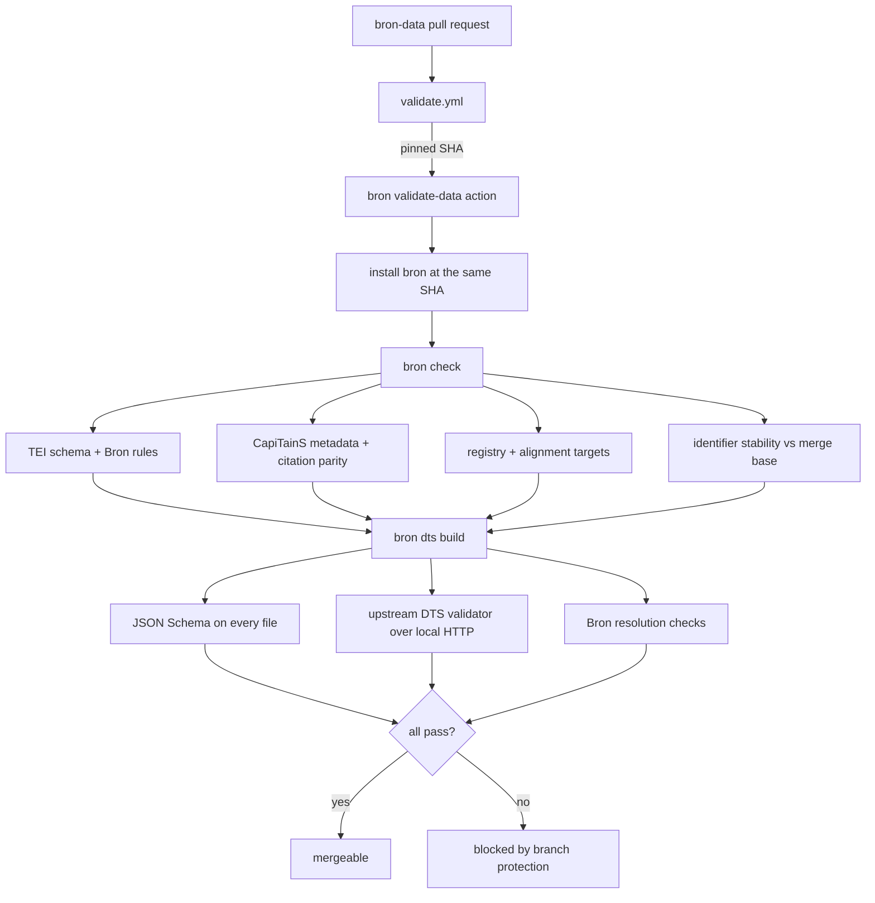
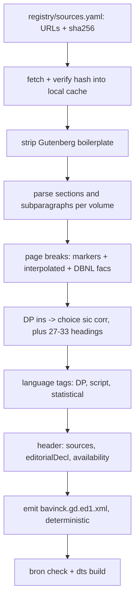
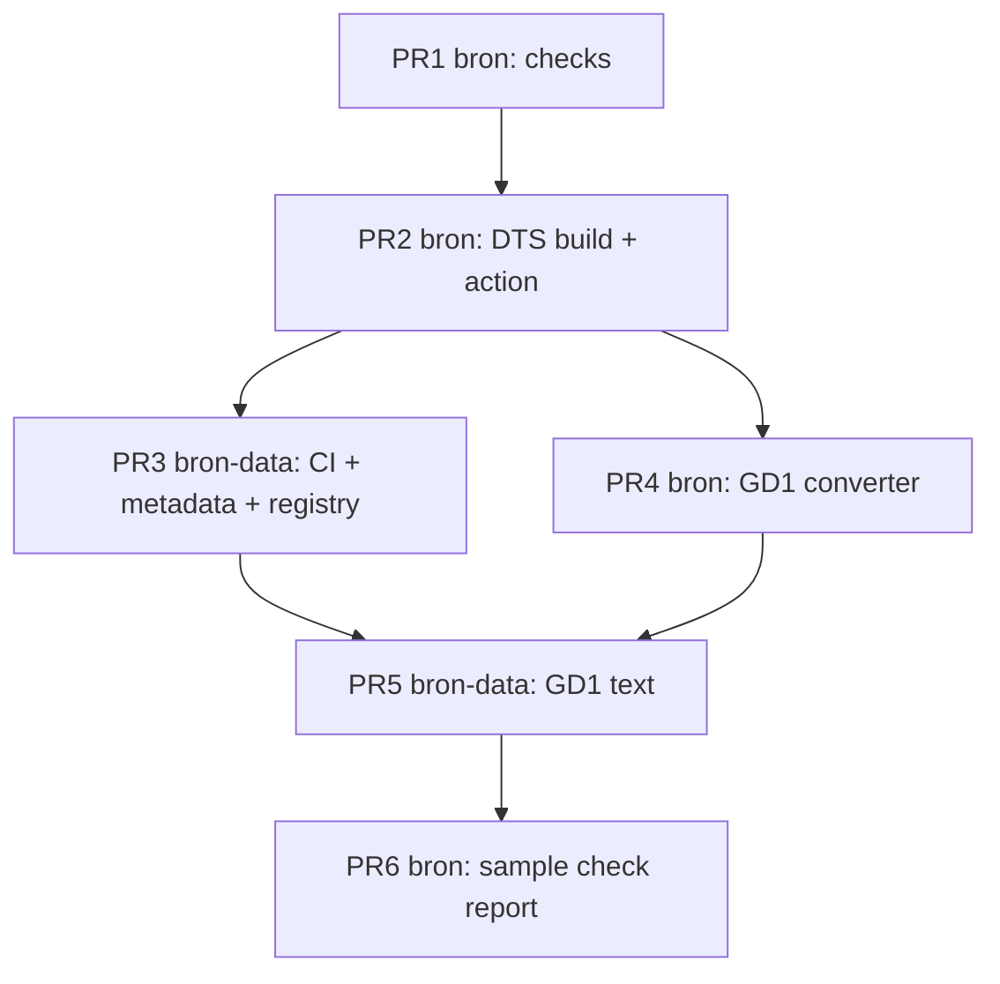

# M0 Scaffolding and M1 GD1 in TEI - Plan

**Target repos:** `bron` (code, this repo) and `bron-data` (data, `github.com/robertguss/bron-data`). Paths are relative to `bron` unless prefixed `bron-data:`.

---

## Goal Capsule

- **Objective:** Anyone can resolve a citation to the first edition of Bavinck's *Gereformeerde Dogmatiek* (for example `urn:cts:bron:bavinck.gd.ed1:3.2`) to the right Dutch text and the scan page it was printed on, and no change to Bron's data can merge if it would break a citation.
- **Means:** a Python validation-and-build tool in `bron`, run by `bron-data`'s CI through one pinned composite action (KTD1), plus a one-time conversion of the four Gutenberg volumes into one TEI file (KTD9, KTD14).
- **Authority:** the accepted ADRs in `docs/decisions/` (especially 0003, 0004, 0005, 0007, 0011, 0012, 0014) outrank this plan. Within the plan, Requirements win on behavior, KTDs win on mechanism, units override neither.
- **Stop conditions:** stop and ask Robert if evidence shows an ADR cannot be honored as written (for example DBNL forbids deep-linking its PDFs, or the GD¹ text cannot be cited by `§.¶` without inventing numbers). Stop a unit if a check would have to be weakened to make real data pass. Report it instead.
- **Execution profile:** Deep. Six PRs across two repos (grouped under Implementation Units). Agents build every unit. M0 and M1 are each done only when their roadmap "done when" holds (Definition of Done).
- **Who finishes:** agents build and open the PRs. Robert confirms the three terms records (U7), enables branch protection on `bron-data` (U7), merges, and separately obtains the Westminster outside-project acknowledgement (PRD §13), which no unit waits on.

---

## Product Contract

### Summary

Build the guardrails the ADRs promise, then push real text through them. M0 delivers a `bron` command-line tool that validates a CapiTainS data repo (TEI schema, CapiTainS conventions, citation declarations, identifier stability, registry, alignment targets) and builds a static DTS 1.0 Level 0 API from it, wired into `bron-data`'s CI along with the first registry records. M1 converts GD¹ from the Gutenberg transcriptions into one TEI file, commits it to `bron-data` through that CI, and checks it against the DBNL scans on a 20-page sample.

### Problem Frame

Bron is designed but unbuilt. The `bron` repo holds design documents and an Apache-2.0 license. `bron-data` exists with its licenses (ADR 0014), `CITATION.cff`, a CapiTainS directory skeleton of placeholder READMEs, and one artifact, the GD¹ ↔ GD² structural concordance. Nothing yet enforces the ADRs' central promise that citations never break (ADR 0004, ADR 0011), and nothing proves the TEI → CTS → DTS chain works on a real text.

Every later milestone depends on this chain. GD² OCR (M2, M3) produces TEI that must validate. Translation (M4) and alignment (M5) cite passages by URN. The reader (M6) is built from the DTS endpoints. If the validators exist only against an empty repo, their first real test would be the long, expensive GD² pipeline. GD¹ arrives already proofread on Project Gutenberg, so it is the cheap real text that exercises the chain first.

### Requirements

**Guardrails (M0)**

- R1. Every pull request and push to `main` in `bron-data` runs CI that validates TEI against a pinned TEI P5 schema, checks CapiTainS conventions, checks the DTS Level 0 build for conformance, and checks identifier stability. Any failure blocks merge.
- R2. A change that removes a passage identifier present on the base branch fails CI unless a redirect record names it. A retired identifier can never be reused.
- R3. The checks and the DTS build live in `bron`. `bron-data` holds data plus a thin CI workflow that pins one `bron` commit.
- R4. `bron-data` in its M0 state, with metadata but no texts, passes CI.

**Rights registry (M0)**

- R5. The registry records the reuse terms of Delpher, DBNL and the NRI sources site, each with the date checked, the link, a summary, and Robert's confirmation (ADR 0012).
- R6. The registry records each GD¹ source copy (four Gutenberg ebooks, four DBNL scan PDFs) with its holding institution, identifier, edition and printing, rightsstatements.org statement, and, for the Gutenberg files, a content hash.

**GD¹ text (M1)**

- R7. `bron-data:data/bavinck/gd/bavinck.gd.ed1.xml` holds all four volumes as one CapiTainS-valid TEI file with the `§.¶` citation hierarchy (§ 1–56 continuous, subparagraphs restarting within each §).
- R8. Every printed page of the body carries a `<pb>` with its printed number and a `facs` link to that page of the DBNL scan.
- R9. Every Distributed Proofreaders correction is visible as `<choice><sic/><corr/></choice>`. The header documents DP's normalizations, the vol. 2 §27–33 renumbering, and the known numbering gaps.
- R10. Greek, Hebrew, Latin, German and French spans carry `xml:lang`, and machine-applied tags are distinguishable from the transcribers' tags.
- R11. Every GD¹ target in the structural concordance (`bavinck.gd.ed1.xml#sec-N`) resolves to the matching § in the TEI file.
- R12. The DTS Level 0 build resolves `urn:cts:bron:bavinck.gd.ed1:3.2` to the Dutch of §3 subparagraph 2, together with its page-image anchor.
- R13. Anyone can re-run the conversion from the pinned sources and get byte-identical TEI (PRD principle 6).
- R14. A sample check of 20 pages against the DBNL scans reports the residual transcription error, published in `docs/research/`.

### Key Decisions

- **M0 and M1 planned together, stopping before M2.** The validators get real TEI to check before the GD² pipeline depends on them. M2 needs the Dutch reviewer and ends in Robert's base-text decision, so it gets its own plan. (session-settled: user-approved — chosen over M0 alone or M0 through M2: M0 alone tests validators only against an empty repo; M2 is a different kind of work.) Governs R1–R14.
- **Licenses (ADR 0014) and the existing `bron-data` repo and layout are fixed inputs.** (session-settled: user-directed — chosen over planning license selection and repo creation as M0 tasks: both already exist.) Governs R3, R4, R7.
- **Robert's checkpoints do not block agent work.** The terms confirmations gate M0's completion, not any unit's start. The Westminster acknowledgement gates nothing in this plan. (session-settled: user-approved — chosen over making them blocking gates: they are Robert's to do in parallel.) Governs R5.
- **The 20-page sample check is a report, not a gate.** (session-settled: user-approved — chosen over a pass/fail threshold: there is no baseline to set one against yet.) Governs R14.

### Success Criteria

- M0's roadmap condition holds: an empty but valid CapiTainS `bron-data` passes CI, and the three terms checks are recorded.
- M1's roadmap condition holds: `urn:cts:bron:bavinck.gd.ed1:3.2` resolves through DTS to the right Dutch, with its page-image anchor.
- A deliberately breaking pull request in `bron-data` (one that deletes §3.2) is shown to fail CI.
- The GD¹ residual error rate is a published number with its method stated.

### Scope Boundaries

- Only GD¹. No GD² OCR, IIIF tiles, translation, alignment beyond resolving existing concordance targets, reader pages, deployment, or release tag.
- The DTS build is a CI artifact. Nothing is published to a public host in this plan.
- The concordance's content (link targets, types, certainty, notes) is not edited, except where U10 finds a GD¹ target that disagrees with the text. That goes to Robert as a finding, not a silent fix. One encoding-only change is in scope: U7 moves its `<note>`s out of `<link>`, which tei_all defines as empty, so the file passes the schema check R1 requires.
- Front matter (title pages, *Voorrede*) is encoded in `<front>` but is not citable through CTS in this plan.

#### Deferred to Follow-Up Work

- Provenance-consistency CI (ADR 0011) lands with the first translated units (M4).
- Sentence segmentation and sentence `xml:id`s land with alignment (M5), using the SRX rules.
- Registry records for copyrighted judge-only translations (Bolt/Vriend and others, ADR 0012) land with M4, the first milestone that uses them.
- The public DTS base URL, response headers, and hosting choice are decided with deployment (M6). The build takes the base URL as a parameter.
- A Bron ODD customization narrower than `tei_all` is a later tightening.

#### Considered and not built

- **Content-anchored renumbering detection** (a per-passage text hash or stable anchor compared across commits). An id-set diff misses a swap that keeps the same set of identifiers. For GD¹ the numbers come from the printed book, and every realistic shift (inserting or dropping a subparagraph) changes the set, so the id-set diff catches it. Revisit at M3, when OCR re-ingests make silent swaps likelier.
- **HookTest in CI.** It is abandoned (last release January 2020), needs `setuptools<81`, and pulls in GPL-licensed MyCapytain. Its checks are reimplemented natively (KTD2).
- **Running tei_all's embedded Schematron.** Neither lxml nor jing runs it, and it needs an XSLT 2 pipeline. Its rules are mostly ODD-related. Bron's own structural rules cover what M0 and M1 need (KTD3).
- **DTS Document range requests** (`start`/`end`). A static site cannot pre-generate every range. Read literally, Level 0 exempts only Navigation ranges, so this is recorded as a known deviation (KTD6). Raising it with the spec editors would be useful but is not plan work.

### Dependencies

- Robert confirms the three drafted terms records before M0 is declared done (U7).
- Robert enables branch protection on `bron-data` `main`, requiring the validation check with bypassing disallowed for administrators (U7).
- The Westminster outside-project acknowledgement (PRD §13) is Robert's. No unit waits on it.
- Network access to gutenberg.org, dbnl.org (rate-limited, KTD18), PyPI, the TEI Vault, and GitHub.

### Sources

- Roadmap M0 and M1: `docs/roadmap.md`.
- Design: `docs/text-model.md`, `docs/transcription.md`, ADRs 0003, 0004, 0005, 0007, 0011, 0012, 0014 in `docs/decisions/`.
- `bron-data` as of 2026-11-02: README layout, placeholder READMEs, `alignments/bavinck.gd.ed1--ed2.structure.xml` (targets `bavinck.gd.ed1.xml#sec-N`).
- External research, 2026-11-03: TEI P5 4.12.0 release and Vault RNG; DTS 1.0 spec (`dtsapi.org/versions/v1.0`), its Level 0 conformance text, and the `distributed-text-services/validator` repo; `dapytains` 1.0.0rc4 (MyDapytains); HookTest and MyCapytain repos (abandonment status); CapiTainS guidelines (`github.com/Capitains/website`, `pages/guidelines.md`, because capitains.org fails TLS); the four Gutenberg HTML files (#51052, #67966, #68527, #69005); the DBNL title pages, PDFs and *gebruiksvoorwaarden* for `bavi002gere01`–`04`. The measured findings are cited where they shape a KTD.

---

## Planning Contract

### Key Technical Decisions

**Tooling and CI**

- KTD1. **One tool in `bron`, one pinned composite action.** `bron` ships a `bron` CLI and a composite action at `.github/actions/validate-data/` that installs `bron` at the action's own commit, runs every check, builds DTS, and runs the DTS validators. `bron-data`'s workflow calls that action pinned to a full commit SHA and passes the base ref. Bumping the pin is a deliberate `bron-data` PR. This keeps one pin, keeps `bron-data` free of code, and lets `bron`'s own CI run the same action against a fixture data repo. (session-settled: user-approved — chosen over validators living in `bron-data`: the data repo stays data-only and separately licensed.) Governs R3.
- KTD2. **CapiTainS checks are native.** HookTest's checklist is reimplemented with lxml:
  - `__cts__.xml` completeness and URN consistency;
  - filename ↔ URN agreement;
  - the URN and `xml:lang` on `text/body`;
  - every edition listed in its work's metadata;
  - passages enumerable, non-empty, and free of duplicates and forbidden characters.

  MyCapytain is not a dependency, because it is GPL-3.0+ and dormant.
- KTD3. **TEI schema: vendored `tei_all.rng` from TEI P5 4.12.0, validated with lxml RelaxNG.** It is pinned from the TEI Vault and recorded with its version. lxml needs no Java and compiles the schema once per run (about 6 s). On top of it, a small set of Bron structural rules in Python:
  - required header fields (`availability` naming its license status, per ADR 0014);
  - `@n` on every cited element, with no duplicate `@n` among siblings;
  - every `pb` in the body carries `facs`;
  - every `xml:id` reference resolves.

  tei_all's embedded Schematron is not run (see Considered and not built).
- KTD4. **Two citation declarations, kept equal by a check.** Each text carries `<refsDecl n="CTS">` with `cRefPattern`s, which is the CapiTainS convention ADR 0003 adopts. Next to it sits `<refsDecl default="true">` with `citeStructure`, the form DTS-era tools read (MyDapytains, SCDH). The TEI schema allows the two as siblings but not mixed. A parity check fails if the two enumerate different passage lists. `cRefPattern` enumeration is evaluated directly (plain XPath 1 with `$n` substitution), with no dependency.
- KTD5. **`dapytains` is the passage engine, behind one module.** `dapytains==1.0.0rc4` with `saxonche==12.9.0` is pinned exactly. Only `src/bron/tei/passages.py` imports it, for `citeStructure` enumeration and passage extraction. It is the only mature Python `citeStructure` implementation, but it is pre-release with one maintainer, and recent commits change milestone and `lb` handling, so the rest of the tool must not see it directly.
- KTD6. **Bron writes its own static DTS 1.0 Level 0 builder.** No reusable DTS 1.0 static generator exists: SCDH needs Java/Saxon/Maven, and `simple-tei2dtsflat` targets a superseded draft.
  - **URI templates:** explicit file extensions, `…/collection{/id}{;nav}.json`, `…/navigation/{+resource}{;tree}{;down}{/ref,start,end}.json` and `…/document/{+resource}{;tree}{/ref,start,end}.xml`. Content types then follow the extension on any static host, without the `index.html` trick. `start`/`end` stay in the Navigation and Document templates, and `nav` in the Collection template, because the validator requires those variables.
  - **Identifiers:** collection and resource ids are CTS URNs, as in the spec's own examples.
  - **Citation tree:** each text has one citation tree, the default one. Every Navigation and Document response is also written under its `;tree=<name>` expansion, so a request that names the tree resolves like one that omits it.
  - **Pre-generated files:** every (unit, `down` ∈ {absent, 0…depth, −1}) Navigation response, the full Document plus one `<dts:wrapper>` fragment per citable unit, and, for the root and every collection and resource id, a bare Collection file plus `;nav=children` and `;nav=parents` files.
  - **Ranges:** Document range requests are unsupported. This is stated in the build's README as a Level 0 deviation.
  - **Page anchor:** each Document fragment opens with the governing `<pb>`, the last page break at or before the passage start. A passage that starts mid-page still carries its scan page, which R12 needs. When the passage's own first content is a `<pb>`, nothing is added. Otherwise the fragment gets a copy without its `xml:id` and with `corresp` pointing at the original, so a fragment never holds a duplicate id.
  - **Output:** the build output is never committed, because colons in file names break Windows checkouts. CI uploads it as one archive (`dts-build.tar.gz`), because `actions/upload-artifact` rejects paths containing `:`.
- KTD7. **DTS conformance is checked three ways.**
  1. Offline: every generated file is validated against the validator's JSON Schemas.
  2. The upstream `distributed-text-services/validator`, pinned to a commit, runs as pytest against `python -m http.server` serving the build, with range tests deselected. Its pip CLI does not accept `--entry-endpoint`, so it runs from a pinned checkout.
  3. Bron's own resolution checks: every Navigation identifier resolves in Document, `parent` links are consistent, members are in document order, and named URNs resolve to expected text.
- KTD8. **Identifier stability compares passage sets, base against head.** For every text version, the set of passage identifiers on the base (the PR's merge base, or the push event's `before` commit on a push to `main`, so a multi-commit push is compared against the state before the push) must be a subset of head's set, minus identifiers listed in `bron-data:identifiers/redirects.yaml`. Each redirect entry names the URN, its replacement or "retired", a reason and a date (ADR 0004). An identifier in the redirects file may never appear in a text again. A whole text version disappearing counts as removing all of its identifiers. Before any release the rule is the same, because the first identifiers to land in `main` are the ones the rule protects.
- KTD16. **Registry as YAML validated by JSON Schema.** `bron-data:registry/sources.yaml` holds one record per work per source copy, and `bron-data:registry/terms.yaml` holds the terms checks. The schemas live in `bron` (`src/bron/schemas/`), and the check validates both files. Rights use rightsstatements.org URIs. A terms record carries `status: pending` until Robert confirms it, which adds `confirmed_by` and `confirmed_on`. M0 is not done while any of the three is pending.
- KTD17. **Python ≥ 3.12, managed with uv, linted with ruff, tested with pytest.** `bron`'s CI tests 3.12 and 3.13. The composite action uses 3.12. `dapytains` is tested upstream to 3.12 and ran on 3.14 in research.

**GD¹ conversion**

- KTD9. **One TEI file for all four volumes.** CapiTainS has one file per version, § numbering runs continuously across volumes, and the concordance already targets `bavinck.gd.ed1.xml#sec-N`.
  - Volumes are `<milestone unit="volume" n="1"/>`.
  - Chapters (*hoofdstukken*) are uncited `<div type="chapter">`.
  - Each § is `<div type="section" n="3" xml:id="sec-3">`.
- KTD10. **Subparagraphs are `<div type="subparagraph" n="2">` containing one or more `<p>`.** In the Gutenberg HTML a number starts a `<p>`, and following unnumbered `<p>`s and `<h4>` sub-headings belong to the same subparagraph, so the cited unit has to be a container. Lettered sub-headings (`<h4>A. …</h4>`) become `<head>` inside the subparagraph they open. Both citation declarations (KTD4) match `div[@type='section']/div[@type='subparagraph']`, and the identifier is `§.¶` joined by `.`.
- KTD11. **Page breaks carry their own printed number and a DBNL deep link.**
  - **Number:** `<pb n="15" xml:id="v1-p15" facs="https://www.dbnl.org/arch/bavi002gere01_01/pag/bavi002gere01_01.pdf#page=25"/>`.
  - **PDF index:** printed page + 10 for vol. 1 and + 6 for vols. 2–4. This was measured against each PDF's OCR layer across every body page. Front-matter (roman) pages get their own measured map.
  - **Unmarked pages:** chapter-opening pages carry no marker in the HTML (vol. 2 p. 386, among others). Their `pb` is inserted before the chapter heading with `resp="#bron-convert"`, so derived page breaks are distinguishable from the transcribers' markers.
  - **Linking only:** DBNL offers per-volume PDFs only (no IIIF, no per-page images), and its terms permit linking, not redistribution, so `facs` links and nothing is copied.
- KTD12. **§27–33 are cited by their corrected numbers. Gaps stay gaps.**
  - **Renumbering:** the printed vol. 2 headings carry wrong numbers (p. 313 reads "§ 26" for §28), and the book's own TOC footnote orders the correction. DP applied it silently. The TEI cites the corrected numbers, which are also the ones the concordance uses, and encodes each printed heading number as `<choice><sic>26</sic><corr>28</corr></choice>` with `resp="#bron-convert"`. The TOC footnote is quoted in `editorialDecl`.
  - **Gaps:** §29 has no subparagraph 11 in the original, so the TEI has no 29.11. If the scan confirms that vol. 1 §5 has no subparagraph 7, it gets the same treatment. Numbers are never invented, and CTS does not require contiguity.
- KTD13. **Character and boilerplate policy.**
  - The Dutch ij ligature (U+0133) is kept as transcribed. Folding it to "ij" is a job for the M6 search index.
  - The bidi marks U+200E and U+200F around Hebrew are HTML presentation and are stripped.
  - The Project Gutenberg header, footer and license are stripped. Gutenberg is named only as a source in `sourceDesc`, which its license permits.
  - DP's "Opmerkingen van de bewerker" and the transcriber credits are kept as provenance in the header.
  - Each of these is documented in `editorialDecl`.
- KTD14. **The converter is a one-time, reproducible ingest.**
  - **Inputs:** it reads its source URLs, archived-copy URLs and SHA-256 hashes from `bron-data:registry/sources.yaml` and fetches into a local cache. Gutenberg revises and rebuilds files in place (last updated October 2024), so when the live file is gone or fails its hash the converter fetches the archived copy. It fails only when neither matches.
  - **Provenance:** the `bron` commit is an explicit `--bron-commit` input that the converter writes into `respStmt`. The output stays a pure function of its inputs.
  - **Determinism:** given the same inputs it emits byte-identical TEI.
  - **After merge:** once the ingest PR merges, the TEI is canonical (ADR 0003). Later corrections are edits to the TEI and are never made by re-running the converter. The Gutenberg HTML is not committed to either repo.
- KTD15. **Language tagging in three layers.**
  1. DP's own `lang` attributes are carried over (`grc`, `hbo`, `la`, `de`, `fr`, `en`, `it`; complete in vols. 3–4, partial in vol. 2, absent in vol. 1).
  2. Greek and Hebrew are detected by Unicode script everywhere.
  3. For Latin, German and French in vols. 1–2, a deterministic statistical language-identification pass over candidate spans proposes tags.

  Tags from the second and third layers carry `resp="#bron-langid"`, and the sample check (U11) reports their precision.
- KTD18. **The sample check is agent-read, stratified, and not a gate.**
  - **Sample:** 20 body pages, five per volume, drawn with a recorded seed. The sample always includes vol. 1 p. 15 plus at least one Greek-heavy and one Hebrew-heavy page.
  - **Method:** each page is rendered from the DBNL PDF and read against the TEI text of that page.
  - **Output:** errors per 1,000 characters, classified (transcription, encoding, language tag, page break), with every discrepancy listed.
  - **Downloads:** DBNL rate-limits (HTTP 429), so downloads are spaced at least two minutes apart and cached outside the repos.
  - **Confirmed errors:** a discrepancy counts as confirmed only when the scan disagrees with the TEI and a second, independent reading agrees with the scan. The second reading is the DBNL PDF's OCR text layer, or a separate agent pass where that layer is unusable (Greek, Hebrew). Discrepancies with one supporting reading are listed as unconfirmed and counted separately.
  - **Fixes:** only confirmed errors are fixed, by ordinary TEI edits in a follow-up `bron-data` PR, not by the report.

### High-Level Technical Design

How a `bron-data` pull request is validated (KTD1, KTD7, KTD8):



How GD¹ becomes TEI (KTD9–KTD15):



Delivery order (PR groups under Implementation Units):



### Output Structure

```text
bron/
  pyproject.toml
  uv.lock
  .github/
    workflows/ci.yml
    actions/validate-data/action.yml
  src/bron/
    cli.py
    schemas/
      tei_all-4.12.0.rng
      registry-sources.schema.json
      registry-terms.schema.json
      redirects.schema.json
    tei/passages.py
    checks/
      schema.py
      bron_rules.py
      capitains.py
      citations.py
      stability.py
      registry.py
      alignment.py
    dts/
      build.py
      collection.py
      navigation.py
      document.py
      resolve.py
    convert/gd1/
      fetch.py
      html.py
      structure.py
      pages.py
      corrections.py
      langs.py
      header.py
      emit.py
  tests/
    fixtures/data-repo/          small CapiTainS repo, valid
    fixtures/broken/             one directory per failure case
    fixtures/gd1/                trimmed Gutenberg HTML excerpts
    checks/  dts/  convert/
  docs/research/2026-11-gd1-sample-check.md

bron-data/
  .github/workflows/validate.yml
  data/bavinck/__cts__.xml
  data/bavinck/gd/__cts__.xml
  data/bavinck/gd/bavinck.gd.ed1.xml      (M1)
  registry/sources.yaml
  registry/terms.yaml
  identifiers/redirects.yaml
```

The tree shows the expected shape. Each unit's **Files** list is authoritative.

### Risks

| Risk | Mitigation |
|---|---|
| `dapytains` is pre-release and still changing passage handling | Exact pin (KTD5). Only `tei/passages.py` imports it. The parity check (KTD4) compares its output against an independent `cRefPattern` evaluation. |
| The DTS validator tracks the spec by commit, is not Level-aware, and its Document tests are unfinished | Pinned commit, range tests deselected by name, plus Bron's own resolution checks (KTD7). |
| Gutenberg files change upstream | SHA-256 pins in the registry. The converter fails on a mismatch (KTD14). |
| DBNL terms are restrictive. Linking is allowed, redistribution is unclear, and commercial text and data mining is prohibited | `facs` links only (KTD11). The DBNL terms record states this. The M6 reader cannot embed DBNL images without a decision. The NRI's own GD¹ scan (`sources.neocalvinism.org/.full_pdfs/bavinck_1895_gd1_2.pdf`) is a candidate to evaluate then. |
| Markup differs between volumes (2016 vs 2022 DP producers): heading ids, page spans inside headings, a TOC that matches the subparagraph pattern | Per-volume parser tests on trimmed real excerpts (U8). The number-sequence check reports every gap or jump, and only the documented gaps are allowed. |
| Statistical language identification mislabels short spans | Tagged with `resp="#bron-langid"` so the tags can be audited, with precision measured in U11. Short spans below a length floor are left untagged rather than guessed. |
| GitHub-hosted runners change their Java or Python images | No Java dependency (KTD3). Python is pinned via `setup-uv`. |

---

## Implementation Units

| U-ID | Title | Key files | Depends on |
|---|---|---|---|
| U1 | Package skeleton and `bron` CI | `pyproject.toml`, `src/bron/cli.py`, `.github/workflows/ci.yml` | — |
| U2 | TEI schema, Bron rules, CapiTainS and citation checks | `src/bron/checks/{schema,bron_rules,capitains,citations}.py`, `src/bron/tei/passages.py` | U1 |
| U3 | Identifier-stability check | `src/bron/checks/stability.py` | U2 |
| U4 | Registry and alignment-target checks | `src/bron/checks/{registry,alignment}.py`, `src/bron/schemas/*.json` | U1 |
| U5 | Static DTS Level 0 build | `src/bron/dts/*` | U2 |
| U6 | DTS validation and the `validate-data` action | `src/bron/dts/resolve.py`, `.github/actions/validate-data/action.yml` | U3, U4, U5 |
| U7 | `bron-data` CI, metadata, registry records | `bron-data:.github/workflows/validate.yml`, `bron-data:registry/*` | U6 |
| U8 | GD¹ converter: structure, pages, corrections, header | `src/bron/convert/gd1/*` | U2 |
| U9 | GD¹ language tagging | `src/bron/convert/gd1/langs.py` | U8 |
| U10 | GD¹ TEI into `bron-data`, end to end | `bron-data:data/bavinck/gd/*` | U7, U9 |
| U11 | 20-page sample check report | `docs/research/2026-11-gd1-sample-check.md` | U10 |

### PR1: bron validation checks

Waits on: nothing.

### U1. Package skeleton and `bron` CI

- **Goal:** a `bron` Python package with a CLI entry point and its own CI, ready for the checks.
- **Requirements:** R3.
- **Dependencies:** none.
- **Files:** `pyproject.toml`, `uv.lock`, `src/bron/__init__.py`, `src/bron/cli.py`, `.github/workflows/ci.yml`, `tests/test_cli.py`, `README.md` (status and repo-layout lines).
- **Approach:**
  1. uv project, Python ≥ 3.12, ruff and pytest configured (KTD17).
  2. The CLI exposes `bron check`, `bron dts build`, `bron convert gd1` as subcommands that later units fill. Exit code 0 means pass and 1 means fail. Output lists findings as `file:line: check-id: message`, so CI logs are greppable.
  3. CI runs ruff and pytest on 3.12 and 3.13.
- **Test scenarios:**
  - `bron --help` lists the three subcommands.
  - An unknown subcommand exits non-zero with a usage message.
- **Verification:** CI is green on the PR, and the README states that code now lives here.

### U2. TEI schema, Bron rules, CapiTainS and citation checks

- **Goal:** `bron check <data-repo>` finds every schema, convention and citation-declaration error in a CapiTainS repo.
- **Requirements:** R1, R4, R7.
- **Dependencies:** U1.
- **Files:** `src/bron/schemas/tei_all-4.12.0.rng` (with a provenance note: Vault URL, version, TEI's CC BY / BSD-2 license), `src/bron/checks/schema.py`, `src/bron/checks/bron_rules.py`, `src/bron/checks/capitains.py`, `src/bron/checks/citations.py`, `src/bron/tei/passages.py`, `tests/fixtures/data-repo/`, `tests/fixtures/broken/`, `tests/checks/test_schema.py`, `tests/checks/test_capitains.py`, `tests/checks/test_citations.py`.
- **Approach:**
  1. Schema validation per KTD3 covers every TEI file under `data/` and `alignments/`. The RNG compiles once per process.
  2. CapiTainS checks per KTD2. A work with zero editions is valid, because that is `bron-data`'s M0 state (R4).
  3. `tei/passages.py` is the only importer of `dapytains` (KTD5). It exposes passage enumeration from `citeStructure` and passage extraction. `cRefPattern` enumeration lives beside it, with no dependency.
  4. The citation parity check compares the two enumerations (KTD4).
  5. The fixture data repo holds one textgroup, one work, and one small edition with two sections and a few subparagraphs, shaped like GD¹ (KTD9, KTD10), so the later units test against the real shape.
- **Patterns to follow:** HookTest's check list (`HookTest/capitains_units/cts.py`) as the checklist only, with no code reuse.
- **Test scenarios:**
  - The valid fixture repo passes with zero findings.
  - A fixture with metadata and no editions passes.
  - An element not allowed by tei_all fails the schema check with file and line.
  - A duplicate `xml:id` fails, reported as a parse error.
  - A missing `xml:lang` on `text/body` fails.
  - A text URN on `body/@n` that disagrees with its filename fails.
  - An edition file not listed in its work's `__cts__.xml` fails.
  - A work `__cts__.xml` whose `groupUrn` does not match its textgroup fails.
  - Two sibling subparagraphs with the same `@n` fail as duplicate passages.
  - An empty cited subparagraph fails.
  - A `cRefPattern` that matches one passage fewer than `citeStructure` fails parity and names the missing identifier.
  - A `pb` in the body without `facs` fails the Bron rules.
  - An `availability` with no license status fails the Bron rules.
- **Verification:** each broken fixture produces exactly its intended finding, and the valid fixture produces none.

### U3. Identifier-stability check

- **Goal:** CI refuses any change that removes or reuses a passage identifier.
- **Requirements:** R1, R2.
- **Dependencies:** U2.
- **Files:** `src/bron/checks/stability.py`, `src/bron/schemas/redirects.schema.json`, `tests/checks/test_stability.py`, `tests/fixtures/stability/`.
- **Approach:**
  1. `bron check --base <dir>` takes a second checkout (the base) and compares passage sets per text version per KTD8, using `tei/passages.py`.
  2. The redirects file is validated against its schema. A missing file means no redirects.
  3. With no base given (a local run), the check is skipped with a notice. CI always passes a base.
- **Test scenarios:**
  - Base and head identical: passes.
  - Head adds a subparagraph: passes.
  - Head removes §3.2: fails, naming `urn:cts:bron:bavinck.gd.ed1:3.2` in the fixture namespace.
  - Head removes §3.2 and the redirects file lists it as retired with a reason: passes.
  - The redirects file lists §3.2 as retired and head still contains or reintroduces §3.2: fails as reuse.
  - Head deletes a whole edition file: fails, listing its identifiers.
  - Base has no texts and head adds the first text: passes (the M1 ingest case).
  - A malformed redirects file fails the schema check.
- **Verification:** all scenarios pass. A removal is reported by URN, not by internal path.

### U4. Registry and alignment-target checks

- **Goal:** the registry files and the concordance's targets are checked on every PR.
- **Requirements:** R1, R5, R6, R11.
- **Dependencies:** U1.
- **Files:** `src/bron/schemas/registry-sources.schema.json`, `src/bron/schemas/registry-terms.schema.json`, `src/bron/checks/registry.py`, `src/bron/checks/alignment.py`, `tests/checks/test_registry.py`, `tests/checks/test_alignment.py`.
- **Approach:**
  1. Registry schemas per KTD16. A source-copy record carries holding institution, institution identifier, work, edition and printing, a rightsstatements.org URI, a URL, an optional SHA-256, and an optional `archive_url`. A terms record carries site, terms URL, date checked, summary, status, and confirmation fields.
  2. The alignment check reads `linkGrp` files under `alignments/`. For each target whose file exists in `data/`, the fragment must resolve to an `xml:id` in that file. Targets into files not yet present (GD² before M3) are skipped and counted in the output.
- **Test scenarios:**
  - A valid sources file and terms file pass.
  - A source record with a rights statement that is not a rightsstatements.org URI fails.
  - A terms record with `status: confirmed` but no `confirmed_on` fails.
  - A concordance target `bavinck.gd.ed1.xml#sec-3`, with an ed1 file containing `xml:id="sec-3"`, passes.
  - A target `#sec-99` with no such id fails, naming the link.
  - Targets into a missing `bavinck.gd.ed2.xml` are skipped and reported as skipped, not failed.
- **Verification:** the real `bron-data` concordance passes against a repo with no ed1 file, reporting all targets skipped.

### PR2: bron DTS build and validation action

Waits on: PR1 (merge order).

### U5. Static DTS Level 0 build

- **Goal:** `bron dts build <data-repo> --out <dir> --base-url <url>` writes a complete static DTS 1.0 Level 0 tree.
- **Requirements:** R1, R12.
- **Dependencies:** U2.
- **Files:** `src/bron/dts/build.py`, `src/bron/dts/collection.py`, `src/bron/dts/navigation.py`, `src/bron/dts/document.py`, `src/bron/dts/README.md` (the supported `down` values and the Document-range deviation), `tests/dts/test_build.py`.
- **Approach:**
  1. Templates, ids, the pre-generated set, and fragment shape per KTD6.
  2. Collection metadata comes from `__cts__.xml` (titles, labels, descriptions, `xml:lang`), and `citationTrees` from the `citeStructure`.
  3. Output is deterministic: sorted members and stable JSON key order. Two builds of the same input are byte-identical, which keeps CI artifacts diffable.
- **Technical design:** (directional) Entry → Collection(root → textgroup → work → edition) → per edition, Navigation files keyed by (ref, down) and Document files keyed by ref, all from one pass over `passages.py`'s enumeration.
- **Test scenarios:**
  - The fixture repo builds an Entry whose three templates expand (via RFC 6570) to files that exist for a sampled set of calls.
  - Navigation for the fixture's `3` with `down=1` lists `3.1`, `3.2` in document order with `parent: "3"`.
  - Navigation with `ref` and no `down` returns the unit alone, and `down=0` returns it with its siblings.
  - Navigation with `down=-1` and no `ref` returns the whole tree.
  - The Document fragment for `3.2` is a `<TEI>` with a `<dts:wrapper>` whose first child is the governing `<pb>` and whose text matches the source subparagraph.
  - A passage that starts mid-page carries the earlier page's `pb`, not the next one, as a copy with no `xml:id`.
  - A passage that begins exactly at a page break carries that page's `pb` once, and its fragment parses with lxml.
  - The Collection template expanded with `nav=parents` for the edition returns the work.
  - A Navigation request for `3` with `down=1` that names the default tree returns the same members as the request without `tree`, and the same holds for the Document fragment of `3.2`.
  - Collection parents for an edition lead back to the work and textgroup.
  - A repo with metadata and no editions builds an Entry and collections with zero resources, without error.
  - Building twice yields byte-identical trees.
- **Verification:** the fixture build passes U6's offline JSON Schema validation (U6 is developed in the same PR).

### U6. DTS validation and the `validate-data` action

- **Goal:** one action that a data repo calls to run every check, the build, and all three DTS validations (KTD7).
- **Requirements:** R1, R3, R12.
- **Dependencies:** U3, U4, U5.
- **Files:** `src/bron/dts/resolve.py`, `.github/actions/validate-data/action.yml`, `.github/workflows/ci.yml` (adds jobs running the action against `tests/fixtures/data-repo` and a metadata-only fixture), `tests/dts/test_resolve.py`.
- **Approach:**
  1. `bron dts verify <build-dir>` runs the offline JSON Schema validation and Bron's resolution checks. It accepts `--expect URN=TEXT-PREFIX` pairs, so a data repo can assert named citations. The action exposes them as an optional `expect` input (newline-separated pairs).
  2. The action:
     - installs `bron` from the action's own ref (KTD1);
     - checks out the base ref into a separate worktree for U3;
     - runs `bron check`, `bron dts build` and `bron dts verify`;
     - serves the build with `python -m http.server`;
     - runs the upstream validator from a pinned commit with range tests deselected, or skips it with a logged notice when the build holds no Resource (the validator crashes without one, and `bron-data` has none in M0);
     - packs the build into `dts-build.tar.gz` and uploads that (KTD6).
  3. The validator's commit pin and the deselected test names live in the action, in one place.
- **Execution note:** prove the action end to end against the fixture repo in `bron`'s own CI before wiring `bron-data`.
- **Test scenarios:**
  - `verify` passes the fixture build.
  - A build with one Navigation identifier missing its Document file fails, naming the identifier.
  - A Navigation member whose `parent` names a non-existent unit fails.
  - `--expect` with the right prefix passes, and with the wrong prefix fails, showing both texts.
  - In CI: the action against the fixture repo passes with one `expect` pair, and the upstream validator reports no failures outside the deselected range tests.
  - In CI: the action against a metadata-only fixture repo passes, logging that the upstream validator was skipped.
- **Verification:** `bron`'s CI shows the fixture job green, with the DTS build attached as an artifact.

### PR3: bron-data CI, metadata and registry

Waits on: PR2 (needed before start: the workflow pins a merged `bron` commit).

### U7. `bron-data` CI, metadata, registry records

- **Goal:** `bron-data` validates itself on every PR, and its M0 registry content exists. This completes M0.
- **Requirements:** R1, R2, R3, R4, R5, R6.
- **Dependencies:** U6.
- **Files:**
  - `bron-data:.github/workflows/validate.yml`
  - `bron-data:data/bavinck/__cts__.xml`
  - `bron-data:data/bavinck/gd/__cts__.xml` (work metadata, no editions yet)
  - `bron-data:registry/sources.yaml`
  - `bron-data:registry/terms.yaml`
  - `bron-data:identifiers/redirects.yaml` (empty list with a header comment)
  - `bron-data:README.md` (layout adds `identifiers/`, notes that CI is live)
  - `bron-data:registry/README.md`
- **Approach:**
  1. The workflow triggers on `pull_request` and on push to `main`, calls the action at a full SHA, checks out with full history, and passes the base ref (KTD1, KTD8).
  2. Textgroup and work metadata: Bavinck's and the *Gereformeerde Dogmatiek*'s titles in Dutch and English. Wikidata and VIAF identifiers go in `cpt:structured-metadata` (ADR 0003), looked up and verified at execution.
  3. Concordance encoding fix (see Scope Boundaries): give each `<link>` that carries a `<note>` an `xml:id`, and move the note out to a sibling `<note target="#<link-id>">` in `<body>`. Link targets, types, `cert` and `resp` stay unchanged.
  4. Source records: the four Gutenberg ebooks with SHA-256 of the HTML files as retrieved, each with an `archive_url` (a Wayback Machine raw `id_` capture taken at hashing time and confirmed to return the same SHA-256), and the four DBNL PDFs (`bavi002gere01`–`04`, "1ste druk", Kampen: J. H. Bos). Each carries its rightsstatements.org statement.
  5. Terms records for Delpher, DBNL and the NRI sources site, drafted with `status: pending` (KTD16). The DBNL record states linking-only, as found in research.
  6. Robert reviews and sets each terms record to confirmed, then enables branch protection on `main` requiring the validation check, with "Do not allow bypassing the above settings" on. The agents work under Robert's owner account, so without that setting a direct push could skip the guard.
- **Test expectation:** none in this repo. The checks are tested in `bron`. This unit's proof is CI on the PR itself.
- **Verification:**
  - CI is green on the PR, with the stability check reporting zero texts on both sides.
  - After Robert's confirmation commit, all three terms records are confirmed.
  - Branch protection lists the validation check as required and does not allow bypassing, administrators included.

### PR4: bron GD1 converter

Waits on: PR2 (merge order: both edit `pyproject.toml` and `uv.lock`).

### U8. GD¹ converter: structure, pages, corrections, header

- **Goal:** `bron convert gd1 --registry <path> --cache <dir> --bron-commit <sha> --out <file>` produces the GD¹ TEI file from the four pinned Gutenberg volumes.
- **Requirements:** R7, R8, R9, R11, R13.
- **Dependencies:** U2.
- **Files:** `src/bron/convert/gd1/fetch.py`, `src/bron/convert/gd1/html.py`, `src/bron/convert/gd1/structure.py`, `src/bron/convert/gd1/pages.py`, `src/bron/convert/gd1/corrections.py`, `src/bron/convert/gd1/header.py`, `src/bron/convert/gd1/emit.py`, `tests/fixtures/gd1/` (trimmed real excerpts per volume), `tests/convert/test_structure.py`, `tests/convert/test_pages.py`, `tests/convert/test_corrections.py`, `tests/convert/test_emit.py`.
- **Approach:**
  1. **Fetch:** read URLs, archived-copy URLs and hashes from the registry, fetch into the cache, and verify the hashes, falling back to the archived copy (KTD14).
  2. **Boilerplate:** strip the Gutenberg boilerplate and the bidi marks (KTD13).
  3. **Structure:** per volume, find § headings (`<h3>`, including the variants with page spans inside the heading and the `<h2>`/`<h3>` split at §29) and subparagraph starts (a leading `N. ` in a `<p>`, after an optional page span). TOC entries are excluded. Build the structure per KTD9 and KTD10.
  4. **Number check:** every § must run 1…n with no gap or jump, except an allow-list holding §29 (no 11) and, if the scan confirms it, §5 (no 7). Settle §5 in this unit, before the full run: fetch the vol. 1 DBNL page holding §5 (spacing downloads per KTD18), read whether a subparagraph 7 is printed, and set the allow-list and the `editorialDecl` note from that. Anything else fails conversion with the location (KTD12).
  5. **Page breaks:** turn `<span class="pagenum">` into `pb` and interpolate the unmarked chapter-opening pages (KTD11). Every body page from first to last must be present exactly once per volume.
  6. **Corrections:** turn `<ins title="X">Y</ins>` into `<choice><sic>X</sic><corr>Y</corr></choice>`. An insertion whose `title` is a note (vol. 1 `cor_1`) gets an empty `sic`, with the note kept as `<note type="transcriber">`. Apply the §27–33 heading encoding (KTD12).
  7. **Header:** title and author, `sourceDesc` naming each ebook and its hash and each DBNL scan, `editorialDecl` (normalizations, character policy, renumbering, gaps), `availability` with the Public Domain Mark and the CC0 waiver (ADR 0014), `respStmt` crediting the DP transcribers and declaring `#bron-convert` and `#bron-langid`, an `<?xml-model?>` processing instruction pointing at tei_all 4.12.0, and both citation declarations (KTD4).
  8. **Emit:** deterministic output (stable attribute order, fixed indentation, no timestamps).
- **Execution note:** build test-first against trimmed real excerpts for each volume. The markup varies by producer, and an excerpt per variant is the only reliable proof.
- **Test scenarios:**
  - The vol. 1 excerpt containing §3 yields `div[@n='3']` with subparagraph `2` beginning "Maar de kerk", preceded by `pb n="15"` with `facs` ending `bavi002gere01_01.pdf#page=25`.
  - An unnumbered `<p>` after subparagraph 2 lands inside subparagraph 2, not as a new unit.
  - An `<h4>A. …</h4>` becomes a `head` inside the following subparagraph.
  - The vol. 2 §28 excerpt (heading with an inline page span) yields `div[@n='28']`, `pb n="313"` with `facs` `…gere02_01.pdf#page=319`, and a heading whose number is `<choice><sic>26</sic><corr>28</corr></choice>`.
  - The vol. 2 chapter V excerpt yields an interpolated `pb n="386"` with `resp="#bron-convert"` and `facs` `…#page=392`.
  - The vol. 2 §29 excerpt has no subparagraph 11 and passes the number check through the allow-list.
  - An excerpt with a jump not on the allow-list fails conversion, naming volume, §, and the missing number.
  - `<ins title="geplitst" id="cor_3">gesplitst</ins>` yields `<choice><sic>geplitst</sic><corr>gesplitst</corr></choice>`.
  - An `<ins>` nested inside a Hebrew span (vol. 2 `cor_10`) keeps the `choice` inside the language span.
  - Output contains no "Project Gutenberg" outside `sourceDesc`, and no U+200E or U+200F.
  - ij (U+0133) in the input survives in the output.
  - A live file whose hash disagrees with the registry is replaced by the archived copy when that copy matches.
  - A file for which neither the live nor the archived copy matches fails before parsing.
  - Two runs over the same cache produce byte-identical files.
  - The emitted fixture file passes `bron check` (schema, CapiTainS, parity).
- **Verification:**
  - A full local run over the four real volumes produces one file with 56 sections that passes `bron check`.
  - The number check lists exactly the allowed gaps.
  - Every body page is present.

### U9. GD¹ language tagging

- **Goal:** every Greek, Hebrew, Latin, German and French span in GD¹ carries `xml:lang` (KTD15).
- **Requirements:** R10.
- **Dependencies:** U8.
- **Files:** `src/bron/convert/gd1/langs.py`, `pyproject.toml` (language-identification dependency), `tests/convert/test_langs.py`.
- **Approach:**
  1. Carry DP's `lang` attributes as `xml:lang`.
  2. Wrap untagged runs of Greek or Hebrew script in `<foreign xml:lang>`.
  3. For vols. 1–2, run statistical language identification over candidate spans. Candidates are clause-sized runs, typically quotations and italic or parenthetical material, whose identified language is not Dutch with confidence above a threshold and whose length is above a floor. Accepted spans are wrapped in `<foreign>`.
  4. Second- and third-layer tags carry `resp="#bron-langid"`. The library, threshold and floor are chosen at execution and recorded in `editorialDecl`.
- **Test scenarios:**
  - A vol. 3 span `<span lang="la">` becomes `xml:lang="la"` with no `resp`.
  - An untagged Greek word in vol. 1 becomes `<foreign xml:lang="grc" resp="#bron-langid">`.
  - An untagged Hebrew phrase becomes `hbo`, without bidi marks.
  - A clear Latin sentence in a vol. 1 excerpt is tagged `la` with `resp="#bron-langid"`.
  - A Dutch sentence containing one Latin loanword is not tagged.
  - A span shorter than the floor is left untagged.
  - Tagging is deterministic across runs.
- **Verification:** the full GD¹ run reports per-volume counts of tags by layer. Vols. 3–4 show only DP-layer tags plus any untagged-script catches.

### PR5: bron-data GD1 text

Waits on: PR3 (needed before start: CI must guard the ingest), PR4 (needed before start: the conversion runs from a merged `bron` commit).

### U10. GD¹ TEI into `bron-data`, end to end

- **Goal:** the GD¹ text is in `bron-data`, CI passes, and `urn:cts:bron:bavinck.gd.ed1:3.2` resolves through DTS with its page anchor. This completes M1.
- **Requirements:** R7, R8, R11, R12, R13.
- **Dependencies:** U7, U9.
- **Files:** `bron-data:data/bavinck/gd/bavinck.gd.ed1.xml`, `bron-data:data/bavinck/gd/__cts__.xml` (adds the `ed1` edition with label and description), `bron-data:.github/workflows/validate.yml` (adds `--expect` for `urn:cts:bron:bavinck.gd.ed1:3.2`, and bumps the `bron` pin only if a check fix landed in `bron` after PR3), `bron-data:README.md` (status).
- **Approach:**
  1. Run the converter from the merged `bron` commit, passing that SHA as `--bron-commit`.
  2. Commit the output and open the PR. CI runs every check, including stability (base has no texts, so every identifier is new), alignment (all 56 `sec-N` ed1 targets must resolve), and the named-URN expectation.
  3. A GD¹ concordance target that does not resolve is reported to Robert, not fixed silently.
- **Test expectation:** none new. The proof is CI on this PR plus the canary below.
- **Verification:**
  - CI is green, and in the unpacked DTS build archive the Document for `3.2` starts with `pb n="15"` (`facs` `…gere01_01.pdf#page=25`) followed by "Maar de kerk".
  - A re-run of the converter at the recorded SHA reproduces the committed file byte for byte.
  - A canary draft PR that deletes §3.2 fails the stability check. With Robert's OK, the canary is opened and then closed without merging.

### PR6: bron sample check report

Waits on: PR5 (needed before start: the report reads the committed TEI).

### U11. 20-page sample check report

- **Goal:** a published residual-error figure for GD¹ against the DBNL scans (KTD18).
- **Requirements:** R14.
- **Dependencies:** U10.
- **Files:** `docs/research/2026-11-gd1-sample-check.md`.
- **Approach:**
  1. Draw the sample per KTD18 and record the seed and page list.
  2. For each page, set the TEI text of that page (between its `pb` and the next) against the rendered scan, and list every discrepancy with its class.
  3. Report errors per 1,000 characters overall and per volume, and the precision of `#bron-langid` tags on sampled pages.
  4. Restate the §5 subparagraph-7 finding from U8 and re-check it against the scan.
  5. Each confirmed TEI error (KTD18) is fixed in a follow-up `bron-data` PR, listed in the report. Unconfirmed discrepancies are listed and not edited.
- **Test expectation:** none. This is a research report. Its method section makes it reproducible.
- **Verification:** the report states its method, sample, the figures, and the follow-up PR, and restates U8's §5 finding.

---

## Verification Contract

| Gate | Command or check | Applies to |
|---|---|---|
| Lint | `uv run ruff check` and `uv run ruff format --check` in `bron` | every `bron` PR |
| Unit and fixture tests | `uv run pytest` in `bron` | every `bron` PR |
| Action on fixtures | `bron` CI job running `.github/actions/validate-data` against `tests/fixtures/data-repo` | PR2 onward |
| Data validation | `bron-data` `validate.yml` (checks, stability vs base, DTS build, three-way DTS validation) | every `bron-data` PR and push to `main` |
| Named citation | `bron dts verify … --expect urn:cts:bron:bavinck.gd.ed1:3.2=…` in `bron-data` CI | PR5 onward |
| Reproducibility | `bron convert gd1` at the recorded SHA reproduces `bavinck.gd.ed1.xml` byte for byte | U8, U10 |
| Merge guard | branch protection on `bron-data` `main` requires the validation check, with no administrator bypass | after U7 |

A failure in any gate blocks the PR. Weakening a check to let real data pass is a stop condition (Goal Capsule).

---

## Definition of Done

- **M0 done:** U1–U7 merged. `bron-data` CI is green in its metadata-only state. The three terms records are confirmed by Robert. Branch protection requires the check.
- **M1 done:** U8–U10 merged. `urn:cts:bron:bavinck.gd.ed1:3.2` resolves in the CI-built DTS to the Dutch of §3.2 with `pb n="15"` and its DBNL `facs`. The canary removal PR was shown to fail.
- **Sample check:** U11 merged with its figure, and the follow-up corrections PR is open or merged.
- **Pins recorded:** TEI 4.12.0, `dapytains` 1.0.0rc4, `saxonche` 12.9.0, the DTS validator commit, the `bron` SHA in `bron-data`, the Gutenberg hashes.
- **Per unit:** each unit's Verification holds, and its test scenarios exist and pass.
- **Clean diff:** no abandoned experiments, dead code, or commented-out attempts remain in either repo.

