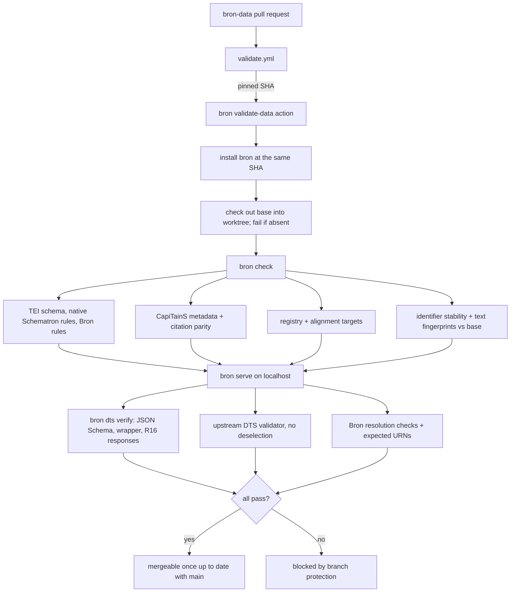
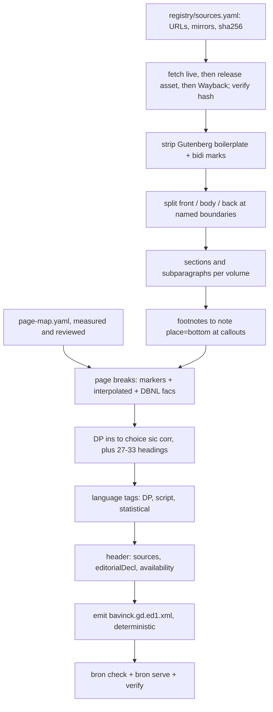
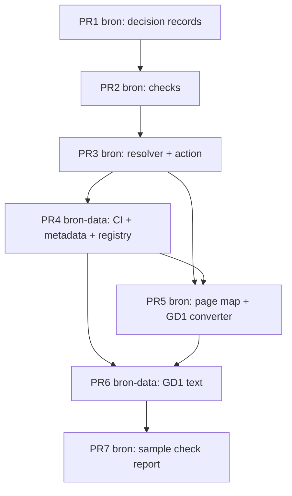

# M0 Scaffolding and M1 GD1 in TEI - Plan

**Target repos:** `bron` (code, this repo) and `bron-data` (data, `github.com/robertguss/bron-data`). Paths are relative to `bron` unless prefixed `bron-data:`.

---

## Goal Capsule

- **Objective:** Anyone running Bron's DTS resolver over `bron-data`, locally or in CI, can resolve a citation to the first edition of Bavinck's *Gereformeerde Dogmatiek* (for example `urn:cts:bron:bavinck.gd.ed1:3.2`) to the right Dutch text and the scan page it was printed on. No change to Bron's data can merge if it would break a citation. Public hosting comes with M6.
- **Means:** a Python validation tool and a small read-only DTS resolver in `bron` (KTD6), run by `bron-data`'s CI through one pinned composite action (KTD1), plus a one-time conversion of the four Gutenberg volumes into one TEI file (KTD9, KTD14).
- **Authority:** the accepted ADRs in `docs/decisions/` outrank this plan, especially 0003, 0004, 0005, 0006, 0007, 0011, 0012 and 0014. U12 adds ADRs 0015–0017, which amend 0011, 0003, 0006, 0007 and 0012 where this plan departs from them. Within the plan, Requirements win on behavior, KTDs win on mechanism, and units override neither.
- **Stop conditions:**
  - Stop and ask Robert if evidence shows an ADR cannot be honored as written or as amended by U12. Examples: DBNL forbids deep-linking its PDFs, or the GD¹ text cannot be cited by `§.¶` without inventing numbers.
  - Stop a unit if a check would have to be weakened to make real data pass, and report it.
  - Stop if the resolver cannot satisfy a MUST in the DTS 1.0 spec, and report it.
- **Execution profile:** Deep. Seven PRs across two repos, grouped under Implementation Units. Agents build every unit. M0 and M1 are each done only when their Definition of Done holds.
- **Who finishes:**
  - Agents build and open the PRs.
  - Robert accepts the ADRs by merging PR1 and confirms the three terms records (U7).
  - Robert enables branch protection on `bron-data` (U7), approves the canary PR (U10), and merges.
  - Robert separately obtains the Westminster outside-project acknowledgement (PRD §13). No unit waits on it.

---

## Product Contract

### Summary

Build the guardrails the ADRs promise, then push real text through them. M0 delivers three things in `bron`:

- a command-line tool that validates a CapiTainS data repo: TEI schema, CapiTainS conventions, citation declarations, identifier stability, registry, and alignment targets;
- a small read-only DTS 1.0 resolver that serves the repo;
- a CI action that runs both.

The action is wired into `bron-data`'s CI along with the first registry records. M1 converts GD¹ from the Gutenberg transcriptions into one TEI file and commits it to `bron-data` through that CI. A protocol-defined 20-page sample check against the DBNL scans then estimates its residual error.

### Problem Frame

Bron is designed but unbuilt. The `bron` repo holds design documents and an Apache-2.0 license. `bron-data` holds:

- its licenses (ADR 0014) and `CITATION.cff`;
- a CapiTainS directory skeleton of placeholder READMEs;
- one artifact, the GD¹ ↔ GD² structural concordance.

Nothing yet enforces the ADRs' central promise that citations never break (ADR 0004, ADR 0011). Nothing proves the TEI → CTS → DTS chain works on a real text.

Every later milestone depends on this chain. GD² OCR (M2, M3) produces TEI that must validate. Translation (M4) and alignment (M5) cite passages by URN. The reader (M6) is built on the DTS endpoints. If the validators exist only against an empty repo, their first real test would be the long, expensive GD² pipeline. GD¹ arrives already proofread on Project Gutenberg, so it is the cheap real text that exercises the chain first.

### Requirements

**Guardrails (M0)**

- R1. Every pull request and every push to `main` in `bron-data` runs CI, and any failure blocks merge. CI:
  - validates TEI against a pinned TEI P5 schema and the applicable TEI constraints;
  - checks CapiTainS conventions;
  - checks the DTS resolver against the DTS 1.0 spec;
  - checks identifier stability.

  The only exception is the upstream DTS validator, which is skipped with a logged notice while the repo holds no text, because it cannot run without a Resource.
- R2. A change that removes a passage identifier present on the base branch fails CI unless a redirect or retirement record names it. A retired or redirected identifier can never be reused, and its record can never be deleted or altered.
- R15. A change that substantially alters the text an existing identifier points to fails CI unless a reviewed edit record declares it. This catches two units trading labels while the identifier set stays the same.
- R16. A request for a redirected identifier answers with its replacement, and a request for a retired identifier answers with a tombstone stating why it was retired. Neither returns a 404 (ADR 0004).
- R3. The checks and the resolver live in `bron`. `bron-data` holds data plus a thin CI workflow that pins one `bron` commit.
- R4. `bron-data` in its M0 state, with metadata but no texts, passes CI.

**Rights registry (M0)**

- R5. The registry records the reuse terms of Delpher, DBNL and the NRI sources site. Each record has the date checked, the link, an accurate summary, and Robert's confirmation (ADR 0012).
- R6. The registry records each GD¹ source copy: four Gutenberg ebooks and four DBNL scan PDFs. Each record has:
  - the holding institution and its identifier;
  - the edition and printing;
  - a standard rights URI, either a rightsstatements.org statement or a Creative Commons public-domain tool;
  - a SHA-256 content hash;
  - for the Gutenberg files, the location of a durable copy.

**GD¹ text (M1)**

- R7. `bron-data:data/bavinck/gd/bavinck.gd.ed1.xml` holds all four volumes as one CapiTainS-valid TEI file with the `§.¶` citation hierarchy. The § numbers run 1–56 continuously, and subparagraphs restart within each §.
- R8. Every printed page of the body carries a `<pb>` with its printed number and a `facs` link to that page of the DBNL scan PDF. This is a staged exception to ADR 0003's IIIF canvases, recorded in ADR 0016.
- R9. Every Distributed Proofreaders correction is visible as `<choice><sic/><corr/></choice>`. The header documents DP's normalizations, the vol. 2 §27–33 renumbering, and the known numbering gaps.
- R10. Every Greek and Hebrew character in the text sits inside an `xml:lang` span, and CI checks this. Latin, German and French spans are tagged by machine assistance with best effort. Every machine-applied tag is distinguishable from the transcribers' tags.
- R17. Footnotes appear exactly once, at their callout. Front matter and back matter (title pages, *Voorrede*, contents, vol. 4's *Breedere Inhoudsopgave*) are encoded but not citable. Neither can become part of a cited subparagraph.
- R11. Every GD¹ target in the structural concordance (`bavinck.gd.ed1.xml#sec-N`) resolves, by standard URI resolution, to the matching § in the TEI file.
- R12. The DTS resolver resolves `urn:cts:bron:bavinck.gd.ed1:3.2` to the Dutch of §3 subparagraph 2, together with its page-image anchor.
- R13. Anyone can re-run the conversion from the pinned, durably stored sources and get byte-identical TEI (PRD principle 6).
- R14. A 20-page sample check against the DBNL scans publishes an exploratory residual-discrepancy estimate in `docs/research/`. The report includes:
  - its sampling, reading and counting protocol;
  - textual error reported separately from encoding error;
  - precision and recall of the machine language tags.

Product Contract preservation: changed R1, R2, R6, R8, R10, R12, R13, R14 and added R15, R16, R17. The changes follow the adversarial audit of the first draft and the decisions Robert made on it. R10 narrows "every span" to complete Greek and Hebrew with machine-assisted Latin, German and French. R12 resolves through a resolver instead of static files.

### Key Decisions

- **M0 and M1 planned together, stopping before M2.** The validators get real TEI to check before the GD² pipeline depends on them. M2 needs the Dutch reviewer and ends in Robert's base-text decision, so it gets its own plan. (session-settled: user-approved — chosen over M0 alone or M0 through M2: M0 alone tests validators only against an empty repo, and M2 is a different kind of work.) Governs R1–R17.
- **Licenses (ADR 0014) and the existing `bron-data` repo and layout are fixed inputs.** (session-settled: user-directed — chosen over planning license selection and repo creation as M0 tasks: both already exist.) Governs R3, R4, R7.
- **Robert's checkpoints do not block agent work.** The terms confirmations gate M0's completion, not any unit's start. The Westminster acknowledgement gates nothing in this plan. (session-settled: user-approved — chosen over making them blocking gates: they are Robert's to do in parallel.) Governs R5.
- **The sample check is a report, not a gate, and M1 is done only when it is merged.** The report is required by the roadmap's M1. (session-settled: user-approved — chosen over a pass/fail threshold: there is no baseline to set one against yet.) Governs R14.
- **A substantial text change under an unchanged identifier blocks merge unless declared (threshold in KTD19).** (session-settled: user-approved — chosen over a warning only, or deferring swap detection to M3: a warning lets a real swap merge unread, and ADR 0011 says a PR that would break a citation cannot merge.) Governs R15.
- **Greek and Hebrew complete, Latin, German and French machine-assisted.** (session-settled: user-approved — chosen over exhaustive tagging of all five languages, or best effort for all: script detection makes Greek and Hebrew mechanically checkable, while the other three cannot be proven complete without a human.) Governs R10, R14.
- **Page anchors link DBNL PDF pages as a staged exception to ADR 0003.** (session-settled: user-approved — chosen over building static IIIF for GD¹ now, or keeping PDF links with no record: IIIF hosting needs a source-copy rights check and image infrastructure that belong to M3 and M6.) Governs R8.

### Success Criteria

- M0's roadmap condition holds: an empty but valid CapiTainS `bron-data` passes CI, and the three terms checks are recorded.
- M1's roadmap condition holds: `urn:cts:bron:bavinck.gd.ed1:3.2` resolves through the DTS resolver to the right Dutch, with its page-image anchor.
- The upstream DTS validator passes against the resolver serving GD¹, with no tests deselected.
- Deliberately breaking pull requests in `bron-data` are shown to fail CI: one deletes §3.2, and one swaps the text of §3.2 and §3.3.
- The GD¹ residual-discrepancy estimate is a published number, with a protocol another reader could repeat.

### Scope Boundaries

- Only GD¹. Out of scope: GD² OCR, IIIF tiles, translation, alignment beyond resolving existing concordance targets, reader pages, public deployment, and release tags.
- The resolver runs locally and in CI. Nothing is deployed to a public host in this plan.
- The concordance's content is not edited: link targets, types, certainty and notes stay as they are. Where U10 finds a GD¹ target that disagrees with the text, it goes to Robert as a finding, not a silent fix. U7 makes three encoding-only changes so the file passes R1:
  - it moves `<note>`s out of `<link>`, which tei_all defines as empty;
  - it adds the `availability` statement its header lacks;
  - it adds an `xml:base` that makes its targets resolve (KTD20).
- Front and back matter are encoded but not citable through CTS (R17).

#### Deferred to Follow-Up Work

- Provenance-consistency CI (ADR 0011) lands with the first translated units (M4).
- Sentence segmentation and sentence `xml:id`s land with the translation pilot (M4), because the hybrid translation method consumes source sentence IDs (ADR 0006). They use the SRX rules, and edition sentence alignment uses them in M5. U12 corrects the roadmap.
- Registry records for copyrighted judge-only translations (Bolt/Vriend and others, ADR 0012) land with M4, the first milestone that uses them.
- Hosting, the public base URL and process supervision for the resolver are decided with deployment (M6). The resolver takes its base URL as a parameter.
- Pinned-version resolution (`?v=<release>`, ADR 0004) lands with the first release (M6).
- IIIF for GD¹ scans, after a source-copy rights check of the DBNL scans (ADR 0016), lands with the IIIF work in M3 and M6.
- A Bron ODD customization narrower than `tei_all` is a later tightening.

#### Considered and not built

- **Static DTS files.** The first draft pre-generated every response as files. Static files cannot answer Document range requests or arbitrary `down` values, so "Level 0 conformant" would have been false. It is replaced by the resolver (KTD6).
- **`dapytains`' own Flask webapp.** Its README calls it a demo using test files. It needs a SQLAlchemy ingest step and has no tests. Bron uses the library, not the app (KTD5).
- **HookTest in CI.** Its last release was January 2020, it needs `setuptools<81`, and it pulls in GPL-licensed MyCapytain. Its checks are reimplemented natively (KTD2).
- **Running tei_all's embedded Schematron.** Neither lxml nor jing runs it, and it needs an XSLT 2 pipeline. The constraints that apply to the elements Bron uses are enforced natively instead (KTD3).
- **Code-owner review on changes to `bron-data`'s workflow and action pin.** Agents open PRs under Robert's account, and GitHub does not let an author approve their own PR, so a required review would block every agent PR. Instead, a pin bump is its own deliberate PR (KTD1). Revisit when a second maintainer exists.
- **A Zenodo deposit of the Gutenberg sources.** It would give the strongest archival guarantee, but it is an outward publication step needing Robert's account. A GitHub release asset is enough for R13 (KTD14). Revisit at the first Zenodo release (M6).

### Dependencies

- Robert accepts ADRs 0015–0017 by merging PR1.
- Robert confirms the three drafted terms records before M0 is declared done (U7).
- Robert enables branch protection on `bron-data` `main` (U7). It requires the validation check, requires branches to be up to date before merging, disallows bypassing for administrators, and disallows force pushes.
- The Westminster outside-project acknowledgement (PRD §13) is Robert's. No unit waits on it.
- Network access to gutenberg.org, dbnl.org (rate-limited, KTD18), the Wayback Machine, PyPI, the TEI Vault, and GitHub.

### Sources

- Roadmap M0 and M1: `docs/roadmap.md`.
- Design: `docs/text-model.md`, `docs/transcription.md`, `docs/alignment.md`, and ADRs 0003, 0004, 0006, 0007, 0011, 0012, 0014 in `docs/decisions/`.
- `bron-data` as of 2026-11-02: its README layout, placeholder READMEs, and `alignments/bavinck.gd.ed1--ed2.structure.xml`. The concordance targets `bavinck.gd.ed1.xml#sec-N` relative to `alignments/`. It has one-target `insert` links (for example `#par-9`) and no `availability` in its header.
- External research, 2026-11-03:
  - TEI P5 4.12.0 release, Vault RNG, and the `link` and `citeStructure` constraints;
  - the DTS 1.0 spec (`dtsapi.org/specifications/versions/v1.0/`), its conformance, parameter and error tables;
  - `distributed-text-services/validator` (its `--entry-endpoint` pytest option, its range tests, and `get_one_resource()` returning `None` on an empty server);
  - `dapytains` 1.0.0rc4 (MyDapytains, Apache-2.0) and its demo webapp;
  - HookTest and MyCapytain;
  - the CapiTainS guidelines (`github.com/Capitains/website`, `pages/guidelines.md`);
  - the four Gutenberg HTML files (#51052, #67966, #68527, #69005);
  - the DBNL title pages, PDFs and title-specific *gebruiksvoorwaarden* for `bavi002gere01`–`04`;
  - rightsstatements.org documentation, which places the Public Domain Mark with Creative Commons.
- The adversarial audit of the first draft (git `e8ed072`), whose findings are folded into this plan.

---

## Planning Contract

### Key Technical Decisions

**Tooling and CI**

- KTD1. **One tool in `bron`, one pinned composite action.** `bron` ships a `bron` CLI and a composite action at `.github/actions/validate-data/`. The action installs `bron` at the action's own commit, runs every check, starts the resolver, and runs the DTS verification. `bron-data`'s workflow calls that action pinned to a full commit SHA and passes the base ref. Bumping the pin is a deliberate `bron-data` PR. This keeps one pin, keeps `bron-data` free of code, and lets `bron`'s own CI run the same action against fixture data repos. (session-settled: user-approved — chosen over validators living in `bron-data`: the data repo stays data-only and separately licensed.) Governs R3.
- KTD2. **CapiTainS checks are native.** HookTest's checklist is reimplemented with lxml:
  - `__cts__.xml` completeness and URN consistency;
  - filename ↔ URN agreement;
  - the URN and `xml:lang` on `text/body`;
  - every edition listed in its work's metadata;
  - passages enumerable, non-empty, and free of duplicates and forbidden characters.

  MyCapytain is not a dependency, because it is GPL-3.0+ and dormant.
- KTD3. **TEI validation: vendored RNG plus the applicable Schematron constraints enforced natively.** `tei_all.rng` from TEI P5 4.12.0 is pinned from the TEI Vault and validated with lxml RelaxNG. lxml needs no Java and compiles the schema once per run (about 6 s). tei_all's embedded Schematron is not run. Instead, U2 enumerates its constraints for every element Bron's files use and enforces those natively. The list lives in `src/bron/schemas/README.md`. It covers at least:
  - `link` needs two or more targets, except the documented deviation in KTD21;
  - an outermost `citeStructure/@match` is an absolute XPath and nested ones are relative.

  Bron's own structural rules sit on top:
  - every TEI file, alignments included, has an `availability` naming its license status (ADR 0014);
  - every cited element has `@n`, with no duplicate `@n` among siblings;
  - every `pb` in a body carries `facs`;
  - every `xml:id` reference resolves;
  - every Greek-script or Hebrew-script character in a `text` element has an ancestor with an `xml:lang` for that script (R10).
- KTD4. **Two citation declarations, kept equal by a check.** Each text carries `<refsDecl n="CTS">` with `cRefPattern`s, the CapiTainS convention ADR 0003 adopts. Next to it sits `<refsDecl default="true">` with `citeStructure`, the form DTS-era tools read (MyDapytains, SCDH). The TEI schema allows the two as siblings but not mixed. The parity check fails if they enumerate different passage lists, or if any label selects different text under the two declarations. The comparison uses normalized text content. `cRefPattern` enumeration is plain XPath 1 with `$n` substitution and has no dependency.
- KTD5. **`dapytains` is the passage engine, behind one module.** `dapytains==1.0.0rc4` is pinned exactly. It declares `saxonche==12.9.0`, which ships no Python 3.15 wheels, so `pyproject.toml` overrides it to `saxonche==13.1.1` through uv's `override-dependencies`. A probe on Python 3.15 with that override enumerated a GD¹-shaped `citeStructure` and extracted a passage with its page break correctly. The parity check (KTD4) and U2's tests guard against any Saxon 13 difference. Only `src/bron/tei/passages.py` imports it, for `citeStructure` enumeration and single-passage extraction. Ranges are built with lxml from the index's document-order passage list, because the pinned release drops the start §'s later subparagraphs from a range that crosses a § boundary (3.2–4.1 loses 3.3–3.11). It is the only mature Python `citeStructure` implementation. It is pre-release with one maintainer, and recent commits change milestone and `lb` handling, so the rest of the tool must not see it directly.
- KTD6. **Bron serves DTS 1.0 from a small read-only resolver.** `bron serve <data-repo> --base-url <url>` is a FastAPI app run by uvicorn (session-settled: user-directed — chosen over Starlette alone or Flask: Robert wants a modern Python stack). FastAPI declares and types the query parameters. The spec's parameter-combination rules stay in Bron's own code, and responses are returned with explicit media types rather than generated schemas. At startup it builds an in-memory index of every collection and passage. Collections come from `__cts__.xml` and passages from `tei/passages.py`. There is no database and no generated files. (session-settled: user-directed — chosen over keeping static files labeled with their deviations, or keeping a static export beside the resolver: static files cannot answer Document ranges or arbitrary `down` values, and two outputs would need parity. ADR 0015 amends ADR 0011.)
  - **URI templates:** `{base}/collection{?id,page,nav}`, `{base}/navigation{?resource,ref,start,end,down,tree,page}`, `{base}/document{?resource,ref,start,end,tree,mediaType}`.
  - **Coverage:** every valid Level 0 call, including Document `start`/`end` ranges and any `down` value. A `down` deeper than the tree returns what exists, without error. Navigation `start`/`end` is also supported, beyond Level 0, because the upstream validator's range tests depend on it.
  - **Errors:** the 400 and 404 conditions in the spec's tables, with RFC 9457 `application/problem+json` bodies. The spec defines no error body.
  - **Headers:** `application/ld+json` for Entry, Collection and Navigation. Document returns `application/tei+xml` with `Link: <collection URL>; rel="collection"`. A `mediaType` other than TEI returns 404, as the spec says.
  - **Identifiers:** collection and resource ids are CTS URNs, as in the spec's own examples. Members are in document order, by source ordinal, never sorted lexically.
  - **Citation tree:** each text has one default tree. A request naming it resolves like one that omits it, and an unknown tree is 404.
  - **Page anchor:** each Document fragment, for a single ref or a range, opens with the governing `<pb>`: the last page break at or before the start. When the fragment's own first content is a `<pb>`, nothing is added. Otherwise the fragment gets a copy without its `xml:id` and with `corresp` pointing at the original, so a fragment never holds a duplicate id (R12).
  - **Redirects and tombstones (R16):** the spec does not cover this, so the behavior is documented in `src/bron/dts/README.md`. A Navigation or Document request for a redirected ref answers 301 to the same request with the replacement ref. A redirect to several replacements (a split) answers 300 with a problem body listing them. A retired ref answers 410 with a tombstone problem body: URN, reason, date.
- KTD7. **DTS conformance is checked three ways.**
  1. `bron dts verify` runs in-process against the resolver. It issues every Navigation request (each unit × `down` ∈ {absent, 0…depth+1, −1}), every Document ref and a sample of ranges, and every Collection call. It validates each JSON response against the validator's JSON Schemas, checks that each Document response is well-formed TEI with a `dts:wrapper`, and checks the R16 responses. For every Document ref, and for each sampled range (at least one crossing a § boundary), the normalized text must equal the concatenation of the indexed passages from start to end. The upstream validator only checks that Document returns a string, so passage content rests on this check.
  2. The upstream validator, pinned to a commit, runs from a pinned checkout as pytest with `--entry-endpoint` against the live resolver. No tests are deselected. Its installed CLI did not accept `--entry-endpoint` in research, so the checkout is used. It is skipped with a logged notice when the server holds no Resource, because its fixtures dereference `None` (R1).
  3. Bron's own resolution checks: every Navigation identifier resolves in Document, `parent` links are consistent, members are in document order, and named URNs resolve to expected text.
- KTD8. **Identifier stability compares passage sets, base against head, and keeps an append-only redirect history.**
  - **Base:** for a PR, the base branch tip. Strict branch protection makes it the merge base. For a push to `main`, the event's `before` commit. CI runs with `--require-base` and fails closed when the base cannot be checked out, including a zero `before`. A local run without `--base` skips with a notice.
  - **Removal:** for every text version, base's passage identifiers must be a subset of head's, plus identifiers recorded in `bron-data:identifiers/redirects.yaml`. A whole text version disappearing counts as removing all of its identifiers.
  - **Redirect records:** each entry names the URN, `status` (`redirected` or `retired`), `replaced_by` (one or more URNs, for `redirected`), a reason and a date (ADR 0004).
  - **Append-only:** every entry on base must appear unchanged on head. This closes the delete-the-record-then-reuse bypass.
  - **No reuse:** a URN in the redirects file may never be a live passage in head.
  - **Chains:** a `replaced_by` chain must end at live identifiers in head and may not cycle.
  - **Review:** a redirect entry, like an edit entry (KTD19), is reviewed by Robert's merge of the PR that adds it. The action lists every new entry in `redirects.yaml` and `edits.yaml` in the job summary so the merge decision sees them.
  - **Timing:** the rule applies before any release too, because the first identifiers to land in `main` are the ones the rule protects.
- KTD19. **Text changes under a kept identifier are caught by fingerprint (R15).** For every identifier present on base and head, the check compares a normalized text fingerprint: NFC, markup stripped, whitespace collapsed. A similarity ratio below a threshold fails, unless `bron-data:identifiers/edits.yaml` holds an entry for that URN. The entry carries the reason, date, and SHA-256 of head's normalized text, so a declaration covers exactly one change and cannot be reused. The review is Robert's merge of the PR that adds the entry. CI cannot see approvals, because agents open PRs under Robert's account. The threshold is fixed in U3 against fixtures. A typo correction must pass, and swapping two neighbouring subparagraphs must fail. Its value is recorded in the check's documentation.
- KTD16. **Registry as YAML validated by JSON Schema.** `bron-data:registry/sources.yaml` holds one record per work per source copy, and `bron-data:registry/terms.yaml` holds the terms checks. The schemas live in `bron` (`src/bron/schemas/`).
  - **Rights URIs:** a source's rights field accepts rightsstatements.org statement URIs and the Creative Commons Public Domain Mark and CC0 URIs. ADR 0017 corrects ADR 0012, which listed the Public Domain Mark as a rightsstatements.org statement.
  - **Kept separate:** source rights (the work's copyright status), access and use conditions (a site's terms), and Bron's output status.
  - **Terms status:** a terms record carries `status: pending` until Robert confirms it, which adds `confirmed_by` and `confirmed_on`. M0 is not done while any of the three is pending.
- KTD17. **A modern Python stack: Python 3.15, uv, ruff, ty, pytest.** (session-settled: user-directed — chosen over Python ≥ 3.12 with a 3.12/3.13 matrix: Robert wants the latest Python and a modern toolchain.)
  - **Python:** `requires-python = ">=3.15"` (3.15.2 is current). uv installs and pins the interpreter (`.python-version`), and CI and the composite action run 3.15.
  - **uv:** manages the project, the lockfile (`uv.lock`), the interpreter and dependency overrides (KTD5).
  - **ruff:** lints and formats.
  - **ty:** type-checks the whole package in CI. It is pre-1.0, so its version is pinned exactly in the dev dependencies and bumped deliberately.
  - **pytest:** runs the tests.

**Alignment files**

- KTD20. **Concordance targets resolve by standard URI resolution.** U7 adds `xml:base="../data/bavinck/gd/"` to the concordance's `linkGrp`, so its unchanged targets resolve as ordinary relative URIs. Any TEI tool resolves them the same way the check does, and the check does no basename search. A target whose file does not exist yet must be listed in `bron-data:alignments/deferred.yaml`, which gives the file path and the milestone it arrives in, for example `bavinck.gd.ed2.xml` and M3. Listed targets are skipped and counted. Unlisted missing targets fail, so a misspelled filename is never silently excused.
- KTD21. **One-target `insert` and `delete` links are a documented deviation from TEI's link constraint.** Bron's native rules enforce two or more targets on every `link` except `type="insert"` and `type="delete"`, which must have exactly one. The deviation is stated in the concordance's `encodingDesc`, in `docs/alignment.md`, and in ADR 0017. Bron's files are described as "tei_all-valid with one documented Schematron deviation". (session-settled: user-approved — chosen over re-encoding them as two-target links or compiling a Bron ODD: the concordance content stays unchanged, and no Java ODD toolchain is needed.) Governs R1, R11.

**GD¹ conversion**

- KTD9. **One TEI file for all four volumes.** CapiTainS has one file per version, § numbering runs continuously across volumes, and the concordance already targets `bavinck.gd.ed1.xml#sec-N`.
  - Volumes are `<milestone unit="volume" n="1"/>`.
  - Chapters (*hoofdstukken*) are uncited `<div type="chapter">`.
  - Each § is `<div type="section" n="3" xml:id="sec-3">`.
- KTD10. **Subparagraphs are `<div type="subparagraph" n="2">` containing one or more `<p>`.** Both citation declarations (KTD4) match `div[@type='section']/div[@type='subparagraph']`, and the identifier is `§.¶` joined by `.`. Boundaries follow one rule, in source order:
  - a `<p>` whose text starts with `N. `, after skipping an optional page span and empty `<a id>` anchors, and reading through an `<ins>` wrapper, opens subparagraph N;
  - an unnumbered `<p>` continues the open subparagraph;
  - a lettered `<h4>` (for example `<h4>A. Opkomst der dogmatiek…</h4>`) becomes the `<head>` of the subparagraph opened by the numbered `<p>` that follows it.

  In vol. 1 §5, `A.` precedes `1.`, `B.` precedes `5.`, and `C.` precedes `8.`. An `<h4>` not followed by a numbered `<p>` fails conversion with its location.
- KTD23. **Source regions are explicit, and notes are placed at their callouts (R17).** Each volume is split into front matter, body and back matter at boundaries named in a per-volume region table in the converter. A boundary is identified by its HTML anchor, for example vol. 4's `<h2 id="_inhoud">` at printed p. 530. Conversion fails if a named boundary is missing. The file keeps one `<text>` with one `<front>`, `<body>` and `<back>`, so KTD2's `text/body` checks and KTD9 hold. `<front>` holds one `<div type="volume" n="1">`…`n="4"` per volume, each containing that volume's title page, *Voorbericht* and *Inhoud* with their roman-page `pb`s. `<back>` holds vol. 4's back matter. Both stay uncited. Each volume's body portion opens with its `<milestone unit="volume">` followed by that volume's first body `pb` (inserted per KTD11 when unmarked), so a volume's first subparagraph never takes its governing `pb` from the previous volume. A subparagraph never extends past the body boundary, so vol. 4's *Breedere Inhoudsopgave* (`<p>§ 1. …</p>` entries) cannot attach to §56. Footnotes (`fnanchor` callouts with a `div.footnotes` body; one or two per volume) become `<note place="bottom" n="…">` at the callout (ADR 0007). The note text is emitted exactly once, and the source's footnote block is removed.
- KTD11. **Page breaks carry their printed number and a DBNL PDF page link.**
  - **Number:** `<pb n="15" xml:id="v1-p15" facs="https://www.dbnl.org/arch/bavi002gere01_01/pag/bavi002gere01_01.pdf#page=25"/>`.
  - **PDF index:** read from the page map (KTD22), not computed from a formula.
  - **Unmarked pages:** chapter-opening pages carry no marker in the HTML (vol. 2 p. 386, among others). Their `pb` is inserted before the chapter heading with `resp="#bron-convert"`, so derived page breaks are distinguishable from the transcribers' markers.
  - **Malformed markers:** a `pagenum` whose visible label is not its number, such as vol. 4's `Page_484` labelled `]`, takes its number from the page map and is listed in the page-map report.
  - **Why PDF links:** this is a staged exception to ADR 0003's IIIF canvases (ADR 0016). DBNL's title-specific terms are recorded as they read: reuse is permitted once copyright has expired, and database and bulk-download conditions are kept separate. Whether Bron may host IIIF derived from these scans is decided with M3 and M6 after a source-copy rights check. Nothing is copied in this plan.
- KTD22. **The page map is a measured, reviewed artifact.** `src/bron/convert/gd1/data/page-map.yaml` maps every printed page of each volume, roman front-matter pages included, to its DBNL PDF page index. Each entry records its method: OCR header or footer match, interpolated, or visually verified. The file also records each PDF's SHA-256, the unmatched pages, and the reviewed exceptions. The +10 (vol. 1) and +6 (vols. 2–4) offsets seen in research are expected values to test against, not assumptions. These checkpoints are visually verified against rendered scans:
  - each volume's first and last body page;
  - every chapter-opening page;
  - the pages carrying the §27–33 headings;
  - vol. 4 p. 484;
  - the vol. 1 page carrying §5's subparagraph numbering.
- KTD12. **§27–33 are cited by their corrected numbers, and gaps stay gaps.**
  - **Renumbering:** the printed vol. 2 headings carry wrong numbers (p. 313 reads "§ 26" for §28), and the book's own TOC footnote orders the correction. DP applied it silently. The TEI cites the corrected numbers, which are also the ones the concordance uses. Each printed heading number is encoded as `<choice><sic>26</sic><corr>28</corr></choice>` with `resp="#bron-convert"`, and the TOC footnote is quoted in `editorialDecl`.
  - **Corrected subparagraph numbers:** a subparagraph number that DP corrected is cited by its corrected value and encoded as `<choice><sic>6.</sic><corr>7.</corr></choice>`. The known case is vol. 4 §51, which prints "6." twice. Each case is listed in `editorialDecl` beside the §27–33 renumbering.
  - **Gaps:** the original has no §29 subparagraph 11 (DP's testimony, checked against the scan in U13), so the TEI has no 29.11. Whether vol. 1 §5 lacks a subparagraph 7 is settled visually in U13, and it gets the same treatment if confirmed. Numbers are never invented, and CTS does not require contiguity.
- KTD13. **Character and boilerplate policy.**
  - The Dutch ij ligature (U+0133) is kept as transcribed. Folding it to "ij" is a job for the M6 search index.
  - The bidi marks U+200E and U+200F around Hebrew are HTML presentation and are stripped. The TEI stores Hebrew in logical order, which stripping does not change.
  - The Project Gutenberg header, footer and license are stripped. Gutenberg is named only as a source in `sourceDesc`, which its license permits.
  - DP's "Opmerkingen van de bewerker" and the transcriber credits are kept as provenance in the header.
  - Each of these is documented in `editorialDecl`.
- KTD14. **The converter is a one-time, reproducible ingest from durably stored inputs.**
  - **Inputs:** the converter reads source URLs, mirror URLs and SHA-256 hashes from `bron-data:registry/sources.yaml`, and the page map from its own package (KTD22). It fetches into a local cache.
  - **Durable copy:** the four Gutenberg HTML files, as hashed, are attached to a `sources-gd1` GitHub release on `bron-data`, which keeps them out of the git tree. A Wayback Machine raw capture is a second, best-effort mirror. A failed capture is recorded in the registry and does not block. Gutenberg revises files in place (last updated October 2024), so the converter tries the live file, then the release asset, then Wayback. It fails only when none matches the hash. (session-settled: user-approved — chosen over a Zenodo deposit, or Wayback alone with a softened R13: a release asset is durable under Robert's control, keeps the HTML out of both repos' trees, and needs no new account.)
  - **Provenance:** the `bron` commit is an explicit `--bron-commit` input that the converter writes into `respStmt`. The output stays a pure function of its inputs.
  - **Determinism:** given the same inputs, it emits byte-identical TEI. The language-identification library, its model data and its settings are pinned (KTD15).
  - **After merge:** once the ingest PR merges, the TEI is canonical (ADR 0003). Later corrections are edits to the TEI, never re-runs of the converter. R13 promises to reproduce the initial ingest, not the later editorial history.
- KTD15. **Language tagging in three layers (R10).**
  1. DP's own `lang` attributes are carried over (`grc`, `hbo`, `la`, `de`, `fr`, `en`, `it`). They are present in vols. 3–4, partial in vol. 2, and absent in vol. 1. Their presence does not make them complete.
  2. Greek and Hebrew are detected by Unicode script everywhere. Every untagged run is wrapped, which makes the KTD3 script rule pass.
  3. For Latin, German and French in all volumes, a deterministic, offline statistical language-identification pass over candidate spans proposes tags. The library, its model data version, the confidence threshold and the length floor are chosen in U9. They are pinned in `pyproject.toml` and recorded in `editorialDecl`.

  Tags from the second and third layers carry `resp="#bron-langid"`. The sample check (U11) reports their precision, and their recall for the third layer.
- KTD18. **The sample check follows a fixed protocol and is not a gate.**
  - **Population:** every body page of each volume with an arabic printed number, from the page map.
  - **Strata:** five pages per volume. Vol. 1 p. 15 is forced. One Greek-heavy and one Hebrew-heavy page are forced: the pages with the most Greek-script and Hebrew-script characters, drawn by the seeded generator from the top decile. The remaining pages in each volume are drawn by `random.Random(seed).sample` over the sorted eligible list after the forced pages are removed. The report records the seed, the algorithm and the page list.
  - **Reading:** the agent makes an independent diplomatic transcription of each rendered scan page, working from the scan without access to the TEI page text. Its text, including notes, is compared with the TEI's diplomatic reading: `sic` where a `choice` exists, because the scan shows the print. Comparison is after NFC normalization, whitespace collapsing, rejoining line-end hyphenation, and treating ij and ij as equal. Each DP normalization documented in `editorialDecl` (R9), including the Hebrew diacritics, is applied to the scan transcription before diffing. Discrepancies that match a documented normalization are counted separately and are neither textual errors nor candidates for fixes.
  - **Counting:** the denominator is the character count of the normalized TEI page text. Each discrepancy is a character-level edit hunk: insertions, deletions and substitutions each count their characters. Textual errors per 1,000 characters are reported separately from encoding errors (language tag, page break, structure). Each class is reported overall and per volume.
  - **Confirmation:** a discrepancy is OCR-confirmed when the DBNL PDF's OCR text layer agrees with the scan reading. Where that layer is unusable (Greek, Hebrew), a separate agent pass can make it agent-corroborated. The report calls both corroboration, not ground truth, and counts OCR-confirmed, agent-corroborated and unconfirmed discrepancies separately.
  - **Language tags:** on the sampled pages, the agent marks every Latin, German and French span independently of the TEI. The report gives the precision and recall of `#bron-langid` tags against that marking.
  - **Downloads:** DBNL rate-limits (HTTP 429). Downloads are spaced at least two minutes apart, back off on 429, and are cached outside the repos.
  - **Fixes:** only errors confirmed by the DBNL OCR layer are fixed. A discrepancy corroborated only by a second agent pass is listed as agent-corroborated and is not edited, because two agent readings can share a misreading. Fixes are ordinary TEI edits in a follow-up `bron-data` PR, never made by the report.

### High-Level Technical Design

How a `bron-data` pull request is validated (KTD1, KTD6, KTD7, KTD8):



Identifier lifecycle (KTD8, KTD19, KTD6):

```mermaid
stateDiagram-v2
  [*] --> Live: first merged in a text
  Live --> Live: text edit above threshold, or declared in edits.yaml
  Live --> Redirected: removed + redirects.yaml entry with replaced_by
  Live --> Retired: removed + redirects.yaml entry, status retired
  Redirected --> Redirected: replacement itself redirected (chain must end live)
  Redirected --> [*]: never; the entry is append-only
  Retired --> [*]: never; the URN is never reused
```

| Request for | Resolver answer |
|---|---|
| live ref | 200, the passage or subtree |
| redirected ref, one replacement | 301 to the same request with the replacement ref |
| redirected ref, several replacements | 300, problem body listing replacements |
| retired ref | 410, tombstone problem body (URN, reason, date) |
| unknown ref, or unknown tree | 404, problem body |
| invalid parameter combination | 400, problem body |

How GD¹ becomes TEI (KTD9–KTD15, KTD22, KTD23):



Delivery order (PR groups under Implementation Units):



### Output Structure

```text
bron/
  pyproject.toml
  uv.lock
  .github/
    workflows/ci.yml
    actions/validate-data/action.yml
  docs/decisions/
    0015-dts-resolver.md
    0016-gd1-staged-exceptions.md
    0017-encoding-deviations-and-rights-vocabulary.md
  src/bron/
    cli.py
    schemas/
      README.md                  enforced Schematron constraints, deviations
      tei_all-4.12.0.rng
      registry-sources.schema.json
      registry-terms.schema.json
      redirects.schema.json
      edits.schema.json
      deferred.schema.json
    tei/passages.py
    checks/
      schema.py
      tei_constraints.py
      bron_rules.py
      capitains.py
      citations.py
      stability.py
      registry.py
      alignment.py
    dts/
      README.md
      index.py
      app.py
      responses.py
      verify.py
    convert/gd1/
      data/page-map.yaml
      pagemap.py
      fetch.py
      html.py
      regions.py
      structure.py
      notes.py
      pages.py
      corrections.py
      langs.py
      header.py
      emit.py
  tests/
    fixtures/data-repo/          small CapiTainS repo, valid
    fixtures/metadata-only/      M0 state of bron-data
    fixtures/broken/             one directory per failure case
    fixtures/stability/          base/head pairs
    fixtures/gd1/                trimmed Gutenberg HTML excerpts
    checks/  dts/  convert/
  docs/research/
    2026-11-gd1-page-map.md
    2026-11-gd1-sample-check.md

bron-data/
  .github/workflows/validate.yml
  data/bavinck/__cts__.xml
  data/bavinck/gd/__cts__.xml
  data/bavinck/gd/bavinck.gd.ed1.xml      (M1)
  alignments/deferred.yaml
  registry/sources.yaml
  registry/terms.yaml
  identifiers/redirects.yaml
  identifiers/edits.yaml
```

The tree shows the expected shape. Each unit's **Files** list is authoritative.

### Risks

| Risk | Mitigation |
|---|---|
| `saxonche` 13.1.1 overrides `dapytains`' declared 12.9.0 | One probe passed on Python 3.15. KTD4's parity check and U2's tests run on every change, and a failure is fixed in `tei/passages.py` or reported. |
| `ty` is pre-1.0 and its rules change between releases | Exact pin (KTD17). A version bump is its own commit. |
| `dapytains` is pre-release and still changing passage handling | Exact pin (KTD5). Only `tei/passages.py` imports it. The parity check (KTD4) compares its output with an independent `cRefPattern` evaluation, by text as well as label. |
| `dapytains` 1.0.0rc4 drops subparagraphs from ranges that cross a § boundary, and may mishandle other shapes | `tei/passages.py` builds ranges with lxml from the passage index (KTD5). U5's cross-§ range scenario and KTD7's content check prove it. |
| The DTS validator tracks the spec by commit, and its Document tests are thin | Pinned commit, plus `bron dts verify` and Bron's resolution checks (KTD7), which cover what it does not: TEI wrapper, errors, redirects. |
| The resolver is a process to run and supervise, not files to copy | No database or state, and it starts from the data repo alone. Hosting and supervision are decided at M6 (ADR 0015). |
| The fingerprint threshold flags legitimate corrections or misses a swap | The threshold is fixed against fixtures for both cases (KTD19). A declared edit is a one-line YAML entry bound to the exact new text. |
| Gutenberg files change upstream, or a mirror disappears | SHA-256 pins plus two mirrors (KTD14). The converter fails on a mismatch. |
| DBNL rights are conditional (terms vary by title and source copy) | `facs` links only in this plan (KTD11). The terms record states the conditions as read. IIIF hosting waits for a source-copy rights check (ADR 0016). The NRI's own GD¹ scan (`sources.neocalvinism.org/.full_pdfs/bavinck_1895_gd1_2.pdf`) is a candidate to evaluate then. |
| Markup differs between volumes (2016 vs 2022 DP producers): heading ids, page spans inside headings, a TOC that matches the subparagraph pattern, back matter after §56 | Per-volume parser tests on trimmed real excerpts (U8). Named region boundaries (KTD23). The number-sequence check reports every gap or jump, and only reviewed gaps are allowed. |
| Statistical language identification mislabels or misses spans | `resp="#bron-langid"` on every machine tag, with precision and recall measured in U11. Greek and Hebrew are mechanically complete (KTD3). |
| GitHub-hosted runners change their Java or Python images | No Java dependency (KTD3). Python is pinned via `setup-uv`. |

---

## Implementation Units

| U-ID | Title | Key files | Depends on |
|---|---|---|---|
| U12 | Decision records | `docs/decisions/0015–0017`, `docs/roadmap.md`, `docs/alignment.md` | — |
| U1 | Package skeleton and `bron` CI | `pyproject.toml`, `src/bron/cli.py`, `.github/workflows/ci.yml` | — |
| U2 | TEI schema, constraints, Bron rules, CapiTainS and citation checks | `src/bron/checks/{schema,tei_constraints,bron_rules,capitains,citations}.py`, `src/bron/tei/passages.py` | U1 |
| U3 | Identifier-stability check | `src/bron/checks/stability.py` | U2 |
| U4 | Registry and alignment-target checks | `src/bron/checks/{registry,alignment}.py`, `src/bron/schemas/*.json` | U1 |
| U5 | DTS 1.0 resolver | `src/bron/dts/{index,app,responses}.py` | U2 |
| U6 | DTS verification and the `validate-data` action | `src/bron/dts/verify.py`, `.github/actions/validate-data/action.yml` | U3, U4, U5 |
| U7 | `bron-data` CI, metadata, registry records, source copies | `bron-data:.github/workflows/validate.yml`, `bron-data:registry/*` | U6 |
| U13 | GD¹ page map | `src/bron/convert/gd1/{pagemap.py,data/page-map.yaml}` | U1, U7 |
| U8 | GD¹ converter: regions, structure, notes, pages, corrections, header | `src/bron/convert/gd1/*` | U2, U13 |
| U9 | GD¹ language tagging | `src/bron/convert/gd1/langs.py` | U8 |
| U10 | GD¹ TEI into `bron-data`, end to end | `bron-data:data/bavinck/gd/*` | U7, U9 |
| U11 | 20-page sample check report | `docs/research/2026-11-gd1-sample-check.md` | U10 |

### PR1: bron decision records

Waits on: nothing.

### U12. Decision records

- **Goal:** the ADRs record the three departures this plan makes, so the plan does not override an accepted ADR.
- **Requirements:** R8, R10, R11, R14, R16, and the Key Decisions.
- **Dependencies:** none.
- **Files:** `docs/decisions/0015-dts-resolver.md`, `docs/decisions/0016-gd1-staged-exceptions.md`, `docs/decisions/0017-encoding-deviations-and-rights-vocabulary.md`, `docs/roadmap.md`, `docs/alignment.md`.
- **Approach:**
  1. ADR 0015 amends ADR 0011's hosting decision. It covers:
     - the reader stays static;
     - DTS is served by a small read-only Python resolver over the TEI, with no database, which answers every Level 0 call and resolves redirected and retired identifiers (KTD6, R16);
     - hosting and supervision are decided at M6.

     It replaces 0011's consequence that "Level 1 DTS and any dynamic features come later behind a small service, if ever".
  2. ADR 0016 records PDF-page `facs` links for GD¹ as a staged exception to ADR 0003's IIIF scan linking. It covers:
     - DBNL's title-specific terms as read;
     - the source-copy rights check that must precede any Bron-hosted IIIF;
     - the milestones (M3, M6) where IIIF replaces the links;
     - a second staged exception: GD¹'s sample check (R14) publishes an exploratory, agent-read residual-discrepancy estimate, departing from ADR 0007's rule that published transcription-quality numbers come from human-corrected samples. Human-corrected measurement begins with GD² at M2.
  3. ADR 0017 records two items:
     - the one-target `insert`/`delete` link deviation (KTD21), amending ADR 0006's representation;
     - the rights-vocabulary correction (KTD16), amending ADR 0012: the Public Domain Mark is a Creative Commons tool, and the registry accepts rightsstatements.org and Creative Commons public-domain URIs.
  4. `docs/roadmap.md`: M4 gains "A: SRX sentence segmentation and sentence `xml:id`s for the slice", and M5 keeps edition sentence alignment.
  5. `docs/alignment.md`: one paragraph on the deviation, citing ADR 0017.
- **Patterns to follow:** existing ADR format in `docs/decisions/` (title line, Status, Context, Decision, Consequences).
- **Test expectation:** none. Decision records only.
- **Verification:** each new ADR names the ADR it amends and the section amended, and Robert merges PR1.

### PR2: bron validation checks

Waits on: PR1 (merge order).

### U1. Package skeleton and `bron` CI

- **Goal:** a `bron` Python package with a CLI entry point and its own CI, ready for the checks.
- **Requirements:** R3.
- **Dependencies:** none.
- **Files:** `pyproject.toml`, `uv.lock`, `src/bron/__init__.py`, `src/bron/cli.py`, `.github/workflows/ci.yml`, `tests/test_cli.py`, `README.md` (status and repo-layout lines).
- **Approach:**
  1. A uv project on Python 3.15 with ruff, ty and pytest configured (KTD17).
  2. The CLI exposes `bron check`, `bron serve`, `bron dts verify` and `bron convert gd1` as subcommands that later units fill. Exit code 0 means pass and 1 means fail. Findings are printed as `file:line: check-id: message`, so CI logs are greppable.
  3. CI runs ruff, ty and pytest on Python 3.15.
- **Test scenarios:**
  - `bron --help` lists the four subcommands.
  - An unknown subcommand exits non-zero with a usage message.
- **Verification:** CI is green on the PR with ruff, ty and pytest, and the README states that code now lives here.

### U2. TEI schema, constraints, Bron rules, CapiTainS and citation checks

- **Goal:** `bron check <data-repo>` finds every schema, TEI-constraint, convention and citation-declaration error in a CapiTainS repo.
- **Requirements:** R1, R4, R7, R10.
- **Dependencies:** U1.
- **Files:** `src/bron/schemas/tei_all-4.12.0.rng` (with a provenance note: Vault URL, version, TEI's CC BY / BSD-2 license), `src/bron/schemas/README.md`, `src/bron/checks/schema.py`, `src/bron/checks/tei_constraints.py`, `src/bron/checks/bron_rules.py`, `src/bron/checks/capitains.py`, `src/bron/checks/citations.py`, `src/bron/tei/passages.py`, `tests/fixtures/data-repo/`, `tests/fixtures/metadata-only/`, `tests/fixtures/broken/`, `tests/checks/test_schema.py`, `tests/checks/test_tei_constraints.py`, `tests/checks/test_bron_rules.py`, `tests/checks/test_capitains.py`, `tests/checks/test_citations.py`.
- **Approach:**
  1. Schema validation per KTD3 covers every TEI file under `data/` and `alignments/`. The RNG compiles once per process.
  2. Enumerate tei_all 4.12.0's Schematron constraints for the elements used by the fixtures, the GD¹ encoding (KTD9–KTD13, KTD23) and the concordance. List them in `src/bron/schemas/README.md` with an enforced, not-applicable, or deviation status. Implement the enforced ones in `tei_constraints.py`, including the KTD21 deviation.
  3. Bron rules per KTD3, including the Greek and Hebrew script rule.
  4. CapiTainS checks per KTD2. A work with zero editions is valid, because that is `bron-data`'s M0 state (R4).
  5. `tei/passages.py` is the only importer of `dapytains` (KTD5). It exposes passage enumeration from `citeStructure`, plus extraction of a single passage or a range. `cRefPattern` enumeration lives beside it, with no dependency.
  6. The citation parity check compares the two enumerations by label and by text (KTD4).
  7. Fixtures:
     - the valid fixture data repo holds one textgroup, one work, and one small edition shaped like GD¹ (KTD9, KTD10): two sections, one with at least eleven subparagraphs so that document order versus lexical order is testable, a footnote, and a page break mid-subparagraph;
     - the metadata-only fixture mirrors `bron-data`'s M0 state.
- **Patterns to follow:** HookTest's check list (`HookTest/capitains_units/cts.py`) as the checklist only, with no code reuse.
- **Test scenarios:**
  - The valid fixture repo passes with zero findings.
  - The metadata-only fixture passes.
  - An element not allowed by tei_all fails the schema check with file and line.
  - A duplicate `xml:id` fails, reported as a parse error.
  - A `link type="equal"` with one target fails the constraint check.
  - A `link type="insert"` with one target passes, and one with two targets fails (KTD21).
  - A top-level `citeStructure` whose `@match` is relative fails.
  - A missing `xml:lang` on `text/body` fails.
  - A text URN on `body/@n` that disagrees with its filename fails.
  - An edition file not listed in its work's `__cts__.xml` fails.
  - A work `__cts__.xml` whose `groupUrn` does not match its textgroup fails.
  - Two sibling subparagraphs with the same `@n` fail as duplicate passages.
  - An empty cited subparagraph fails.
  - A `cRefPattern` that matches one passage fewer than `citeStructure` fails parity and names the missing identifier.
  - A `cRefPattern` that selects a different element for `3.2` than `citeStructure` does, with the same label set, fails parity.
  - A `pb` in the body without `facs` fails the Bron rules.
  - An alignment file with no `availability` fails the Bron rules.
  - A Greek word outside any `xml:lang` element fails the script rule, naming file and line, and the same word inside `<foreign xml:lang="grc">` passes.
- **Verification:** each broken fixture produces exactly its intended finding, the valid fixtures produce none, and `src/bron/schemas/README.md` gives every applicable constraint a status.

### U3. Identifier-stability check

- **Goal:** CI refuses any change that removes, reuses, or silently repoints a passage identifier.
- **Requirements:** R1, R2, R15.
- **Dependencies:** U2.
- **Files:** `src/bron/checks/stability.py`, `src/bron/schemas/redirects.schema.json`, `src/bron/schemas/edits.schema.json`, `tests/checks/test_stability.py`, `tests/fixtures/stability/`.
- **Approach:**
  1. `bron check --base <dir>` takes a second checkout and compares base and head per KTD8 and KTD19, using `tei/passages.py`. `--require-base` makes a missing or unreadable base a failure.
  2. The redirects and edits files are validated against their schemas. A missing file means no entries.
  3. Fix the KTD19 similarity threshold against the fixtures, and record it in the check's docstring and in `src/bron/schemas/README.md`.
  4. Findings name URNs, not internal paths.
- **Test scenarios:**
  - Base and head identical: passes.
  - Head adds a subparagraph: passes.
  - Head removes §3.2: fails, naming `urn:cts:bron:…:3.2` in the fixture namespace.
  - Head removes §3.2, and redirects lists it as retired with a reason: passes.
  - Head removes §3.2, and redirects lists it as redirected to `3.3`: passes.
  - Redirects lists §3.2 as retired, and head still contains or reintroduces §3.2: fails as reuse.
  - Base's redirects has a §3.2 entry, and head deletes that entry and reintroduces §3.2: fails as an append-only violation.
  - Head alters the reason or date of a base redirect entry: fails.
  - A redirect whose `replaced_by` names a URN absent from head and not itself redirected: fails.
  - Two redirect entries pointing at each other: fails as a cycle.
  - Head swaps the text of §3.2 and §3.3: fails, naming both URNs.
  - Head corrects one word in §3.2: passes.
  - Head rewrites §3.2, and `edits.yaml` declares it with the matching head hash: passes.
  - Head rewrites §3.2, and `edits.yaml` declares it with a stale hash: fails.
  - Head deletes a whole edition file: fails, listing its identifiers.
  - Base has no texts and head adds the first text: passes (the M1 ingest case).
  - `--require-base` with a nonexistent base directory: fails.
  - A malformed redirects or edits file fails the schema check.
- **Verification:** all scenarios pass, and the threshold is documented.

### U4. Registry and alignment-target checks

- **Goal:** the registry files and the concordance's targets are checked on every PR.
- **Requirements:** R1, R5, R6, R11.
- **Dependencies:** U1.
- **Files:** `src/bron/schemas/registry-sources.schema.json`, `src/bron/schemas/registry-terms.schema.json`, `src/bron/schemas/deferred.schema.json`, `src/bron/checks/registry.py`, `src/bron/checks/alignment.py`, `tests/checks/test_registry.py`, `tests/checks/test_alignment.py`.
- **Approach:**
  1. Registry schemas per KTD16. A source-copy record carries:
     - holding institution, institution identifier, work, edition and printing;
     - a rights URI;
     - a URL, a SHA-256, and a `mirrors` list (each with `url`, `kind` ∈ {`release-asset`, `wayback`}, and `status`).

     A terms record carries site, terms URL, date checked, summary, `status`, and confirmation fields.
  2. The alignment check reads `linkGrp` files under `alignments/`. It resolves each target by standard URI resolution, honoring `xml:base` (KTD20). A target in a file that exists must name an `xml:id` in that file. A target in a missing file passes only when `alignments/deferred.yaml` lists the file, and it is then skipped and counted.
- **Test scenarios:**
  - A valid sources file and terms file pass.
  - A source record with the Creative Commons Public Domain Mark URI passes, and one with an arbitrary URL fails.
  - A source record with a rightsstatements.org statement URI passes.
  - A terms record with `status: confirmed` but no `confirmed_on` fails.
  - A target `bavinck.gd.ed1.xml#sec-3`, under `xml:base="../data/bavinck/gd/"` with that file containing `xml:id="sec-3"`, passes.
  - The same target without `xml:base` fails, because `alignments/bavinck.gd.ed1.xml` does not exist and is not deferred.
  - A target `#sec-99` with no such id fails, naming the link.
  - Targets into a missing `bavinck.gd.ed2.xml` that `deferred.yaml` lists are skipped and reported as skipped.
  - Targets into a missing `bavinck.gd.ed3.xml` that is not listed fail.
- **Verification:** a copy of the real `bron-data` concordance with U7's encoding fixes, checked against a repo with no ed1 file, fails until ed1 is listed in `deferred.yaml`. It then passes with every target reported skipped.

### PR3: bron DTS resolver and validation action

Waits on: PR2 (merge order).

### U5. DTS 1.0 resolver

- **Goal:** `bron serve <data-repo> --base-url <url> --port <n>` answers every DTS 1.0 Level 0 request for the repo, plus Navigation ranges and redirected or retired identifiers.
- **Requirements:** R1, R12, R16.
- **Dependencies:** U2.
- **Files:** `src/bron/dts/index.py`, `src/bron/dts/app.py`, `src/bron/dts/responses.py`, `src/bron/dts/README.md` (endpoints, the redirect and tombstone behavior, and the problem-body shape), `pyproject.toml` (FastAPI, uvicorn), `tests/dts/test_navigation.py`, `tests/dts/test_document.py`, `tests/dts/test_collection.py`, `tests/dts/test_redirects.py`.
- **Approach:**
  1. `index.py` builds the collection tree from `__cts__.xml`, with titles, labels, descriptions and `xml:lang`, and `citationTrees` from the `citeStructure`. It builds each edition's passage list in document order, with parent, level and source ordinal, from `passages.py`. It reads `identifiers/redirects.yaml` for R16.
  2. `app.py` routes the three endpoints and the Entry per KTD6, and validates parameter combinations against the spec's tables.
  3. `responses.py` builds JSON-LD and TEI responses. JSON key order is stable, so responses are diffable.
- **Technical design:** (directional) startup loads the index once, and each request is a lookup plus, for Document, one extraction through `passages.py`, wrapped with the governing `pb`.
- **Execution note:** write the parameter-combination tests from the spec's Navigation and Document tables before the handlers.
- **Test scenarios:**
  - Entry returns `dtsVersion` and three URI templates that expand (RFC 6570) to working calls.
  - Navigation for the fixture's `3` with `down=1` lists `3.1`, `3.2` … `3.11` in document order, with `3.10` after `3.9`, and `parent: "3"`.
  - Navigation with `ref` and no `down` returns the unit alone, and `down=0` returns it with its siblings.
  - Navigation with `down=-1` and no `ref` returns the whole tree.
  - Navigation with `down=99` returns the whole subtree without error.
  - Navigation with `start=3.2&end=3.4` returns those units, and adding `down=1` returns their subtrees.
  - Navigation with `ref` and `start` returns 400, `start` without `end` returns 400, and no parameters besides `resource` returns 400.
  - Navigation for a nonexistent ref, or an unknown `tree`, returns 404 with a problem body.
  - A Navigation request naming the default tree returns the same members as one without `tree`.
  - The Document fragment for `3.2` is a `<TEI>` with a `<dts:wrapper>` whose first child is the governing `<pb>` and whose text matches the source subparagraph. Its headers are `application/tei+xml` and `Link: …; rel="collection"`.
  - A Document range `start=3.2&end=3.3` contains both subparagraphs in order and opens with the `pb` governing `3.2`.
  - A Document range `start=3.2&end=4.1` contains 3.2 through 3.11 and then 4.1, in document order, and opens with the `pb` governing `3.2`.
  - A passage that starts mid-page carries the earlier page's `pb`, not the next one, as a copy with no `xml:id`.
  - A passage that begins exactly at a page break carries that page's `pb` once, and its fragment parses with lxml.
  - Document with `mediaType=text/html` returns 404.
  - Collection with `nav=parents` for the edition returns the work, and the chain leads back to the textgroup.
  - A repo with metadata and no editions serves an Entry and collections with zero resources, without error.
  - With redirects listing `3.2` redirected to `3.3`, Navigation and Document for `3.2` return 301 to the `3.3` request.
  - With `3.2` redirected to `3.3` and `3.4`, the response is 300 listing both.
  - With `3.2` retired, the response is 410 with a body carrying the URN, reason and date.
- **Verification:** all scenarios pass in-process with FastAPI's test client.

### U6. DTS verification and the `validate-data` action

- **Goal:** one action that a data repo calls to run every check, start the resolver, and run all three DTS verifications (KTD7).
- **Requirements:** R1, R3, R12, R16.
- **Dependencies:** U3, U4, U5.
- **Files:** `src/bron/dts/verify.py`, `.github/actions/validate-data/action.yml`, `.github/workflows/ci.yml` (adds jobs running the action against `tests/fixtures/data-repo` and `tests/fixtures/metadata-only`), `tests/dts/test_verify.py`.
- **Approach:**
  1. `bron dts verify <data-repo>` runs KTD7 checks 1 and 3 in-process. It accepts `--expect URN=TEXT-PREFIX` pairs, so a data repo can assert named citations, and the action exposes them as an optional `expect` input (newline-separated pairs).
  2. The action:
     - installs `bron` from the action's own ref (KTD1);
     - checks out the base ref into a separate worktree, applying the same `data-path` input to head and base so nested fixture repos work, and fails when the base is missing (KTD8);
     - runs `bron check --require-base` and `bron dts verify`;
     - starts `bron serve` on localhost and waits for readiness;
     - runs the upstream validator from its pinned checkout with `--entry-endpoint`, or skips it with a logged notice when the server holds no Resource;
     - stops the server and writes a verification summary to the job summary, including every `redirects.yaml` and `edits.yaml` entry new relative to base (KTD8, KTD19).
  3. The validator's commit pin lives in the action, in one place.
- **Execution note:** prove the action end to end against both fixtures in `bron`'s own CI before wiring `bron-data`.
- **Test scenarios:**
  - `verify` passes the fixture repo.
  - A resolver index with one Navigation identifier whose Document extraction fails is reported, naming the identifier.
  - A Navigation member whose `parent` names a nonexistent unit fails.
  - `--expect` with the right prefix passes, and with the wrong prefix fails, showing both texts.
  - A redirect fixture's 301, 300 and 410 responses pass `verify`'s R16 checks, and a redirected URN that answers 404 fails them.
  - In CI, the action against the fixture repo passes with one `expect` pair, and the upstream validator reports no failures with nothing deselected.
  - In CI, the action against the metadata-only fixture passes and logs that the upstream validator was skipped.
- **Verification:** `bron`'s CI shows both fixture jobs green, with the verification summary visible.

### PR4: bron-data CI, metadata and registry

Waits on: PR3 (needed before start: the workflow pins a merged `bron` commit).

### U7. `bron-data` CI, metadata, registry records, source copies

- **Goal:** `bron-data` validates itself on every PR, its M0 registry content exists, and the GD¹ sources are durably stored. This completes M0.
- **Requirements:** R1, R2, R3, R4, R5, R6, R13.
- **Dependencies:** U6.
- **Files:**
  - `bron-data:.github/workflows/validate.yml`
  - `bron-data:data/bavinck/__cts__.xml`
  - `bron-data:data/bavinck/gd/__cts__.xml` (work metadata, no editions yet)
  - `bron-data:alignments/bavinck.gd.ed1--ed2.structure.xml` (encoding-only changes)
  - `bron-data:alignments/deferred.yaml`
  - `bron-data:registry/sources.yaml`
  - `bron-data:registry/terms.yaml`
  - `bron-data:identifiers/redirects.yaml` (empty list with a header comment)
  - `bron-data:identifiers/edits.yaml` (empty list with a header comment)
  - `bron-data:README.md` (layout adds `identifiers/`, notes that CI is live)
  - `bron-data:registry/README.md`
- **Approach:**
  1. The workflow triggers on `pull_request` and on push to `main`, checks out with full history, calls the action at a full SHA, and passes the base ref (KTD1, KTD8).
  2. Textgroup and work metadata: Bavinck's and the *Gereformeerde Dogmatiek*'s titles in Dutch and English. Wikidata and VIAF identifiers go in `cpt:structured-metadata` (ADR 0003), looked up and verified at execution.
  3. Concordance encoding fixes (Scope Boundaries). Link targets, types, `cert` and `resp` stay unchanged.
     - Give each `<link>` that carries a `<note>` an `xml:id`, and move the note to a sibling `<note target="#<link-id>">` in `<body>`.
     - Add `<availability>` with the CC BY 4.0 licence, because alignment judgments are authored content (ADR 0014).
     - Add `xml:base` per KTD20.
     - State the KTD21 deviation in `encodingDesc`.
  4. `deferred.yaml` lists `bavinck.gd.ed1.xml` (M1) and `bavinck.gd.ed2.xml` (M3). U10 removes the ed1 entry.
  5. Source records and copies:
     - Download the four Gutenberg HTML files and record their SHA-256.
     - Attach the files to a `sources-gd1` release on `bron-data` and confirm that each asset downloads with the same hash.
     - Request a Wayback raw `id_` capture of each file and record its status.
     - Download the four DBNL PDFs (`bavi002gere01`–`04`, "1ste druk", Kampen: J. H. Bos), spaced per KTD18, and record their SHA-256.
     - Give each record its rights URI.
  6. Terms records for Delpher, DBNL and the NRI sources site, drafted with `status: pending` (KTD16). The DBNL record summarizes the title-specific terms accurately (KTD11).
  7. Robert reviews and confirms each terms record. He then enables branch protection on `main` per Dependencies. The agents work under Robert's owner account, so without "do not allow bypassing" a direct push could skip the guard.
- **Test expectation:** none in this repo. The checks are tested in `bron`, and this unit's proof is CI on the PR itself.
- **Verification:**
  - CI is green on the PR. The stability check reports zero texts on both sides, the alignment check reports every target skipped as deferred, and the upstream validator is reported skipped.
  - Each release asset's SHA-256 matches its registry record.
  - After Robert's confirmation commit, all three terms records are confirmed.
  - Branch protection requires the validation check and up-to-date branches, and does not allow bypassing, administrators included.

### PR5: bron GD1 page map and converter

Waits on: PR3 (merge order: both edit `pyproject.toml` and `uv.lock`), PR4 (needed before start: U13 and U8 read the source hashes and mirrors from the merged registry).

### U13. GD¹ page map

- **Goal:** a reviewed map from every printed page of GD¹ to its DBNL PDF page, with the evidence behind each entry (KTD22).
- **Requirements:** R8, R9.
- **Dependencies:** U1, U7.
- **Files:** `src/bron/convert/gd1/pagemap.py`, `src/bron/convert/gd1/data/page-map.yaml`, `docs/research/2026-11-gd1-page-map.md`, `tests/convert/test_pagemap.py`, `tests/fixtures/gd1/ocr/` (OCR text of a few PDF pages).
- **Approach:**
  1. `pagemap.py` reads each cached DBNL PDF, after verifying its registry hash, and its OCR text layer. It matches printed page numbers in each page's header and footer lines, reports the per-volume offsets, fills unmatched pages by interpolation between matched neighbours, and lists every page whose evidence is interpolation only.
  2. An agent renders and reads each KTD22 checkpoint page and every interpolated page that borders a disagreement. It records the result as `visually verified` with a note.
  3. Settle the two numbering questions on the scans: vol. 1 §5 (is a subparagraph 7 printed?) and §29 (no subparagraph 11). Record the answers in the report and the page map's header. U8's allow-list reads them.
  4. The report states the method, the offsets found, the exceptions, the unmatched pages, and each checkpoint's result.
- **Test scenarios:**
  - OCR text with "15" in its header line on PDF page 25 maps printed 15 to 25 with method `ocr`.
  - A page with no readable number between two matched pages is interpolated and listed.
  - Two matched pages whose numbers disagree with their PDF order are reported as a conflict, not silently resolved.
  - A PDF whose hash differs from the registry fails before any matching.
- **Verification:** the map has exactly one entry for every printed page of each volume, every checkpoint is visually verified, and the report lists every exception.

### U8. GD¹ converter: regions, structure, notes, pages, corrections, header

- **Goal:** `bron convert gd1 --registry <path> --cache <dir> --bron-commit <sha> --out <file>` produces the GD¹ TEI file from the four pinned Gutenberg volumes.
- **Requirements:** R7, R8, R9, R11, R13, R17.
- **Dependencies:** U2, U13.
- **Files:** `src/bron/convert/gd1/fetch.py`, `src/bron/convert/gd1/html.py`, `src/bron/convert/gd1/regions.py`, `src/bron/convert/gd1/structure.py`, `src/bron/convert/gd1/notes.py`, `src/bron/convert/gd1/pages.py`, `src/bron/convert/gd1/corrections.py`, `src/bron/convert/gd1/header.py`, `src/bron/convert/gd1/emit.py`, `tests/fixtures/gd1/` (trimmed real excerpts per volume), `tests/convert/test_fetch.py`, `tests/convert/test_regions.py`, `tests/convert/test_structure.py`, `tests/convert/test_notes.py`, `tests/convert/test_pages.py`, `tests/convert/test_corrections.py`, `tests/convert/test_emit.py`.
- **Approach:**
  1. **Fetch:** per KTD14.
  2. **Boilerplate:** strip the Gutenberg boilerplate and the bidi marks (KTD13).
  3. **Regions:** split each volume into front, body and back at the region table's named boundaries (KTD23).
  4. **Structure:** per volume, find § headings in the body and subparagraph boundaries per KTD9 and KTD10. § headings are `<h3>`, including the variants with page spans inside the heading and the `<h2>`/`<h3>` split at §29. TOC entries are excluded.
  5. **Number check:** every § must run 1…n with no gap or jump. The only exceptions are the allow-list U13 settled: §29 without 11, and §5 without 7 if confirmed. Anything else fails conversion with the location (KTD12).
  6. **Notes:** footnotes per KTD23.
  7. **Page breaks:** turn `<span class="pagenum">` into `pb` and insert the unmarked chapter-opening pages, all with `facs` from the page map (KTD11). Every page in the map must appear exactly once per volume.
  8. **Corrections:** turn `<ins title="X">Y</ins>` into `<choice><sic>X</sic><corr>Y</corr></choice>`. An insertion whose `title` is a note (vol. 1 `cor_1`) gets an empty `sic`, with the note kept as `<note type="transcriber">`. Apply the §27–33 heading encoding (KTD12). Reconcile the count of converted `ins` elements against the source's count per volume.
  9. **Header:**
     - title and author;
     - `sourceDesc` naming each ebook with its hash and mirrors, and each DBNL scan with its hash;
     - `editorialDecl` covering normalizations, character policy, renumbering, gaps, regions and the language-tagging configuration;
     - `availability` with the Public Domain Mark and the CC0 waiver (ADR 0014);
     - `respStmt` crediting the DP transcribers and declaring `#bron-convert` and `#bron-langid`;
     - an `<?xml-model?>` processing instruction pointing at tei_all 4.12.0;
     - both citation declarations (KTD4).
  10. **Emit:** deterministic output (stable attribute order, fixed indentation, no timestamps).
- **Execution note:** build test-first against trimmed real excerpts for each volume. The markup varies by producer, and an excerpt per variant is the only reliable proof.
- **Test scenarios:**
  - The vol. 1 excerpt containing §3 yields `div[@n='3']` with subparagraph `2` beginning "Maar de kerk", preceded by `pb n="15"` with `facs` ending `bavi002gere01_01.pdf#page=25`.
  - An unnumbered `<p>` after subparagraph 2 lands inside subparagraph 2, not as a new unit.
  - The vol. 1 §5 excerpt puts `<head>A. Opkomst der dogmatiek…</head>` inside subparagraph 1 and `<head>B. …</head>` inside subparagraph 5. Subparagraph 4's last `<p>` stays in 4.
  - An `<h4>` followed by an unnumbered `<p>` fails conversion with its location.
  - The vol. 4 §53 excerpt `<p id="lmn_53-3"><a id="ct_185"></a>3. Dit avondmaal…` opens subparagraph 3.
  - The vol. 4 §51 excerpt `<ins title="6.">7.</ins> Het getal…` yields `n="7"` with `<choice><sic>6.</sic><corr>7.</corr></choice>`, and §51 has no duplicate 6.
  - The vol. 4 excerpt spanning §56's end and p. 530 puts *Breedere Inhoudsopgave* in `<back>`, and §56's last subparagraph ends before it. The `<p>§ 1. …</p>` entries are not subparagraphs.
  - A volume whose named boundary anchor is missing fails conversion.
  - Vol. 2's title page and *Inhoud* land in `<front>` under `div[@type='volume'][@n='2']`, and vol. 2's first body subparagraph is preceded, after the volume milestone, by vol. 2's first body `pb`.
  - The vol. 1 footnote excerpt (`FNanchor_1`) yields one `<note place="bottom" n="1">` at the callout, and the note text appears nowhere else.
  - The vol. 2 §28 excerpt (a heading with an inline page span) yields `div[@n='28']`, `pb n="313"` with `facs` `…gere02_01.pdf#page=319`, and a heading whose number is `<choice><sic>26</sic><corr>28</corr></choice>`.
  - The vol. 2 chapter V excerpt yields an inserted `pb n="386"` with `resp="#bron-convert"` and `facs` `…#page=392`.
  - The vol. 4 `Page_484` marker with the label `]` yields `pb n="484"` with its mapped `facs`.
  - The vol. 2 §29 excerpt has no subparagraph 11 and passes the number check through the allow-list.
  - An excerpt with a jump not on the allow-list fails conversion, naming the volume, the §, and the missing number.
  - `<ins title="geplitst" id="cor_3">gesplitst</ins>` yields `<choice><sic>geplitst</sic><corr>gesplitst</corr></choice>`.
  - An `<ins>` nested inside a Hebrew span (vol. 2 `cor_10`) keeps the `choice` inside the language span.
  - A Hebrew span with U+200F around it loses the marks, and its remaining characters are unchanged and in the same order.
  - The output contains no "Project Gutenberg" outside `sourceDesc`, and no U+200E or U+200F.
  - ij (U+0133) in the input survives in the output.
  - A live file whose hash disagrees with the registry is replaced by the release asset when that matches, and by the Wayback copy when only that matches.
  - A file for which no copy matches fails before parsing.
  - Two runs over the same cache produce byte-identical files.
  - The emitted fixture file passes `bron check` (schema, constraints, CapiTainS, parity).
- **Verification:**
  - A full local run over the four real volumes produces one file with 56 sections that passes `bron check`.
  - The number check lists exactly the allowed gaps.
  - Every mapped page is present.
  - The `ins` counts reconcile.

### U9. GD¹ language tagging

- **Goal:** every Greek and Hebrew character in GD¹ is inside an `xml:lang` span, and Latin, German and French spans are tagged by machine assistance (KTD15).
- **Requirements:** R10.
- **Dependencies:** U8.
- **Files:** `src/bron/convert/gd1/langs.py`, `pyproject.toml` (language-identification dependency, exact pin), `tests/convert/test_langs.py`.
- **Approach:**
  1. Carry DP's `lang` attributes as `xml:lang`.
  2. Wrap untagged runs of Greek or Hebrew script in `<foreign xml:lang>`.
  3. In all volumes, run statistical language identification over candidate spans outside existing language spans. Candidates are clause-sized runs: quotations, italic and parenthetical material, and sentences. A span is accepted only when its identified language is Latin, German or French, its confidence is above the threshold, and its length is above the floor. Accepted spans are wrapped in `<foreign>`.
  4. Choose an offline, deterministic library whose model data is versioned. Pin it, and record it, its model version, the threshold and the floor in `editorialDecl` (KTD14).
- **Test scenarios:**
  - A vol. 3 span `<span lang="la">` becomes `xml:lang="la"` with no `resp`.
  - An untagged Greek word in vol. 1 becomes `<foreign xml:lang="grc" resp="#bron-langid">`.
  - An untagged Greek word in vol. 3, outside DP's spans, is wrapped the same way.
  - An untagged Hebrew phrase becomes `hbo`, without bidi marks.
  - A clear Latin sentence in a vol. 1 excerpt is tagged `la` with `resp="#bron-langid"`.
  - A Dutch sentence containing one Latin loanword is not tagged.
  - A span shorter than the floor is left untagged.
  - Tagging is deterministic across runs.
- **Verification:** the full GD¹ run passes the KTD3 script rule with zero findings and reports per-volume tag counts by layer.

### PR6: bron-data GD1 text

Waits on: PR4 (needed before start: CI must guard the ingest), PR5 (needed before start: the conversion runs from a merged `bron` commit).

### U10. GD¹ TEI into `bron-data`, end to end

- **Goal:** the GD¹ text is in `bron-data`, CI passes, and `urn:cts:bron:bavinck.gd.ed1:3.2` resolves through the resolver with its page anchor.
- **Requirements:** R7, R8, R10, R11, R12, R13, R17.
- **Dependencies:** U7, U9.
- **Files:** `bron-data:data/bavinck/gd/bavinck.gd.ed1.xml`, `bron-data:data/bavinck/gd/__cts__.xml` (adds the `ed1` edition with label and description), `bron-data:alignments/deferred.yaml` (removes ed1), `bron-data:.github/workflows/validate.yml` (adds `--expect` for `urn:cts:bron:bavinck.gd.ed1:3.2`, and bumps the `bron` pin to the PR5 merge commit), `bron-data:README.md` (status).
- **Approach:**
  1. Run the converter from the merged `bron` commit, passing that SHA as `--bron-commit`.
  2. Commit the output and open the PR. CI runs every check:
     - stability: base has no texts, so every identifier is new;
     - alignment: all 56 `sec-N` ed1 targets must resolve;
     - the named-URN expectation;
     - the upstream validator, now running with a Resource.
  3. A GD¹ concordance target that does not resolve is reported to Robert, not fixed silently.
- **Test expectation:** none new. The proof is CI on this PR plus the canaries below.
- **Verification:**
  - CI is green, and the upstream validator ran with no tests deselected.
  - The resolver's Document for `3.2` starts with `pb n="15"` (`facs` `…gere01_01.pdf#page=25`), followed by "Maar de kerk".
  - A re-run of the converter at the recorded SHA reproduces the committed file byte for byte.
  - With Robert's OK, two canary draft PRs are opened and then closed without merging: one deletes §3.2 and fails the stability check, and one swaps the text of §3.2 and §3.3 and fails the fingerprint check.

### PR7: bron sample check report

Waits on: PR6 (needed before start: the report reads the committed TEI).

### U11. 20-page sample check report

- **Goal:** a published residual-discrepancy estimate for GD¹ against the DBNL scans, with a repeatable protocol (KTD18). This completes M1.
- **Requirements:** R10, R14.
- **Dependencies:** U10.
- **Files:** `docs/research/2026-11-gd1-sample-check.md`.
- **Approach:**
  1. Draw the sample per KTD18, and record the seed, the algorithm, the eligible-page counts and the page list.
  2. For each page, extract the TEI diplomatic text between its `pb` and the next, and transcribe the rendered scan independently. Diff them after normalization, then classify and confirm each hunk.
  3. Report textual and encoding error per 1,000 characters, overall and per volume, with OCR-confirmed, agent-corroborated and unconfirmed counts kept separate. Report `#bron-langid` precision and recall on the sampled pages. Keep the page-level comparisons in an appendix.
  4. Restate U13's §5 and §29 findings.
  5. Fix each OCR-confirmed TEI error in a follow-up `bron-data` PR, listed in the report (KTD18). Agent-corroborated and unconfirmed discrepancies are listed and not edited.
- **Test expectation:** none. This is a research report, and its protocol section makes it repeatable.
- **Verification:** the report states its protocol, sample, figures and follow-up PR, and labels the figure an exploratory estimate.

---

## Verification Contract

| Gate | Command or check | Applies to |
|---|---|---|
| Lint | `uv run ruff check` and `uv run ruff format --check` in `bron` | every `bron` code PR |
| Type check | `uv run ty check` in `bron` | every `bron` code PR |
| Unit and fixture tests | `uv run pytest` in `bron`, on Python 3.15 | every `bron` code PR |
| Action on fixtures | `bron` CI jobs running `.github/actions/validate-data` against `tests/fixtures/data-repo` and `tests/fixtures/metadata-only` | PR3 onward |
| Data validation | `bron-data` `validate.yml`: checks, stability and fingerprints vs base, resolver, three-way DTS verification | every `bron-data` PR and push to `main` |
| Upstream DTS validator | pinned validator checkout, `--entry-endpoint` at the local resolver, nothing deselected | `bron` fixture job; `bron-data` from PR6 |
| Named citation | `bron dts verify … --expect urn:cts:bron:bavinck.gd.ed1:3.2=…` in `bron-data` CI | PR6 onward |
| Reproducibility | `bron convert gd1` at the recorded SHA reproduces `bavinck.gd.ed1.xml` byte for byte | U8, U10 |
| Merge guard | branch protection on `bron-data` `main`: required check, up-to-date branches, no administrator bypass, no force push | after U7 |

A failure in any gate blocks the PR. Weakening a check to let real data pass is a stop condition (Goal Capsule).

---

## Definition of Done

- **Decisions recorded:** U12 merged, with ADRs 0015–0017 accepted.
- **M0 done:**
  - U1–U7 merged;
  - `bron-data` CI green in its metadata-only state;
  - the three terms records confirmed by Robert;
  - the GD¹ sources stored as release assets with matching hashes;
  - branch protection set per the Merge guard gate.
- **M1 done:**
  - U13 and U8–U11 merged;
  - `urn:cts:bron:bavinck.gd.ed1:3.2` resolves through the resolver in CI to the Dutch of §3.2, with `pb n="15"` and its DBNL `facs`;
  - the upstream validator passes against GD¹ with nothing deselected;
  - both canary PRs shown to fail;
  - the sample report merged, with its follow-up corrections PR open or merged.
- **Pins recorded:**
  - Python 3.15, TEI 4.12.0, `dapytains` 1.0.0rc4, `saxonche` 13.1.1 (override), and the `ty` version;
  - the language-identification library and its model version;
  - the DTS validator commit and the `bron` SHA in `bron-data`;
  - the Gutenberg and DBNL hashes.
- **Per unit:** each unit's Verification holds, and its test scenarios exist and pass.
- **Clean diff:** no abandoned experiments, dead code, or commented-out attempts remain in either repo.

