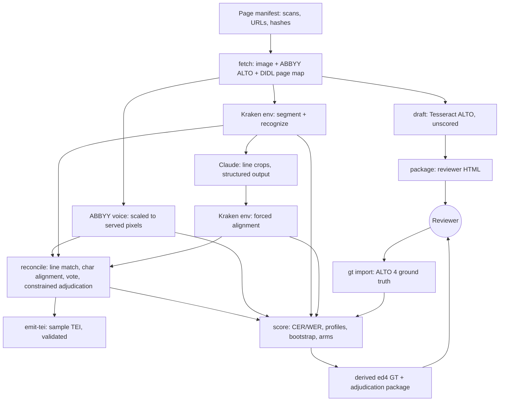
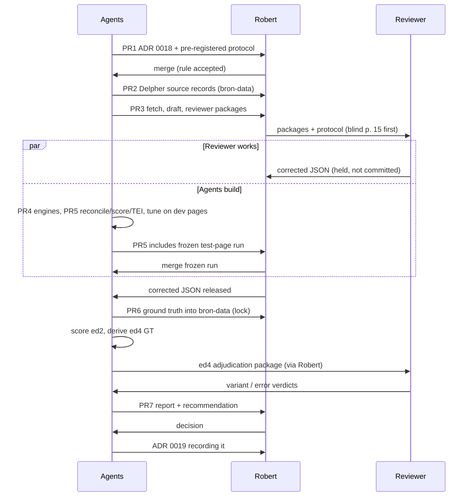
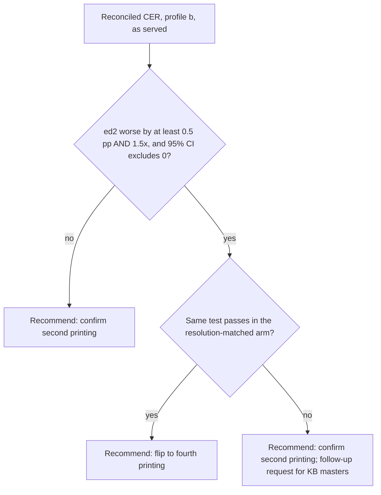

# M2 GD2 OCR Sample Test - Plan

**Target repos:** `bron` (code, this repo) and `bron-data` (data, `github.com/robertguss/bron-data`). Paths are relative to `bron` unless prefixed `bron-data:`.

---

## Goal Capsule

- **Objective:** Robert can confirm or flip ADR 0007's choice of base text for GD² (second printing or fourth) on evidence a reader can check: error rates measured against human-corrected pages. M3 then starts from an OCR pipeline whose error rate on this book is already known.
- **Means:** three scored OCR voices on ten pages of each printing, fetched from Delpher (KTD1–KTD6). The voices are reconciled into one reading (KTD8) and scored against a reviewer's ground truth with a decision rule fixed in advance (KTD9–KTD12).
- **Authority:** the accepted ADRs in `docs/decisions/` outrank this plan, especially 0007, 0011, 0012, 0013 and 0016. U1 adds ADR 0018, which amends ADR 0007 where this plan departs from it. Within the plan, Requirements win on behavior, KTDs win on mechanism, and units override neither.
- **Stop conditions:**
  - Stop and report if Delpher blocks or throttles the fixed page list (KTD3). Do not switch to a different copy or site without Robert.
  - Stop scoring if the freeze-then-lock order (KTD13) has been broken, for example if the ground truth entered `bron-data` before the frozen run merged. Report it rather than scoring.
  - Stop and ask Robert if the reviewer cannot follow the ground-truth protocol as written (U1).
  - Publish no transcription-quality number before locked ground truth exists (R12).
- **Execution profile:** Deep. Seven PRs across two repos, grouped under Implementation Units. Agents build every unit. The reviewer's corrections are the critical path, so the reviewer packages ship in PR3, before the engines.
- **Who finishes:**
  - Agents build the PRs, run the pipeline, and draft the report.
  - Robert merges PR1. That accepts ADR 0018 and the pre-registered decision rule, which he may adjust first.
  - Robert recruits the reviewer (a personal ask, not the institutional outreach ADR 0013 holds until M6), sends the packages, and keeps the returned corrections out of `bron-data` until the frozen run has merged.
  - The reviewer corrects the ten pages, keys one page blind, and later adjudicates the fourth-printing variant candidates.
  - Robert makes the base-text decision. U14 records it.

---

## Product Contract

### Summary

Measure how well OCR reads GD² vol. II, pp. 1–74 (#161–177) in the second printing (VU copy on Delpher) and the fourth printing (KB copy on Delpher). Three voices read each page: Kraken, Claude, and Delpher's own ABBYY layer. A reconciled reading is built from all three. A Dutch reviewer corrects ten second-printing pages as ground truth, and every voice is scored against it. The report gives error rates per voice, per printing and per scan resolution, and ends in Robert's recorded decision on the base text.

### Problem Frame

ADR 0007 picked the second printing as GD²'s base text. It was the last edition Bavinck prepared, and its Delpher scans have library provenance and permanent page URLs. The ADR also said to flip the roles if the second printing reads materially worse under OCR. Nobody has measured that. M3 cannot start the real transcription until the base text is settled and the pipeline has a human-measured error rate.

Research on 2026-11-04 changed the comparison:

- **The fourth printing is on Delpher too.** `MMKB18A:049654000` is the KB copy of vol. II, 1928, with permanent page URLs and its own ABBYY OCR. Library provenance no longer separates the printings.
- **The printings are served at different resolutions.** Delpher serves the second printing at about 150 ppi; both the VU and UvA copies stop there, and larger requests are only upscaled. It serves the fourth printing at about 300 ppi. A naive comparison would measure the scans as much as the type.
- **Delpher's ABBYY read the 300 ppi masters of both printings.** Its coordinates for the second printing refer to images that are not served publicly.

ADR 0007 also requires every published quality number to come from human-corrected pages. ADR 0016 staged an exception for GD¹ and said human-corrected measurement starts here. GD¹ arrived proofread. GD² is the first text Bron must read itself.

### Requirements

**Sample and sources**

- R1. The test uses ten second-printing pages from GD² vol. II pp. 1–74 (#161–177), plus the fourth-printing pages that carry the same text. The page list follows a stated selection rule and is fixed before any engine runs (KTD2).
- R2. A committed manifest identifies every scan and OCR file used, by its Delpher persistent URL and SHA-256. No scan image is committed to either repo.

**Voices and outputs**

- R3. Three scored voices read each test page: Kraken, Claude, and Delpher's ABBYY layer. Each voice produces ALTO per page, in the coordinates of the image actually served.
- R4. A reconciled reading is produced per page from the three voices. Every disagreement is adjudicated and marked with its certainty and who resolved it. The reconciled reading is emitted as TEI that validates.

**Ground truth**

- R5. A Dutch reviewer corrects the ten second-printing pages against the scan, under a written protocol. The reviewer starts from a draft made by an engine that is not scored, and can add, split or delete lines.
- R6. Ground truth is locked only after every scored voice's output on the test pages has been frozen. No setting is tuned on test pages.
- R7. The ground truth is committed to `bron-data` with its protocol and reviewer credit. The text carries the Public Domain Mark with CC0 for residual rights (ADR 0014).

**Measurement and decision**

- R8. CER and WER are reported per voice and for the reconciled reading, per printing. The second printing is reported under both normalization profiles, and the fourth printing under the normalized profile only, because its line breaks differ from the ground truth's (KTD10). Each figure has a page-cluster bootstrap interval, and the report includes per-page tables and separate figures for body text, footnotes, Greek and Hebrew.
- R9. The comparison between printings controls for scan resolution. The fourth printing is also scored at the second printing's effective resolution, and the report states which way each remaining bias runs.
- R10. Fourth-printing scores are computed against ground truth derived from the second printing's and labeled that way. Where all voices agree with each other but not with the derived ground truth, the reviewer decides whether the spot is a variant, an engine error, or an error in the ground truth itself.
- R11. The decision rule is registered before scoring. Robert's decision, the evidence behind it and its consequences are recorded in an ADR.
- R12. No transcription-quality number is published before ground truth exists. If no reviewer completes the work, M2 stops in a ground-truth-ready state with no number and no decision.

### Key Decisions

- **M2 gets its own plan, separate from M0/M1.** (session-settled: user-approved — chosen over planning M0 through M2 together: M2 needs the Dutch reviewer and ends in Robert's base-text decision.) Governs R1–R12.
- **M2 runs alongside M1's unfinished PRs, not after them.** The two plans share only `bron-data`'s registry and README, and the waits on PR2 and PR6 handle that. (session-settled: user-approved — chosen over waiting for M1 to finish: M2's critical path is the reviewer, not M1.) Governs R2, R7.
- **The ten pages come from the slice chapter, #161–177.** The reviewer's corrections also serve M3 and the thin slice. (session-settled: user-approved — chosen over pages spread across volumes: the cost, that the decision rests on one chapter of vol. II, is accepted.) Governs R1.
- **The fourth printing has no ground truth of its own.** It is scored against ground truth transferred from the second printing, and the report labels it that way. (session-settled: user-approved — chosen over a second round of human correction: the printings are documented as text-identical, and real variants are adjudicated.) Governs R10.
- **The reviewer is the critical path, and finding one is Robert's task.** It is a personal ask, not outreach to an institution. (session-settled: user-approved — chosen over waiting for M7 outreach: ADR 0013 holds partner outreach until the thin slice is public, which is after M2.) Governs R5, R12.
- **Ground truth lives in `bron-data`. Scans are linked, not copied, and the sample's ALTO and TEI stay in `bron` as research artifacts.** (session-settled: user-approved — chosen over keeping ground truth in `bron` or committing GD² sample text to the corpus: ground truth is reusable data, while the sample TEI is not a citable text.) Governs R2, R4, R7.

### Success Criteria

- The roadmap's M2 condition holds: the numbers are in `docs/research/`, and the base text is confirmed or flipped by Robert.
- Another reader can repeat the measurement from the report alone: page list, hashes, tool and model versions, prompts by hash, bootstrap seed, and decision rule with its registration date.
- M3 can run the same pipeline on a longer page list without code changes. Only the manifest grows.

### Scope Boundaries

- Only the ten test pages, four dev pages and their fourth-printing counterparts. Out of scope: full-volume OCR, the `<pb ed="ed4">` layer, IIIF tiles, and citable GD² TEI in `bron-data:data/`.
- The sample TEI carries pages, paragraphs, notes, languages and certainty. ADR 0007's full structure encoding (part, chapter, Par., subparagraph `#` as the citable unit) is M3.
- No engine is trained or fine-tuned (KTD5).
- No publication threshold for CER is set. `docs/transcription.md` sets one once the first volume's numbers exist.
- Latin, German and French spans are not tagged in the sample TEI. Greek and Hebrew are tagged by script (KTD16).

#### Deferred to Follow-Up Work

- **A request for the KB's 300 ppi masters** (dataservices@kb.nl). This is Robert's call after the report, if the resolution arm shows the gap comes from the scans (KTD12). Robert also decides when to send it under ADR 0013, which holds contact with institutions until the thin slice is public.
- **A rights and terms record for theologienet.nl.** It is not used as a source (KTD1).
- **Machine language identification for GD²**, reusing the M0/M1 plan's U9. It lands in M3.
- **A CI job for the Kraken environment.** It lands when M3 runs Kraken on whole volumes.

#### Considered and not built

- **The UvA copy (`MMSFUBA02:000050299`) as a fourth voice or alternate base copy.** It is the same printing with the same 150 ppi limit, and ADR 0007 names the VU copy. Revisit if pencil marks in the VU copy turn out to be a leading error source.
- **theologienet.nl PDFs as the fourth-printing source.** They are bitonal two-page spreads with a poor text layer and no stated provenance. Delpher's KB copy replaces them (KTD1).
- **A contamination check against GD¹ wording and a modern-spelling guard on Claude.** CER against ground truth already counts these errors, and the error-analysis appendix shows them by type. Revisit in M3, where most pages have no ground truth.
- **eScriptorium or Transkribus for the reviewer.** One needs hosting and the other costs credits. A self-contained HTML package is enough for eleven pages (KTD15).
- **dinglehopper as the scorer.** It drops ALTO `HYP` elements and folds dashes and `ij` by default, which would score Bavinck's punctuation inconsistently (KTD9).
- **Weighting votes by ABBYY confidence.** Delpher's ALTO character confidences are all zero.
- **A code guard enforcing freeze-before-lock.** The order is visible in git history, and the report must cite both commits (KTD13). Revisit if M3 automates scoring runs.

### Dependencies

- Robert merges PR1, recruits the reviewer, controls when the ground truth is committed, and decides.
- The reviewer: ten pages, one blind page, and one adjudication round.
- The M0/M1 plan's PR4 (U7: `bron-data` CI, `registry/sources.yaml`, the Delpher terms record) must merge before this plan's PR2 and PR6. This is merge order only.
- `ANTHROPIC_API_KEY` in the environment of whoever runs the Claude voice. It is never committed and never in CI (ADR 0011).
- System Tesseract 5.5.x with `tessdata_best` for `nld`, `grc` and `heb`. Python 3.13 available to uv for the Kraken environment.
- Network access to `resolver.kb.nl`, `services.kb.nl`, `zenodo.org`, `api.anthropic.com`, PyPI and GitHub.

### Sources

- Roadmap M2 and M3 (`docs/roadmap.md`); ADRs 0007, 0011, 0012, 0013, 0014 and 0016; `docs/transcription.md`; the M0/M1 plan (`docs/plans/2026-11-03-0447-feat-m0-m1-scaffolding-gd1-tei-plan.md`), whose KTD17 (Python 3.15), KTD18 (download pacing), KTD22 (hash-recorded source map) and U8 layout this plan mirrors.
- Checked live on 2026-11-04:
  - KB SRU lists both printings. Second printing, VU copy: `MMUBVU05:000000743`, `…817`, `…818`, `…819`. Second printing, UvA copy: `MMSFUBA02:…`. Fourth printing, KB copy: `MMKB18A:026558000`, `049654000`, `049655000`, `049656000`.
  - The title page at `MMKB18A:049654000:00009` reads "TWEEDE DEEL, VIERDE ONVERANDERDE DRUK, J. H. KOK, 1928".
  - `imageviewer.kb.nl` at `s=1`: VU page 942×1416 and UvA 959×1436, where `s=2` adds no detail; KB fourth printing 2010–2074 × 3030–3070.
  - VU ALTO refers to `…_master.jp2`, ABBYY FineReader 10, Planman, 2013.
  - Hebrew (תכלית, חקר) on printed p. 7 of the second printing.
- Research dossiers on Delpher endpoints, the slice's page map, Kraken 7.1 and its models, Tesseract, VLM OCR evidence, scoring tools and edition alignment. They are summarized where they shape a KTD, with sources inline there.

---

## Planning Contract

### Key Technical Decisions

- KTD1. **Both printings come from Delpher.**
  - **Second printing:** VU copy `MMUBVU05:000000817`, scans `00013`–`00086` = printed pp. 1–74. Printed page = scan − 12 in this range.
  - **Fourth printing:** KB copy `MMKB18A:049654000`.
  - **Page numbers:** the scan-to-printed-page map comes from each book's OAI-PMH DIDL record (`dcx:originalPageNumber`), never from Delpher's viewer numbering.
  - **Why the change:** ADR 0007 named the theologienet PDFs for the fourth printing. Delpher's copy has library provenance, permanent page URLs, about 300 ppi images and its own ABBYY ALTO. ADR 0018 records the change (U1).
- KTD2. **The page list is fixed and stratified.**
  - **Test pages:** pp. 1, 7, 8, 15, 29, 38, 47, 50, 59, 71 (scans `00013`, `00019`, `00020`, `00027`, `00041`, `00050`, `00059`, `00062`, `00071`, `00083`). Together they cover:
    - Par. openings with small-type bibliographies: pp. 1, 29, 50;
    - polytonic Greek: pp. 1, 8, 38, 47;
    - Hebrew: p. 7;
    - heavy footnotes: pp. 15, 59;
    - plain body text with pencil marks: p. 71.
  - **Dev pages:** pp. 3, 20, 44, 64. They have no reviewer ground truth, are used for tuning only, and never appear in the report's figures.
  - **Alternates:** pp. 26, 33, 56, used in order if a test page proves unusable. Each substitution is recorded.
  - **Fourth-printing pages:** every fourth-printing page that holds any text of a test or dev page. They are found by aligning Delpher's OCR text of both printings, a step that needs no human.
  - U1 checks each page's content against the scan before the list is registered, and swaps in an alternate where a page does not hold its stratum.
- KTD3. **Fetching is slow, identified and hash-recorded.** This mirrors the M0/M1 plan's KTD18.
  - A fixed URL list, sent with an identifying User-Agent and spaced at least three seconds apart.
  - Exponential backoff on 429 and 5xx responses. Stop after three consecutive failures.
  - A cache outside both repos, keyed by URL and recorded by SHA-256. A different hash on a refetch is an error.
  - Images are fetched from their persistent resolver URL (`resolver.kb.nl/resolve?urn=<id>:<scan>:image`), which serves a JP2 at the native served size. The manifest records that URL and the JP2's SHA-256, so a reader repeating the run gets the same bytes. Each JP2 is decoded once into a lossless working copy in the cache, whose hash is recorded beside the original, and the engines read the working copy. Requests that would upscale are never made.
  - Delpher's robots.txt disallows generic crawling, yet the KB documents the resolver and OAI as APIs. About a hundred fixed requests to documented endpoints stays well below ADR 0012's "bulk use".
- KTD4. **One pixel space per page.** Every voice's ALTO uses the coordinates of the served image. ABBYY coordinates are scaled by served width divided by the ALTO page `WIDTH`. That is about ×0.5 for the second printing, whose ALTO refers to unserved masters, and ×1 for the fourth, whose ALTO page is 2010×3030, the served size. An overlay test on real pages verifies the scaling.
- KTD5. **Kraken runs in its own environment.**
  - **Environment:** `tools/kraken/` is a separate uv project pinned to Python 3.13 and `kraken==7.1.1`. Kraken requires Python below 3.14, and `bron` is on 3.15 (M0/M1 KTD17).
  - **Interface:** a small CLI in that project segments, recognizes and force-aligns. Each call is a batch: a page list goes in, a directory of ALTO and JSON comes out, under a versioned JSON contract. Torch and the model then load once per batch rather than once per page, which matters when M3 runs whole volumes. `bron` calls it as a subprocess. The root ruff and ty configs exclude `tools/kraken/`, which has its own.
  - **Recognition model:** PP-OCRv6-medium (Zenodo record 21788410, Apache-2.0), reported to cover Dutch, Ancient Greek and Hebrew in one model. Kraken 7 removed per-line model switching, which is why a single multi-script model matters. U6 verifies that the model loads. If it does not, U6 uses CATMuS-Print Large (Zenodo 10592716, CC-BY-4.0) and records the substitution.
  - **Training:** none. Stock models only, because the ground-truth pages are the test set. (session-settled: user-approved — chosen over training on ground truth: training on the test set would invalidate the measurement.)
  - Models are downloaded by DOI into the cache with recorded hashes and are never committed.
- KTD6. **Claude reads line by line on Kraken's segmentation.**
  - **Input and output:** the model gets the full page image plus numbered line crops and returns `{line_id: text}` as structured output. A page has more than 20 lines, so the request falls under the API's many-image size limit. The full-page context image is therefore downscaled to at most 2000 px on its longest side, and the line crops stay at native served resolution. The scale factor is recorded in the run manifest and frozen with the other KTD13 settings.
  - **Prompt:** transcribe diplomatically. Keep the printed spelling ("zoo", "menschen", "eene") and line-end hyphens. Do not modernize, translate or join anything.
  - **Coordinates:** Kraken's forced alignment of the returned text gives character positions for ALTO.
  - **Missing lines:** missing or empty line IDs get one retry. After that they stay empty and are scored as deletions.
  - **Run settings:** the model is `claude-opus-5-5`, pinned. One run at fixed settings, with the model ID and prompt hash recorded in the run manifest.
  - **Why line-anchored:** the 2025 CHURRO benchmark found whole-page VLM OCR of printed Dutch weak and prone to modernization. Anchoring to lines bounds omissions and keeps ALTO coordinates.
  - **Why Kraken's lines:** Kraken can be re-run on the resolution-matched arm and on M3 pages, and ABBYY cannot. The cost is shared coverage: a line Kraken loses is lost to Claude too. The report therefore gives line recall per segmenter (Kraken, ABBYY) against ground-truth lines, which keeps lost lines apart from misread ones.
- KTD7. **Tesseract makes the reviewer's draft and is never scored.** It is Tesseract 5.5.x via the CLI with `-l nld+grc+heb`, dictionaries switched off, and ALTO output. (session-settled: user-approved — chosen over seeding the draft from a scored engine: a draft from a scored voice would tilt the scores toward it.)
- KTD8. **Reconciliation votes, and Claude only chooses.**
  1. Lines are matched across voices by box overlap.
  2. The three readings of each matched line are aligned character by character.
  3. Where all three agree, the reading is accepted with `cert="high"`.
  4. Where two agree, the majority reading is taken with `cert="medium"`.
  5. Where all three disagree, Claude gets the line crop and the candidate readings and must pick one or answer "unsure". It never rewrites text freely, because free post-correction over-corrects clean text (ICDAR 2026 HIPE-OCRepair). "Unsure" takes the reading from a fixed voice order, set on dev pages before the freeze, with `cert="low"`.
  6. A line only one voice read is kept as read, with `cert="low"` and marked single-voice. A choice with one candidate means nothing, so it is not adjudicated.
  - Every span records which voices supported it, and the reconciled reading is scored as a voice of its own.
  - **Why Claude adjudicates although it is also a voice:** its bias is the same for both printings, and the printings are what KTD12 compares. The report still gives the self-choice rate (how often Claude picks Claude's own reading). It also scores a vote-only reconciliation, in which every three-way disagreement takes the voice-order reading, so the adjudicator's effect can be seen.
  - The alignment library is chosen in U8 (see Deferred to Implementation).
- KTD9. **Bron scores with its own code.**
  - **CER:** edit distance over grapheme clusters.
  - **WER:** edit distance over whitespace tokens.
  - **Profile (a), diplomatic:** NFC; whitespace collapsed; `ij` mapped to `ij`; line-end hyphens kept as `-`; em-dash and en-dash kept distinct.
  - **Profile (b), normalized:** profile (a), plus line-end hyphenation rejoined and quotes, apostrophes and dashes folded.
  - **Primary unit:** text-level CER over the aligned span of each page (KTD10), with page text in canonical order (body, then footnotes, by geometry). The same cropping and footnote-marker stripping apply to both printings. The fourth printing was reset in type, so its lines do not correspond to the second's, and a text-level measure is the only one both printings share.
  - **Line roles:** running heads, page numbers and sheet signatures are transcribed but excluded from scoring, because they differ between printings (KTD14).
  - **Diagnostic unit (second printing only):** lines matched to ground-truth lines by geometry. A ground-truth line with no match counts as a deletion, and a voice line with no match as an insertion. A badly split or merged line is charged twice, which measures the segmenter, so this unit is reported alongside the line recall from KTD6 and is never the decision measure.
  - **Intervals:** page-cluster bootstrap, 10,000 resamples, fixed seed. Voices are compared by paired bootstrap of per-page differences.
  - **Breakdowns:** character counts with every figure. Body text, footnotes, Greek and Hebrew get separate figures, and the report notes where small counts make them unreliable.
- KTD10. **Fourth-printing ground truth is derived, cropped and adjudicated.**
  1. The second-printing ground truth for each test page, under profile (b), is aligned to each fourth-printing voice's text with anchored alignment: unique-word anchors plus edit distance (RETAS, Yalniz & Manmatha).
  2. Fourth-printing text outside the aligned span is not scored.
  3. Footnote markers are stripped on both sides, because footnote numbering restarts on each page and differs between printings.
  4. Internal page cross-references ("bl. 23") are classed as variants by rule.
  5. Where all three fourth-printing voices agree with each other and differ from the derived ground truth, the reviewer judges the spot against the fourth-printing image and the matching second-printing crop. There are three verdicts:
     - **variant:** excluded from scoring and listed;
     - **error:** counted against the fourth printing;
     - **ground-truth error:** a mistake in the locked second-printing ground truth. It is corrected in a versioned erratum to the ground truth in `bron-data`, both printings are rescored, and the change is reported as a deviation (KTD13). Without this verdict, a ground-truth slip would look like a variant: dropped from the fourth printing's score but still counted against every second-printing voice, biasing the comparison toward a flip.
  - Fourth-printing figures use profile (b) only and are labeled "against derived ground truth". Under ADR 0007 they inform the decision but are not a published quality figure.
- KTD11. **A resolution-matched arm.** Fourth-printing images are downsampled to the second printing's effective ppi, and Kraken and Claude run again on the downsampled images. The ppi values come from the fetched JP2s' resolution boxes (150 ppi for the VU copy, 300 ppi for the KB copy, as checked). If a box is missing, the run stops rather than guessing.
  - The arms are: second printing as served (about 150 ppi), fourth printing as served (about 300 ppi), and fourth printing matched (about 150 ppi).
  - ABBYY cannot be re-run. It read 300 ppi masters of both printings, so it is already a resolution-matched voice, though an old engine.
  - Remaining biases run both ways. Derived ground truth works against the fourth printing, and resolution works for it. Ground-truth errors on spots where the fourth-printing voices disagree also count against the second printing. The report states all three.
- KTD12. **The decision rule is registered in advance.** These are the defaults; Robert may change them before merging PR1.
  - **Primary measure:** reconciled text-level CER over the aligned spans (KTD9), profile (b), arms as served, compared by paired bootstrap over the ten passages.
  - **Flip:** recommended only when the second printing is worse by at least 0.5 percentage points and at least 1.5×, and the 95% interval of the difference excludes zero.
  - **Resolution check:** if the gap fails that test in the resolution-matched arm, the recommendation is to confirm the second printing and record a request for the KB's 300 ppi masters as a follow-up, not to flip. Robert times the request under ADR 0013.
  - **Otherwise:** confirm. A tie keeps ADR 0007's choice.
  - The report sets ADR 0007's non-CER reasons beside the numbers, together with what each outcome costs M3:
    - **Confirm with a follow-up request for masters:** ADR 0013 holds the request until the thin slice is public, so M3 would transcribe from the 150 ppi scans at the as-served second-printing error rate, which is printed beside the recommendation. Once the masters arrive, those pages need another OCR and review pass.
    - **Flip:** M2's ground truth does not carry over, and M3 needs a new fourth-printing ground-truth round from the reviewer.
  - Robert decides; the rule produces a recommendation, not the decision.
- KTD13. **Freeze, then lock.**
  1. Settings are tuned only on dev pages: model IDs, prompts, thresholds, normalization and voice order. Tuning is judged by voice agreement counts, the missing-line rate, and an agent's reading of the outputs against the scan, never by reviewer ground truth.
  2. The frozen run on test pages is committed to `bron`: outputs, Claude's raw transcription and adjudication responses (the calls cannot be re-run to the same result), and a run manifest recording the `bron` commit and a hash of the configuration. The scorer lands in the same PR, so the frozen commit fixes the scoring code too. The run merges before the ground truth enters `bron-data`.
  3. Robert holds the returned corrections until that merge.
  4. The report cites both commits. Any later change to normalization or metrics code is reported as a deviation, with scores under both versions.
- KTD14. **Ground truth is ALTO 4 with line geometry and line roles.**
  - **Why ALTO, not PAGE:** ADR 0007 fixes ALTO as the physical layer, and every voice already passes through U3's ALTO model. PAGE, which OCR-D uses for ground truth, is one converter away if the set is ever shared there.
  - **Format:** one file per page. Lines start from Tesseract's segmentation and are edited by the reviewer. Words are `String` elements and line-end hyphens are `HYP` elements.
  - **Line roles:** each line carries a role: body, footnote, heading, running head, page number or sheet signature. Roles are pre-filled from position and font size and corrected by the reviewer. Scoring uses them to split body from footnotes and to exclude running heads, page numbers and signatures (KTD9).
  - **Image binding:** each file records the SHA-256 and pixel size of the image its geometry belongs to. If the KB's 300 ppi masters are ever obtained, the geometry is rescaled from that record rather than redrawn.
  - **Transcription level:** OCR-D Ground Truth Guidelines level 2, printed forms kept. The `ij` digraph is two letters. Greek keeps its accents and breathings, and Hebrew is transcribed as printed. Illegible spans are marked, excluded from scoring and counted.
  - **Location:** `bron-data:ground-truth/bavinck.gd.ed2/print2-vu-MMUBVU05-000000817/` holds the ALTO files, the reviewer's returned JSON as the original record, and a manifest of SHA-256 per file, protocol version, reviewer and date. The path names the printing and copy, because a flip (U14) would add fourth-printing ground truth beside it.
  - **Why outside `data/`:** the CapiTainS checks treat every XML file under `data/` as a text (`src/bron/checks/capitains.py`).
- KTD15. **The reviewer gets self-contained HTML.**
  - **Package:** one static HTML file per page. The scan is embedded, and each line crop sits beside an editable field holding the draft text and a pre-filled, editable line role (KTD14). The reviewer can add, split and delete lines and leave a page note. Adding a line means dragging a rectangle on the page image, and splitting one means marking a cut position on its crop. Both write polygons in served-image pixels. An export button downloads a JSON file.
  - **Workflow:** no server and no install. The reviewer emails the JSON files back, and `bron ocr gt import` turns them into ALTO 4 ground truth and validates it.
  - **Blind page:** p. 15's blind package has empty fields. The reviewer keys it first, then corrects the ordinary p. 15 package. The difference measures anchoring to the draft, and the report labels it that way, not as inter-annotator error.
  - **Adjudication package:** the same mechanism serves KTD10's fourth-printing adjudication round.
- KTD16. **The sample TEI is light research output.**
  - **Files:** one TEI file per printing and arm. The sampled pages are `<pb n facs>` elements, with `facs` set to the Delpher persistent page URL. ADR 0018 states that research output in `bron` is not corpus text, so ADR 0003's IIIF rule does not bind it (U1).
  - **Content:** paragraphs, `<note place="bottom">`, and Greek and Hebrew wrapped in `<foreign xml:lang>` by Unicode script. Adjudicated spans carry `cert` and `resp` per KTD8.
  - **Validation:** `tei_all` plus Bron's `pb-facs`, `script-lang`, `availability` and `id-ref` rules, run through `run_checks` on a temporary data-repo wrapper. It is not CapiTainS-cited, because the pages hold fragments of subparagraphs.
  - **Script tagging:** a shared helper, `src/bron/tei/scripts.py`. If the M0/M1 plan's PR5 has already merged an equivalent step in `src/bron/convert/gd1/langs.py`, U9 moves that step into the shared helper and both callers use it. Otherwise U9 creates the helper and the GD¹ code adopts it.
- KTD17. **Where the artifacts live.**
  - **`bron`:** the sample's page manifest, the frozen ALTO per voice, Claude's raw responses, the reconciled TEI, score JSON and run manifests go under `docs/research/2026-11-gd2-ocr-sample-test/`. Delpher's ABBYY ALTO for these pages is stored there too: it is OCR of a public-domain text and covers far less than a "substantial part" of the database.
  - **Rights status:** a README in that directory gives each file class its status under ADR 0014. OCR text, ABBYY output and TEI of the public-domain text carry the Public Domain Mark with CC0. The reviewer's variant verdicts are contributor judgments under CC BY 4.0, credited to the reviewer.
  - **Never committed:** images and model weights.
  - **Report:** `docs/research/2026-11-gd2-ocr-sample-test.md`, following the M0/M1 plan's year-month naming.
- KTD18. **One CLI family: `bron ocr`.**
  - **Subcommands:** `fetch`, `draft`, `package`, `gt import`, `run`, `reconcile`, `emit-tei` and `score`.
  - **Manifests:** each subcommand takes a page manifest by path. The manifest carries a `schema_version` and open-ended page roles, so M3 writes a new manifest, not new code.
  - **Pattern:** lazy imports, exit codes 0/1/2 and findings to stdout, following `src/bron/cli.py`.

### High-Level Technical Design

Data flow per page. Each box is a CLI step (KTD18), and every artifact is keyed by page and voice.



Order across actors. The freeze-then-lock order (KTD13) is the line everything else respects.



Decision rule (KTD12), applied by the report and confirmed or overridden by Robert:



### Output Structure

```text
bron/
  pyproject.toml                         ruff/ty exclude tools/kraken; new deps
  src/bron/cli.py                        bron ocr …
  src/bron/tei/scripts.py                Greek/Hebrew script spans (KTD16)
  src/bron/ocr/
    manifest.py                          page manifest, passed by path (schema_version)
    fetch.py
    textalign.py                         anchored text alignment (U2, reused by U10)
    alto.py                              read ABBYY ALTO v2, scale, write ALTO 4
    runs.py                              run manifests, config hash (U3; frozen in U11)
    voices/abbyy.py
    voices/tesseract.py
    voices/kraken.py                     subprocess to tools/kraken
    voices/claude.py
    gt/package.py                        reviewer and adjudication HTML
    gt/importer.py
    reconcile.py
    emit.py
    score/normalize.py
    score/metrics.py
    score/derived.py                     ed4 derived ground truth
    score/bootstrap.py
    data/run-config.yaml                 frozen settings (U11)
  src/bron/schemas/ocr-manifest.schema.json
  tools/kraken/
    pyproject.toml                       Python 3.13, kraken==7.1.1
    uv.lock
    bron_kraken.py                       segment, recognize, align
  tests/ocr/  tests/fixtures/gd2/        trimmed ALTO, recorded responses, synthetic images
  docs/decisions/0018-gd2-ocr-sample-test.md
  docs/decisions/0019-gd2-base-text.md
  docs/research/2026-11-gd2-ocr-sample-protocol.md
  docs/research/2026-11-gd2-ocr-sample-test.md
  docs/research/2026-11-gd2-ocr-sample-test/   page manifest, frozen outputs, raw responses, TEI, scores, rights README

bron-data/
  ground-truth/README.md
  ground-truth/bavinck.gd.ed2/print2-vu-MMUBVU05-000000817/   ALTO 4 per page, returned JSON, manifest.yaml
  registry/sources.yaml                  two Delpher source records added
  README.md                              layout gains ground-truth/
```

Each unit's **Files** list is authoritative.

### Risks

| Risk | Mitigation |
|---|---|
| No reviewer is found, or one is found and stops partway | Agents finish everything except the scores, and M2 stops ground-truth-ready (R12). Any decision on an agent-read estimate would need its own ADR, as ADR 0016 did, and Robert would have to choose that. |
| Delpher's 2026-08 bot rate limit blocks the fetch | Fixed list, slow pacing, identifying agent, cached results (KTD3). Stop condition rather than switching sources. |
| PP-OCRv6 for Kraken is reported by research but not yet verified to load | U6 verifies it first. CATMuS-Print is the fallback, and the substitution is recorded. |
| Claude modernizes spelling or drops lines | Line anchoring and the diplomatic prompt (KTD6). Errors show in CER against ground truth, and the error-analysis appendix breaks them out by type. |
| The second printing's scans are 150 ppi, so the comparison measures the scan and not the type | The resolution-matched arm (KTD11). The decision rule's third branch, request masters (KTD12). |
| Pencil underlining in the VU copy confuses segmentation | Measured, not hidden. The appendix lists marked lines. The UvA copy is a fallback to revisit (Scope Boundaries). |
| Derived ground truth misses real fourth-printing variants where the voices disagree | Those spots count as errors against the fourth printing. That bias runs against the flip and is stated in the report (KTD11). |
| A mistake in the second-printing ground truth counts against the second printing only, biasing toward a flip | Spots where all fourth-printing voices agree against the derived ground truth get a ground-truth-error verdict, an erratum and a rescore (KTD10). Slips at spots where the voices disagree remain, and the report states that bias (KTD11). |
| Tuning on test pages inflates the scores | Freeze-then-lock order (KTD13). Dev pages for tuning (KTD2). |
| M2 and the M0/M1 plan's PR5 both edit `cli.py`, `pyproject.toml` and `uv.lock` | Whichever lands second rebases. Neither restructures the other's code. |
| Kraken 7.x and its torch pin drift | Exact pins in `tools/kraken/` with a lock file. The run manifest records versions. |

---

## Implementation Units

| U-ID | Title | Key files | Depends on |
|---|---|---|---|
| U1 | Decision record and pre-registered protocol | `docs/decisions/0018-gd2-ocr-sample-test.md`, `docs/research/2026-11-gd2-ocr-sample-protocol.md`, `docs/transcription.md` | — |
| U15 | Delpher source records | `bron-data:registry/sources.yaml` | U1 |
| U2 | Page manifest, fetch and text alignment | `src/bron/ocr/{manifest,fetch,textalign}.py` | U1 |
| U3 | ALTO model, run manifests and the ABBYY voice | `src/bron/ocr/{alto,runs}.py`, `src/bron/ocr/voices/abbyy.py` | U2 |
| U4 | Tesseract draft | `src/bron/ocr/voices/tesseract.py` | U3 |
| U5 | Reviewer packages and ground-truth import | `src/bron/ocr/gt/{package,importer}.py` | U3, U4 |
| U6 | Kraken environment and voice | `tools/kraken/*`, `src/bron/ocr/voices/kraken.py` | U3 |
| U7 | Claude voice | `src/bron/ocr/voices/claude.py` | U6 |
| U8 | Reconciliation | `src/bron/ocr/reconcile.py` | U3, U6, U7 |
| U9 | Sample TEI emission | `src/bron/ocr/emit.py`, `src/bron/tei/scripts.py` | U8 |
| U10 | Scoring | `src/bron/ocr/score/*` | U2, U3, U5, U8 |
| U11 | Dev tuning and the frozen run | `src/bron/ocr/data/run-config.yaml`, `docs/research/2026-11-gd2-ocr-sample-test/` | U8, U9, U10 |
| U12 | Ground truth into `bron-data` | `bron-data:ground-truth/*` | U5, U11 |
| U13 | Scoring run, adjudication and report | `docs/research/2026-11-gd2-ocr-sample-test.md` | U10, U12 |
| U14 | Base-text decision record | `docs/decisions/0019-gd2-base-text.md`, `docs/transcription.md` | U13 |

### PR1: bron decision record and protocol

Waits on: nothing.

### U1. Decision record and pre-registered protocol

- **Goal:** the departures from ADR 0007 are accepted, and the measurement protocol is fixed before any engine runs.
- **Requirements:** R1, R5, R9, R10, R11.
- **Dependencies:** none.
- **Files:** `docs/decisions/0018-gd2-ocr-sample-test.md`, `docs/research/2026-11-gd2-ocr-sample-protocol.md`, `docs/transcription.md`.
- **Approach:**
  1. ADR 0018 amends ADR 0007 in six places:
     - the fourth printing comes from Delpher's KB copy, and theologienet is not used (KTD1);
     - the two scored engines are Kraken and a vision model, and Tesseract makes the unscored ground-truth draft (KTD7);
     - Kraken uses one multi-script model, not separate Dutch, Greek and Hebrew models, because Kraken 7 removed per-line model switching (KTD5);
     - fourth-printing figures against derived ground truth inform the decision but are not published quality figures (KTD10);
     - the base-text decision follows the registered rule in the protocol (KTD12);
     - the M2 sample TEI tags only Greek and Hebrew. Tagging Latin, German and French, as ADR 0007 requires for published text, starts in M3.
     It also states that research output in `bron` is not corpus text, so ADR 0003's IIIF rule does not bind its `facs` links (KTD16). It records the resolution asymmetry of Delpher's public images as context.
  2. Before the list is registered, check each page of KTD2 against its scan, swapping in alternates where needed.
  3. The protocol document fixes:
     - the page list with alternates (KTD2);
     - the voices and their settings classes;
     - the two normalization profiles (KTD9);
     - the three arms (KTD11);
     - the decision rule with its thresholds (KTD12);
     - the freeze-then-lock order (KTD13).
  4. The protocol also holds the reviewer-facing transcription rules (KTD14): what to transcribe, line roles, how to mark the illegible, and the blind-page order (KTD15). They are written in plain English so the reviewer can follow them without reading code.
  5. `docs/transcription.md`:
     - §1 gains the KB fourth-printing copy, and the theologienet row is marked "not used".
     - §5 open items 1, 2 and 5 point to the protocol. The open-items list drops "Kraken vs. Tesseract", which is now decided.
- **Patterns to follow:** ADR format in `docs/decisions/` and ADR 0016 (an amendment scoped to one milestone). The research-doc tone of `docs/research/2026-11-02-fact-checks.md`.
- **Test expectation:** none. These are decision and protocol documents.
- **Verification:** ADR 0018 names each ADR 0007 section it amends. The protocol states every threshold as a number. Robert merges PR1, and its merge date is the registration date the report cites.

### PR2: bron-data Delpher source records

Waits on: PR1 (merge order only); the M0/M1 plan's PR4 (merge order only: it creates `registry/sources.yaml` and the Delpher terms record).

### U15. Delpher source records

- **Goal:** the two copies M2 reads are in the registry before their output is committed anywhere (ADR 0012).
- **Requirements:** R2.
- **Dependencies:** U1.
- **Files:** `bron-data:registry/sources.yaml`.
- **Approach:**
  1. Add a record for the VU second-printing vol. II (`MMUBVU05:000000817`, imprint J. H. Bos 1908 as on the title page).
  2. Add a record for the KB fourth-printing vol. II (`MMKB18A:049654000`, J. H. Kok 1928).
  3. Each record carries the persistent book URL, the holder, the printing, and the rights URI the M0/M1 plan's U7 settled for Delpher. A note says the record covers the M2 sample only.
- **Test expectation:** none in `bron-data`. Its CI's registry check validates the records.
- **Verification:** `bron-data` CI is green with both records.

### PR3: bron acquisition, draft and reviewer packages

Waits on: PR1 (merge order only).

### U2. Page manifest, fetch and text alignment

- **Goal:** every test, dev and alternate page of both printings is fetched once, identified by persistent URL and hash, and mapped to its printed page number.
- **Requirements:** R1, R2.
- **Dependencies:** U1.
- **Files:** `src/bron/ocr/__init__.py`, `src/bron/ocr/manifest.py`, `src/bron/ocr/fetch.py`, `src/bron/ocr/textalign.py`, `src/bron/schemas/ocr-manifest.schema.json`, `src/bron/cli.py`, `pyproject.toml`, `uv.lock`, `docs/research/2026-11-gd2-ocr-sample-test/manifest.yaml`, `tests/ocr/test_manifest.py`, `tests/ocr/test_fetch.py`, `tests/ocr/test_textalign.py`, `tests/fixtures/gd2/didl-excerpt.xml`.
- **Approach:**
  1. The manifest carries a `schema_version`. Per printing it lists the book identifier, and per page the scan number, printed page, role (test, dev, alternate, or any later role) and, after a fetch, the image and ALTO hashes and the image's pixel size. A JSON Schema validates it through `bron.datafiles`. The sample's manifest lives in the research directory and is passed by path (KTD18).
  2. `bron ocr fetch --manifest … --cache <dir>` reads each book's DIDL record. It checks that every manifest page's printed number matches `dcx:originalPageNumber`, then fetches the image and ABBYY ALTO under KTD3's pacing. Hashes are written back to the manifest.
  3. `textalign.py` is the one anchored text aligner in the plan: unique-word anchors plus edit distance between anchors. U10's derived ground truth reuses it.
  4. Fourth-printing pages are added by aligning the plain OCR text of each second-printing test and dev page against the fourth printing's OCR across its first 70 pages (KTD2). The chosen pages and their aligned span offsets are recorded.
- **Patterns to follow:** the M0/M1 plan's U13 (hash-first source handling) and `convert gd1` CLI shape (`--cache` as an explicit argument). `bron.datafiles.load_yaml` and `schema_findings`.
- **Test scenarios:**
  - A DIDL excerpt where scan `00019` carries `originalPageNumber` 7 maps p. 7 to `00019`.
  - A manifest page whose printed number disagrees with the DIDL record fails with a finding naming both numbers.
  - A cached file whose hash differs from the manifest fails before any later step reads it.
  - A 429 response is retried with backoff. Three consecutive failures stop the run with a non-zero exit, and nothing is written for the failed page.
  - Requests carry the identifying User-Agent, are spaced at least three seconds apart (checked with an injected clock), and never ask for an image larger than its served size.
  - Aligning a second-printing OCR excerpt against a two-page fourth-printing excerpt selects both pages and records the span offsets.
  - Aligning a text against itself with one sentence inserted before and after returns exactly the original span.
  - A manifest without `schema_version`, or with an unknown one, is rejected.
- **Verification:** a real fetch fills the manifest with hashes for every page, and the cache directory sits outside both repos.

### U3. ALTO model, run manifests and the ABBYY voice

- **Goal:** one internal page model (lines with polygons, roles, words, hyphenation) that every voice reads and writes, Delpher's ABBYY output converted into it, and the run manifest every later step writes to.
- **Requirements:** R3, R6.
- **Dependencies:** U2.
- **Files:** `src/bron/ocr/alto.py`, `src/bron/ocr/runs.py`, `src/bron/ocr/voices/__init__.py`, `src/bron/ocr/voices/abbyy.py`, `tests/ocr/test_alto.py`, `tests/ocr/test_runs.py`, `tests/ocr/test_abbyy.py`, `tests/fixtures/gd2/abbyy-ed2-p7.xml`, `tests/fixtures/gd2/abbyy-ed4-excerpt.xml`.
- **Approach:**
  1. Parse ALTO v2 and v4 with the safe parser settings already used in `src/bron/tei/passages.py`.
  2. Text extraction honors `SUBS_TYPE=HypPart1/HypPart2`, `SUBS_CONTENT` and `<HYP>`, so a line-end hyphen survives (KTD9).
  3. Scale coordinates into served-image pixels (KTD4).
  4. Write ALTO 4 for every voice, recording the voice, its role (scored or draft) and its version in the ALTO `Description`.
  5. `runs.py` owns the run manifest: voices, tool and model versions, the `bron` commit, a configuration hash, and per-file SHA-256. Voices append to it, and U11 freezes it.
- **Patterns to follow:** `src/bron/tei/passages.py` (safe lxml parsing), `src/bron/findings.py` (diagnostics).
- **Test scenarios:**
  - A trimmed ABBYY ALTO line that ends in a `HypPart1` word and a `HYP` element yields text ending in `-`, and the next line begins with the second half.
  - A second-printing ALTO whose page `WIDTH` is 1883, with a served width of 942, scales a word box at x=1000 to about x=500.
  - Writing a page to ALTO 4 and reading it back preserves line order, polygons, word text and hyphens.
  - A page with no text blocks yields an empty page, not an error.
  - Greek ABBYY garbage such as `jxvazrjoiov` passes through unchanged. The voice is never cleaned.
  - A run manifest records every output file's hash, and a tampered output fails verification.
  - The configuration hash changes when any setting changes, and not when only comments change.
- **Verification:** an overlay of ABBYY word boxes on one real served page of each printing lands on the words. The run attaches the overlay images to the PR description, not to the repo.

### U4. Tesseract draft

- **Goal:** an unscored first draft of each second-printing test page, as ALTO with line geometry, for the reviewer to correct (KTD7).
- **Requirements:** R5.
- **Dependencies:** U3.
- **Files:** `src/bron/ocr/voices/tesseract.py`, `src/bron/cli.py`, `tests/ocr/test_tesseract.py`, `tests/fixtures/gd2/tesseract-alto-excerpt.xml`.
- **Approach:**
  1. `bron ocr draft` runs the system Tesseract CLI with KTD7's settings on each cached image and converts the output through U3's model.
  2. It records the Tesseract and traineddata versions.
  3. Its output is always tagged with the draft role (U3), and the run manifest's list of scored voices excludes it.
  4. It pre-fills each line's role from position and relative font size (KTD14).
- **Test scenarios:**
  - Recorded Tesseract ALTO converts into the page model with lines and polygons.
  - A missing `tesseract` binary exits 2 with a message naming the dependency.
  - Every page it produces carries the draft role.
  - A short line at the top of the page above the text block is pre-filled as a running head, and small-type lines below a separator as footnotes.
- **Verification:** drafts exist for all ten test pages, with roles pre-filled.

### U5. Reviewer packages and ground-truth import

- **Goal:** the reviewer can correct each page in a browser with no install, and the returned files become validated ground truth (KTD14, KTD15).
- **Requirements:** R5, R7, R10.
- **Dependencies:** U3, U4.
- **Files:** `src/bron/ocr/gt/__init__.py`, `src/bron/cli.py`, `src/bron/ocr/gt/package.py`, `src/bron/ocr/gt/template.html`, `src/bron/ocr/gt/importer.py`, `tests/ocr/test_package.py`, `tests/ocr/test_importer.py`, `tests/fixtures/gd2/gt-return.json`.
- **Approach:**
  1. `bron ocr package` writes one self-contained HTML file per page. It holds the image inlined as data, line crops by polygon, editable fields with the draft text and line role, add (drag a rectangle on the page image), split (mark a cut on the crop) and delete controls, a page note, and an export that downloads JSON. The JSON carries the page ID, protocol version, the image's SHA-256 and pixel size, and line geometry with roles.
  2. The blind package for p. 15 has the same lines with empty fields and is named so it is done first.
  3. An adjudication mode renders KTD10's spots: a fourth-printing crop, the matching second-printing crop, the derived ground truth reading, the voices' shared reading, and a choice of variant, error or ground-truth error, with a comment. U5 owns the spot format, and U10 produces spots in it.
  4. `bron ocr gt import` validates the returned JSON. It checks the page ID, protocol version and image hash, that lines are non-overlapping polygons inside the page with a known role, and that illegible marks are well formed. It then writes ALTO 4 ground truth and a manifest entry with SHA-256, keeping the returned JSON beside it unchanged as the original record (KTD14).
  5. Packages go to a directory outside the repo. They contain scan images and are sent privately, never committed.
- **Execution note:** test the importer against the exported JSON shape first. The HTML template is checked by a smoke test that loads it in a headless browser only if one is available locally.
- **Test scenarios:**
  - A returned JSON with one line split into two produces two ALTO lines whose polygons cover the original.
  - An added line with a drawn rectangle imports as an ALTO line with that rectangle as its polygon.
  - A JSON for the wrong page ID, protocol version or image hash is rejected with a finding.
  - A line whose role the reviewer changed from body to running head imports with the new role.
  - Re-importing the kept JSON produces byte-identical ALTO.
  - A line marked illegible imports with its mark and is excluded from scored text, with its character count recorded.
  - A JSON with Greek in NFD imports as NFC.
  - The generated HTML contains no external URLs. Everything is inline.
  - The blind package carries the same line IDs as the ordinary package for p. 15, with empty text.
  - An adjudication return maps each spot ID to `variant`, `error` or `gt-error`. A missing spot is reported, not defaulted.
  - Each adjudication spot carries both a fourth-printing and a second-printing crop.
- **Verification:** Robert can open a package offline, edit, export, and have the import accept the result. Agents check this with one dev page before the packages go out.

### PR4: bron Kraken and Claude voices

Waits on: PR3 (merge order only; built on its branch).

### U6. Kraken environment and voice

- **Goal:** Kraken segments and reads every page in its own pinned environment, and `bron` receives ALTO it can use (KTD5).
- **Requirements:** R3.
- **Dependencies:** U3.
- **Files:** `tools/kraken/pyproject.toml`, `tools/kraken/uv.lock`, `tools/kraken/bron_kraken.py`, `tools/kraken/README.md`, `src/bron/ocr/voices/kraken.py`, `src/bron/cli.py`, `pyproject.toml` (ruff and ty excludes, `kraken` pytest marker), `tests/ocr/test_kraken_voice.py`, `tests/fixtures/gd2/kraken-alto-excerpt.xml`, `tests/fixtures/gd2/kraken-align.json`.
- **Approach:**
  1. `tools/kraken/` is a uv project on Python 3.13 with `kraken==7.1.1` and its own lint config.
  2. `bron_kraken.py` has three batch commands, each taking a page list and writing to an output directory under a versioned JSON contract (KTD5):
     - `segment`: the default baseline segmenter, writing lines and polygons;
     - `recognize`: the KTD5 model on those lines;
     - `align`: forced alignment of supplied line texts, writing character cuts as JSON.
     Device is CPU by default, and models are fetched by DOI into the cache with hash checks.
  3. `voices/kraken.py` calls these through `uv run --project tools/kraken`, passing the cache and model paths, and converts the results through U3. It refuses an output whose contract version it does not know.
  4. This unit creates `bron ocr run`, which runs the voices named on the command line over a manifest. U7 adds the Claude voice to it, and U11 runs it frozen.
  5. The first step verifies that PP-OCRv6-medium loads and reads a dev page. If it does not, switch to the fallback and record that in `tools/kraken/README.md`.
- **Test scenarios:**
  - The `bron`-side adapter turns recorded Kraken ALTO into the page model with polygons in served pixels.
  - Recorded alignment cuts for a line produce word boxes whose union lies within the line polygon.
  - A non-zero exit from the Kraken subprocess surfaces its stderr and exits 1. No partial ALTO is written.
  - A model file whose hash differs from the recorded one is refused.
  - Output carrying an unknown contract version is refused before any conversion.
  - Integration, marked `kraken` and skipped unless the environment exists: segmenting a synthetic rendered image of three text lines finds three lines.
- **Verification:** Kraken output exists for every dev page in both arms, and the run manifest records the Kraken version, model DOI and hash.

### U7. Claude voice

- **Goal:** Claude's line-anchored reading of every page, with coordinates, as a scored voice (KTD6).
- **Requirements:** R3.
- **Dependencies:** U6.
- **Files:** `src/bron/ocr/voices/claude.py`, `src/bron/ocr/prompts/transcribe.md`, `pyproject.toml`, `uv.lock` (the `anthropic` SDK and `pillow`), `tests/ocr/test_claude_voice.py`, `tests/fixtures/gd2/claude-response.json`.
- **Approach:**
  1. Build the request: the full page image downscaled per KTD6, numbered line crops cut from Kraken's polygons at native resolution, and the prompt file.
  2. Ask for structured output keyed by line ID.
  3. Retry missing or empty lines once, as a smaller request, then leave them empty (KTD6).
  4. Send the returned texts to U6's `align` for character positions and write ALTO.
  5. Record the model ID, the SHA-256 of the prompt file, and the request settings in the run manifest. Keep each raw response beside the voice's ALTO (KTD13).
  6. Read the API key from the environment only.
- **Test scenarios:**
  - A recorded response with all line IDs produces one ALTO line per Kraken line, in Kraken's geometry.
  - A recorded response missing two line IDs triggers one retry for exactly those lines. If they are still missing, they become empty lines flagged `missing` in the voice's diagnostics.
  - A response with an unknown line ID is ignored and reported.
  - With no `ANTHROPIC_API_KEY`, `bron ocr run --voice claude` exits 2 before reading any image.
  - Changing one character of the prompt file changes the recorded prompt hash.
  - Text is stored as returned apart from NFC. No spelling or hyphen normalization happens in the voice.
- **Verification:** Claude output exists for every dev page, and the dev-page diagnostics show the missing-line rate.

### PR5: bron reconciliation, scoring, TEI and frozen run

Waits on: PR4 (merge order only; built on its branch); PR2 (merge order only: the source records land before Delpher output is committed). PR5 must merge before PR6 (KTD13).

### U8. Reconciliation

- **Goal:** one reconciled reading per page, from the three voices, with certainty and provenance on every span (KTD8).
- **Requirements:** R4.
- **Dependencies:** U3, U6, U7.
- **Files:** `src/bron/ocr/reconcile.py`, `src/bron/cli.py`, `src/bron/ocr/prompts/adjudicate.md`, `pyproject.toml`, `uv.lock`, `tests/ocr/test_reconcile.py`, `tests/fixtures/gd2/reconcile-cases.yaml`.
- **Approach:**
  1. Match lines across voices by polygon overlap above a threshold set on dev pages. A line read by only one voice is kept as read (KTD8).
  2. Align the characters of each matched line across the three readings.
  3. Vote as in KTD8.
  4. Batch the three-way disagreement windows per page into one constrained-choice request to Claude, with crops. Keep the raw responses (KTD13).
  5. Write the reconciled page as ALTO 4. Each `String` carries its certainty and supporting voices in ALTO's `TAGREFS` or an equivalent attribute that validates.
  6. Also write the vote-only reconciliation (KTD8) as a separate voice.
  7. Report the self-choice rate and the adjudication counts.
- **Test scenarios:**
  - Three identical readings yield one span with `cert="high"` and all three voices.
  - Two readings of "menschen" and one of "mensehen" yield "menschen" with `cert="medium"`.
  - Three different readings send one window to adjudication. A recorded "pick B" answer yields B with `resp` naming the adjudicator.
  - A recorded "unsure" answer yields the reading of the first voice in the configured order, with `cert="low"`.
  - An adjudication answer that is not one of the candidates is rejected and treated as "unsure".
  - A footnote line read only by ABBYY is kept as read, with `cert="low"`, marked single-voice, and sent to no adjudication.
  - The vote-only reconciliation of the same three-way case takes the first voice in the configured order and makes no request.
  - Lines in different reading orders across voices still match by geometry.
- **Verification:** reconciled ALTO exists for the dev pages, and the dev-page report lists agreement and adjudication counts.

### U9. Sample TEI emission

- **Goal:** the reconciled pages as TEI that passes the schema and Bron's applicable rules (KTD16).
- **Requirements:** R4.
- **Dependencies:** U8.
- **Files:** `src/bron/ocr/emit.py`, `src/bron/cli.py`, `src/bron/tei/scripts.py`, `tests/ocr/test_emit.py`, `tests/tei/test_scripts.py`.
- **Approach:**
  1. Emit one TEI file per printing and arm. Each sampled page becomes `<pb n facs>` followed by its paragraphs. Bottom-of-page footnote zones become `<note place="bottom">` anchored where the reconciled text has a marker.
  2. Low- and medium-certainty spans are marked with `cert` and `resp` pointing to `respStmt` entries for each voice and the adjudicator.
  3. Greek and Hebrew runs are wrapped by `src/bron/tei/scripts.py`, following KTD16's rule on sharing with the GD¹ code.
  4. The header records sources, voices, versions, the run manifest hash and `availability`.
  5. Validate by building a temporary data-repo wrapper and calling `run_checks` with schema, TEI-constraint and Bron-rule checks.
- **Patterns to follow:** `src/bron/checks/__init__.py` (`run_checks`), `src/bron/checks/bron_rules.py` (rules the output must pass), `tests/conftest.py` fixtures.
- **Test scenarios:**
  - A reconciled page with a Greek word emits `<foreign xml:lang="grc">` around it, and the `script-lang` rule passes.
  - A Hebrew word emits `xml:lang="hbo"` with no bidi control characters.
  - Every `<pb>` has `facs` set to the page's persistent Delpher URL.
  - A medium-certainty span carries `cert="medium"` and a `resp` that resolves to a declared `xml:id` (`id-ref` passes).
  - The emitted file passes `tei_all` and the Bron rules through `run_checks`, and fails if `availability` is removed.
  - `scripts.py` leaves Latin-script text untouched and merges adjacent Greek words separated by spaces into one span.
- **Verification:** sample TEI for the dev pages validates with zero findings.

### U10. Scoring

- **Goal:** CER and WER per voice, per printing and per arm, with intervals and breakdowns, and the derived fourth-printing ground truth (KTD9–KTD11).
- **Requirements:** R8, R9, R10.
- **Dependencies:** U2, U3, U5, U8.
- **Files:** `src/bron/ocr/score/__init__.py`, `src/bron/cli.py`, `src/bron/ocr/score/normalize.py`, `src/bron/ocr/score/metrics.py`, `src/bron/ocr/score/derived.py`, `src/bron/ocr/score/bootstrap.py`, `pyproject.toml`, `uv.lock`, `tests/ocr/score/test_normalize.py`, `tests/ocr/score/test_metrics.py`, `tests/ocr/score/test_derived.py`, `tests/ocr/score/test_bootstrap.py`.
- **Approach:**
  1. `normalize.py` implements the two profiles (KTD9).
  2. `metrics.py`:
     - computes the primary text-level CER and WER over each page's aligned span in canonical order, with KTD9's role exclusions and marker stripping applied to both printings;
     - computes the line-level diagnostic and per-segmenter line recall for the second printing (KTD6, KTD9);
     - splits body and footnotes by ground-truth line role, and Greek and Hebrew by script;
     - lists top confusion pairs per voice.
  3. `derived.py`:
     - builds the fourth-printing ground truth with U2's `textalign.py` and crops to the aligned span;
     - strips footnote markers and classes cross-references (KTD10);
     - emits the candidate spots in U5's adjudication format;
     - applies adjudication verdicts, and on a `gt-error` verdict applies the ground-truth erratum and marks the run for rescoring of both printings.
  4. `bootstrap.py` runs the page-cluster and paired bootstraps with a fixed seed.
  5. `bron ocr score` refuses voices tagged as draft and writes one scores JSON per run.
- **Execution note:** implement `normalize.py` and `metrics.py` test-first. Hand-computed CER on short strings is the oracle.
- **Test scenarios:**
  - "menschen" against ground truth "menschen" gives CER 0. "mensehen" gives 1/8 under both profiles.
  - A line-end "ge-" plus "heel" against ground truth "ge-" plus "heel" scores 0 under profile (a). Against ground truth "geheel" on one line it scores 0 under profile (b) and not under (a).
  - An em-dash read as an en-dash is an error under (a) and not under (b).
  - A Greek word with a combining accent in NFD scores the same as its NFC form, and counts as one grapheme per letter-plus-accent.
  - In the line-level diagnostic, a ground-truth line no voice matched adds its full length as deletions, and an extra voice line adds insertions.
  - A voice that split one ground-truth line into two scores 0 at text level and lowers that segmenter's line recall.
  - Swapped footnote order between voice and ground truth does not change text-level CER, because both are put in canonical order.
  - A running head that differs between voice and ground truth does not count, because its role is excluded.
  - Derived ground truth: a second-printing span aligned into a fourth-printing text that has an extra sentence before and after scores only the aligned span.
  - Footnote markers "¹)" at different numbers in the two printings do not count as errors.
  - A spot where all three fourth-printing voices read "bl. 31" and the derived ground truth reads "bl. 38" is classed as a cross-reference variant.
  - A bootstrap with a fixed seed is reproducible to the last digit. Paired bootstrap over identical voices gives a difference interval of exactly zero.
  - A voice tagged as draft is rejected.
- **Verification:** scoring one dev page against an agent-made test ground truth produces the expected tables. That test ground truth checks the scorer only; it is never used for tuning and never reported.

### U11. Dev tuning and the frozen run

- **Goal:** settings tuned on dev pages only, then a frozen run on every test page in every arm, committed with a run manifest before any ground truth is used (KTD13).
- **Requirements:** R6, R9.
- **Dependencies:** U8, U9, U10.
- **Files:** `src/bron/ocr/arms.py`, `src/bron/cli.py`, `src/bron/ocr/data/run-config.yaml`, `tests/ocr/test_arms.py`, `tests/ocr/test_frozen_run.py`, `docs/research/2026-11-gd2-ocr-sample-test/` (frozen ALTO per voice and arm, raw Claude responses, reconciled and vote-only ALTO, sample TEI, run manifest, rights README).
- **Approach:**
  1. Tune on dev pages the line-match threshold, the voice order for "unsure", and the prompts.
  2. Freeze the configuration into `run-config.yaml`.
  3. `arms.py` builds the resolution-matched fourth-printing images in the cache (KTD11).
  4. Extend U6's `bron ocr run` with `--config`, `--pages` and `--arms`, and chain the reconcile and emit-tei stages after the voices. `bron ocr run --config … --pages test --arms all` then runs ABBYY, Kraken, Claude, reconciliation and TEI emission in every arm. U3's run manifest records the `bron` commit, the configuration hash, versions and file hashes.
  5. Commit the outputs and the rights README (KTD17) under the research directory. No images are included.
- **Test scenarios:**
  - The downsampled arm's images have the second printing's effective ppi, within one percent.
  - Running the scorer on a run whose configuration hash differs from the frozen hash fails with a finding.
  - A frozen run on two synthetic pages writes every voice's ALTO, the raw responses and a manifest that verifies.
- **Verification:** the frozen run is merged on `bron` `main`, its sample TEI validates, and its manifest hash is quoted in the PR description for the report to cite.

### PR6: bron-data ground truth

Waits on: this plan's PR5 (must merge first: KTD13); this plan's PR2 and the M0/M1 plan's PR4 (merge order only: both edit `bron-data`'s README or registry); the reviewer's returned corrections (needed before this group can start).

### U12. Ground truth into bron-data

- **Goal:** the reviewer's corrections are locked as ground truth in `bron-data`, with protocol and credit (KTD14).
- **Requirements:** R6, R7.
- **Dependencies:** U5, U11.
- **Files:** `bron-data:ground-truth/README.md`, `bron-data:ground-truth/bavinck.gd.ed2/print2-vu-MMUBVU05-000000817/*.alto.xml`, `bron-data:ground-truth/bavinck.gd.ed2/print2-vu-MMUBVU05-000000817/returned/*.json`, `bron-data:ground-truth/bavinck.gd.ed2/print2-vu-MMUBVU05-000000817/manifest.yaml`, `bron-data:README.md`.
- **Approach:**
  1. Import the reviewer's JSON with `bron ocr gt import`, including the blind p. 15 file as a separate, labeled artifact. Commit the returned JSON unchanged beside the ALTO.
  2. Write the manifest: file hashes, protocol version, image hashes and pixel sizes, reviewer name and ORCID if they have one, and date.
  3. `ground-truth/README.md` carries the protocol's transcription rules, the licence statement (Public Domain Mark with CC0, ADR 0014), and the credit.
  4. Add `ground-truth/` to the README's layout.
- **Test expectation:** none in `bron-data`. The import's validation is tested in U5.
- **Verification:** `bron-data` CI is green, the manifest hashes match the files, and the PR's merge commit is later than PR5's.

### PR7: bron report and decision

Waits on: PR6 (needed before this group can start: scoring reads the locked ground truth).

### U13. Scoring run, adjudication and report

- **Goal:** the M2 numbers, a recommendation under the registered rule, and a report another reader can repeat.
- **Requirements:** R8, R9, R10, R11, R12.
- **Dependencies:** U10, U12.
- **Files:** `docs/research/2026-11-gd2-ocr-sample-test.md`, `docs/research/2026-11-gd2-ocr-sample-test/scores/*.json`, `docs/research/2026-11-gd2-ocr-sample-test/ed4-variants.yaml`, and, only if a ground-truth-error verdict occurs, `bron-data:ground-truth/bavinck.gd.ed2/print2-vu-MMUBVU05-000000817/errata.yaml` in its own `bron-data` PR.
- **Approach:**
  1. Score the frozen second-printing run against the locked ground truth.
  2. Build the derived fourth-printing ground truth and send the adjudication package to the reviewer through Robert.
  3. Apply the verdicts. For each ground-truth-error verdict, commit a versioned erratum to the ground truth in `bron-data` and rescore both printings, reporting the change as a deviation. Then score both fourth-printing arms.
  4. Apply KTD12 to produce the recommendation.
  5. The report contains:
     - the question and the registered rule with its registration date;
     - the sample: pages, scan IDs, copies, served sizes and ppi, hashes, alternates used;
     - the ground truth: protocol version, reviewer, lock commit, blind-page result and what it measures, excluded spans;
     - versions: Kraken and model DOI, Claude model and prompt hashes, ABBYY versions per printing, Tesseract as the draft source, and the `bron` commits of the frozen run and the scoring run;
     - results: text-level tables per voice, reconciled and vote-only, per printing and per arm, under both profiles, with intervals, per-page tables, character counts, body and footnotes, Greek and Hebrew;
     - the second-printing line-level diagnostic and line recall per segmenter, and the adjudicator's self-choice rate;
     - the resolution arm, and bias directions in both senses;
     - fourth-printing variants found;
     - non-CER factors from ADR 0007, and each outcome's cost for M3 (KTD12);
     - which numbers are publishable under ADR 0007 and which are not;
     - the recommendation;
     - an appendix of top confusions per voice and per-page diffs.
  6. If no reviewer has completed by the time Robert calls it, the report is written in its ground-truth-ready form instead: everything except scores, and no recommendation (R12). That form ships in its own PR, which waits only on PR5, because PR6 never happens.
- **Test expectation:** none. This is a research report, and its protocol section makes it repeatable.
- **Verification:** every number in the report traces to a scores JSON file in the research directory, and the report cites both commits required by KTD13.

### U14. Base-text decision record

- **Goal:** Robert's decision and its consequences are recorded where later milestones look.
- **Requirements:** R11.
- **Dependencies:** U13.
- **Files:** `docs/decisions/0019-gd2-base-text.md`, `docs/transcription.md`, `docs/roadmap.md`.
- **Approach:**
  1. ADR 0019 states Robert's decision (confirm, flip, or confirm with a follow-up request for masters), its date, the report it rests on, and what changes.
  2. On a flip, ADR 0019 amends ADR 0007's base-text section, and `docs/transcription.md` §1 swaps the base and layered roles. M3's roadmap entry gains fresh fourth-printing ground truth, because M2's ground truth is second-printing.
  3. On a confirmation, ADR 0019 records that the condition in ADR 0007 was tested and not met.
  4. On a follow-up request for masters, its owner and its timing under ADR 0013 are recorded.
- **Patterns to follow:** ADR 0016's amendment format.
- **Test expectation:** none. Decision record only.
- **Verification:** ADR 0019 names the report and the registered rule, and Robert merges it.

---

## Verification Contract

| Gate | Command or check | Applies to |
|---|---|---|
| Lint | `uv run ruff check` and `uv run ruff format --check` in `bron` (excluding `tools/kraken/`) | every `bron` code PR |
| Type check | `uv run ty check` in `bron` (excluding `tools/kraken/`) | every `bron` code PR |
| Unit and fixture tests | `uv run pytest` in `bron` on Python 3.15; `kraken`- and network-marked tests skipped by default | every `bron` code PR |
| Kraken environment | `uv run --project tools/kraken` lint and the `kraken`-marked tests, run locally before PR4 merges; results in the PR description | PR4 |
| Existing CI | the `validate-data` action jobs stay green | every `bron` code PR |
| Sample TEI | `run_checks` with schema, TEI-constraint and Bron-rule checks on every emitted TEI file, zero findings | U9, U11 |
| Freeze before lock | PR5 merge commit precedes PR6 merge commit; the report cites both | U11, U12, U13 |
| Data validation | `bron-data` CI (from the M0/M1 plan's U7) green | PR2, PR6 |
| Fixtures | no Delpher image bytes in either repo; test images are synthetic | every PR |

A failure in any gate blocks the PR. Weakening a check to let real output pass is a stop condition (Goal Capsule).

---

## Definition of Done

- **Protocol registered:** PR1 merged, so ADR 0018 is accepted and the decision rule is registered with its date.
- **Pipeline built:** PR2–PR5 merged, and the frozen run on all test pages and arms is committed with its manifest.
- **Ground truth locked:** PR6 merged, with ten corrected pages, the blind page and the manifest in `bron-data`, and CI green.
- **M2 done** (roadmap): PR7 merged with the report's numbers in `docs/research/`, and ADR 0019 merged recording Robert's decision.
- **Ground-truth-ready stop** (if no reviewer completes): PR1–PR5 merged, packages delivered, and the report merged in its ground-truth-ready form, in its own PR that waits only on PR5. No number is published and ADR 0019 is not written.
- **Pins recorded:** Python 3.15 for `bron` and 3.13 for `tools/kraken`, `kraken` 7.1.1 and model DOI, Tesseract and traineddata versions, the Claude model ID and prompt hashes, and the `anthropic`, `pillow` and alignment-library versions in `uv.lock`.
- **Per unit:** each unit's Verification holds, and its test scenarios exist and pass.
- **Clean diff:** no abandoned experiments, dead code, or tuning scaffolding remain in either repo, and the research directory holds only the frozen and scoring runs.

---

## Appendix

### Deferred to Implementation

- **The character-alignment library for U8.** Use `pyabpoa` if it ships Python 3.15 wheels; otherwise use progressive pairwise alignment on `rapidfuzz`. Record the choice.
- **The exact polygon-overlap threshold and the voice order for "unsure".** Both are set on dev pages and frozen in `run-config.yaml`.
- **How the footnote zone is detected on fourth-printing pages for page-level ordering.** The candidates are the separator rule and font-size clustering.
- **How ALTO 4 carries certainty and supporting voices on `String` elements** (`TAGREFS` with `Tags`, or a `STYLEREFS`-free attribute that validates). Choose whichever validates against the ALTO 4 XSD.
- **Whether `bron_kraken.py`'s forced alignment needs batching for long lines on CPU.**

### Research notes that shaped decisions

- **Delpher endpoints:**
  - per page: `resolver.kb.nl/resolve?urn=<id>:<scan>:image|alto|ocr`;
  - page map: `services.kb.nl/mdo/oai?verb=GetRecord&identifier=BOEKEN:<prefix>:<id>&metadataPrefix=didl`.
- **robots.txt and rate limits:** robots.txt on KB hosts disallows all generic agents. Delpher added a bot rate limit on 2026-08-31 (changelog v5.20.1). About 250 slow requests went unthrottled during research.
- **Delpher terms** (version of 3 September 2025): free reuse once copyright has expired. The KB claims a database right over substantial parts of the site.
- **Kraken 7.1.1** (2026-09-04): `Requires-Python >=3.10,<3.14`. Version 7.0 removed `mm_rpred`. Its API includes forced alignment.
- **VLM OCR evidence:**
  - CHURRO (arXiv 2509.19768): Claude 4.x around 70 on printed Dutch, against 97.9 for Gemini 2.5 Pro, with a modernization tendency;
  - Greif et al. 2025 (arXiv 2504.00414): image plus OCR text for post-correction;
  - HIPE-OCRepair (arXiv 2607.08143): over-correction on low-noise input.
- **Scoring:**
  - dinglehopper 0.11.0 source: drops `HYP`, and its default equivalence table folds dashes and `ij`;
  - OCR-D GT Guidelines level 2;
  - Fogliato et al. (arXiv 2306.01198): bootstrap under-coverage with few clusters.
- **Edition alignment:** RETAS (Yalniz & Manmatha). The 3rd and 4th printings are documented as text-identical to the 2nd, with different pagination.
