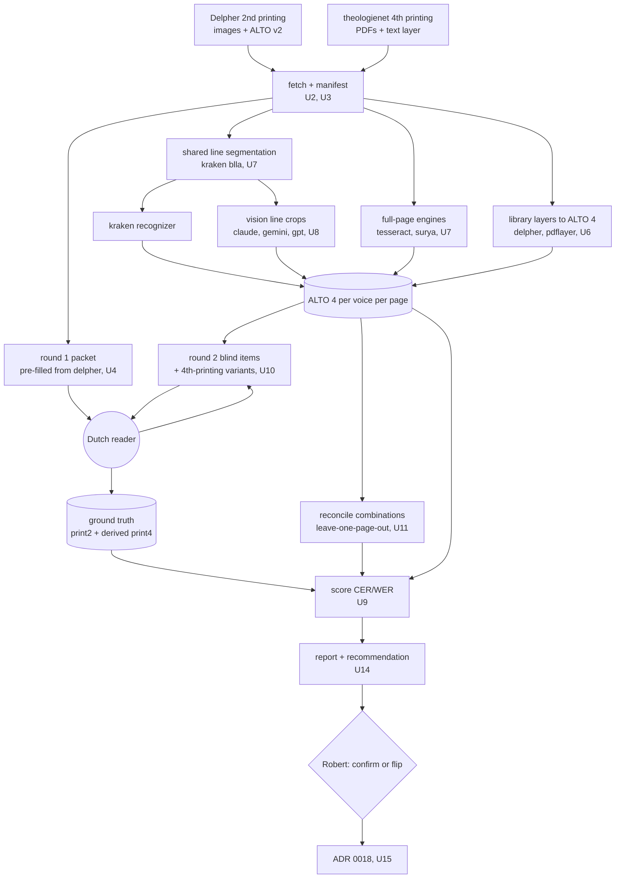
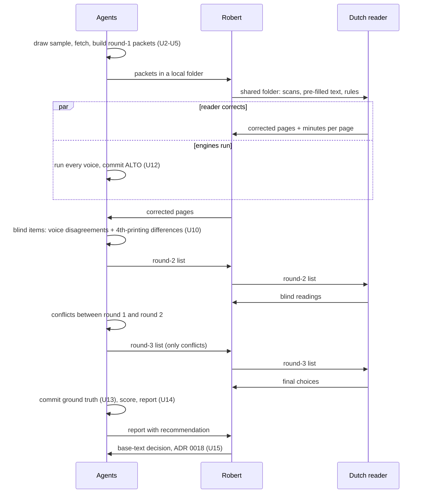

# M2 GD2 OCR Sample Test - Plan

**Target repos:** `bron` (code, this repo) and `bron-data` (data, `github.com/robertguss/bron-data`). Paths are relative to `bron` unless prefixed `bron-data:`.

---

## Goal Capsule

- **Objective:** Robert can confirm or flip the base text of GD² (ADR 0007), and choose the OCR ensemble M3 will run, from CER and WER figures measured against human-corrected pages of both printings. Anyone can recompute every figure from what is committed.
- **Means:** an engine comparison in `bron` (KTD1). Every voice on the roster (KTD5) reads the same seeded ten-page sample of the second printing (KTD7) and the matching text of the fourth printing (KTD8), and writes ALTO. The outputs are reconciled (KTD13) and scored (KTD12) against ground truth that a Dutch reader corrects and checks in three rounds (KTD10, KTD11).
- **Authority:** the accepted ADRs in `docs/decisions/` outrank this plan, especially 0007, 0009, 0011, 0012, 0016 and 0017. U15 adds ADR 0018, which records the measurement protocol, the ensemble and Robert's base-text decision. Within the plan, Requirements win on behavior, KTDs win on mechanism, and units override neither.
- **Stop conditions:**
  - Stop and ask Robert if a fetched Delpher page image is not the 942-px-class public image, its native JPEG 2000, whose size is half its ALTO page within 2 px (KTD3). Another size means the source changed under the sample.
  - Stop and ask Robert if a theologienet volume turns out not to be an unchanged fourth printing of the second-edition text, or if more than 1% of a span's words differ between the printings (KTD11). The derived ground truth would then not hold.
  - Stop a unit if a check would have to be weakened to make real data pass, and report it.
  - Stop and ask Robert before any vision run would use a paid API instead of his subscriptions (KTD17).
- **Execution profile:** Deep. Nine PRs across two repos, grouped under Implementation Units. Agent work runs up to the ground-truth handover and resumes when the corrected pages come back. Engine work proceeds while the reader corrects.
- **Who finishes:**
  - Agents build the tools, run the engines, prepare the reader's packets and check lists, compute the figures, and open the PRs.
  - Robert recruits and names the Dutch reader, hands the packets over through a shared folder and returns the results (R8). He signs in to Claude Code, Codex CLI and Gemini CLI with his subscriptions when the vision runs start (KTD17), and confirms the theologienet terms record (U1).
  - The reader corrects the ten pages and answers the check lists (R8–R10).
  - Robert reads the report, decides the base text, approves ADR 0018, and merges every PR.

---

## Product Contract

### Summary

Measure before M3 commits to a pipeline. Ten pages of the Delpher second printing and the same text in the theologienet fourth printing go through every engine on a roster: three classical engines, three vision models, and each printing's existing OCR layer. Each voice writes ALTO per page. A Dutch reader hand-corrects the ten second-printing pages, then checks every place where an engine disagrees with them, and every place where the fourth printing seems to print something different. Bron scores each voice and each reconciled combination by CER and WER, per printing, and publishes the figures with a recommendation in `docs/research/`. Robert then confirms or flips the base text, and the decision is recorded in ADR 0018.

### Problem Frame

GD² has no open transcription. ADR 0007 makes it the base text of `ed2`, OCR'd from the Delpher scans of the second printing, with the fourth printing's pagination layered on. It adds one condition: if the second printing reads materially worse than the fourth, the roles flip. ADR 0007 also promises that every published quality figure is measured against human-corrected pages. ADR 0016 moved that promise to GD², because GD¹'s figure was read by agents (`docs/research/2026-11-gd1-sample-check.md`).

Three things are unknown and cannot be settled by assumption:

- **Which engines read this book well.** The pages are dense Dutch roman type with footnotes in smaller type, and with Latin, German, French, polytonic Greek and pointed Hebrew throughout. Research found no published Kraken model for Dutch print, printed polytonic Greek or pointed Hebrew. Vision models beat classical engines on historical print in independent studies, but they can produce fluent text that is not on the page.
- **Which printing gives the better text.** The second printing has library provenance and permanent page URLs. The fourth printing (Kok, 1928–30, title page "vierde onveranderde druk") is the pagination scholars cite, and the theologienet PDFs that carry it are anonymous.
- **What the images allow.** Delpher's public page images are about 942×1416 px, about 150 dpi; its larger downloads are upscales of them, and so are the images in its whole-volume PDFs. Its own 2013 OCR (ABBYY FineReader 10, ALTO v2) was made from master scans at twice that size, which are not public. The theologienet scans are about 940 px across a page in vol. I and about 620 px in vols. II–IV.

M3 transcribes Par. 23–25 and then whole volumes through whichever pipeline M2 recommends. A wrong base text or a weak ensemble would cost far more to undo later than ten measured pages cost now.

### Requirements

**Sources and rights**

- R1. The registry has a record for each source copy M2 uses: the four Delpher volumes of the second printing (VU Amsterdam copy, identifiers such as `MMUBVU05:000000743` for vol. 1 and `MMUBVU05:000000817` for vol. 2) and the four theologienet fourth-printing PDFs, each with its SHA-256. A theologienet terms record is added, and Robert confirms it (ADR 0012).
- R2. Page images are committed to `bron-data` only once permission is recorded: for Delpher images, the KB's written permission noted in its terms record; for theologienet images, the confirmed terms record. Until then, images stay in a cache outside the repos, identified in the sample manifest by URL and SHA-256, so a re-run can prove it fetched the same bytes.

**Sample**

- R3. The sample is ten body pages of the second printing, drawn by a recorded, seeded procedure: four from Par. 23–25 in vol. 2 and two from each of vols. 1, 3 and 4.
- R4. For each sampled page, the fourth-printing pages that carry the same words are identified, and the fourth printing is scored over exactly those words.

**Engines and outputs**

- R5. Every voice on the roster reads every sampled page of the printing it applies to, and writes one ALTO file per page with line coordinates.
- R6. Every engine run carries a run record: engine and version, model identifier and hash, prompt, parameters, date and cost. Raw engine responses are kept.
- R7. For the recommended combination, each printing has a reconciled ALTO per page, with every word the voices disagree on flagged, and a non-citable sample TEI.

**Ground truth**

- R8. A named Dutch reader corrects the ten second-printing pages against the scans, line by line, footnotes, Greek and Hebrew included, following written transcription rules. They log their minutes per page.
- R9. The reader re-reads, blind, every word where any voice disagrees with the corrected text. Where the two readings differ, the reader settles it with both readings in view.
- R10. The fourth printing's ground truth is the second printing's corrected text over the same words, except where the reader has confirmed on the fourth-printing scan that it prints something else.
- R11. The ground truth is committed to `bron-data` with the reader's name, the dates, the rules version and the rights statement. The reader is credited in the report (ADR 0009).

**Measurement and decision**

- R12. CER and WER are reported for each voice, each reconciled combination and each printing: per page and pooled, strict and normalized, with body and footnotes, and Latin-script, Greek and Hebrew characters, broken out separately.
- R13. A report in `docs/research/` states the protocol, the sample, the figures, error examples, cost and time per page, and recommends the M3 ensemble and the base text.
- R14. The decision rules for the base text and the ensemble are fixed before any ground truth exists (KTD14). Robert decides the base text, and the decision is recorded in ADR 0018.

### Key Decisions

- **M2 compares an engine roster, not two engines.** (session-settled: user-directed — chosen over a fixed pair of engines: Robert wants as many engines as practical, including the Claude and OpenAI models he pays for.) Governs R5, R6, R13.
- **The vision models are Claude Opus 5.5, the latest Gemini Pro and the latest GPT.** (session-settled: user-directed — chosen over also including Mistral OCR.) Governs R5.
- **A Dutch reader Robert recruits produces the ground truth.** (session-settled: user-approved — chosen over a paid proofreader or Robert correcting the pages himself: the roadmap's reviewer is the first vetted reader, and Robert's Dutch is not the instrument.) Governs R8–R11.
- **Pages go to the reader and back through a shared folder.** (session-settled: user-approved — chosen over a pull request on `bron-data` or a hosted transcription tool: the reader needs no GitHub, and agents commit the results.) Governs R8, R9.
- **Page images are committed to `bron-data`, once permitted.** (session-settled: user-directed — chosen over keeping images in a local cache only: anyone can re-run M2 from the repo. Delpher's FAQ forbids redistribution, so the commit waits for the KB's permission.) Governs R2.
- **The KB is not asked, so Delpher page images stay in the cache and only the theologienet images are committed.** (session-settled: user-directed — chosen over sending the drafted KB permission request.) Governs R2.
- **Four sample pages come from the thin slice and six from the other volumes.** (session-settled: user-approved — chosen over all ten from Par. 23–25, or ten drawn at random: the slice pages give M3 reusable ground truth, and the other volumes keep the base-text comparison from resting on one volume.) Governs R3.
- **The fourth printing's ground truth is derived from the second printing's, plus the reader's checks of differences.** (session-settled: user-approved — chosen over a second fully corrected set: the words are the same by the title page's own account, and checking only the differences keeps real variants from counting as OCR errors.) Governs R4, R10.
- **The reader corrects pre-filled pages, and a blind check offsets the pull toward the pre-fill.** (session-settled: user-approved — chosen over typing from scratch: correcting is several times faster, and the blind round catches what the pre-fill would otherwise make the reader accept.) Governs R8, R9.
- **The base-text rule is fixed in advance: flip only if the second printing's best CER is at least 1.5 times the fourth's and it is worse on at least 7 of 10 page pairs.** (session-settled: user-approved — chosen over judging "materially worse" after seeing the numbers.) Governs R14.
- **The second printing is also measured at the fourth printing's resolution, as a control.** The theologienet PDFs turned out to be two-page spreads at about 600–940 px across a book page, against about 1,880 px for Delpher. The pre-registered rule still decides on the scans as they are, and the control lets the report separate print quality from scan quality. (session-settled: user-approved — chosen over comparing the scans as they are with no control, or waiting for a better fourth-printing scan.) Governs R12, R13.
- **M2's data lives in a non-citable area of `bron-data`, outside `data/`.** (session-settled: user-approved — chosen over a partial `ed2` text in `data/`: no citation identifier exists before M3 defines the structure.) Governs R7, R11.

### Success Criteria

- The roadmap's M2 condition holds: the numbers are in `docs/research/` and the base text is confirmed or flipped, as recorded in ADR 0018.
- One command, run over committed data, reproduces every table in the report byte for byte, with no network access.
- The report names the M3 ensemble with its measured CER and its cost per page, and gives the reader's minutes per page, so M3's ground-truth ask can be sized.

### Scope Boundaries

- No citable `ed2` text, no `<pb ed="ed4">` layer, no IIIF, and no page structure beyond pages, lines, regions and notes. These are M3's.
- No model training or fine-tuning. Training on the ten pages would make them useless as a test set.
- No recruiting. Robert finds the reader. Agent work up to the handover does not wait on it.
- No CER threshold for publication. ADR 0007 sets it once the first volume's numbers exist, in M3.
- Running heads and page numbers are transcribed but not scored.

#### Deferred to Follow-Up Work

- Fine-tuning Kraken (or Tesseract) on separately drawn training pages, if M2 shows the zero-shot models are worth training. This is M3's open item from `docs/transcription.md`.
- Transkribus, Mistral OCR and open-weight vision models that need a GPU. Each can join the roster later through the same adapter contract (KTD2) and be scored against the same ground truth.
- Committing the Delpher page images, if Robert later asks the KB and it agrees. It is one `bron-data` PR adding the files the manifest already names.
- Ground-truth pages for other volumes, and a confidence interval on CER. Both come with M3's and M8's larger samples.

#### Considered and not built

- **Typing the ground truth from scratch.** It would remove the pre-fill's pull entirely, at roughly three times the reader's hours. The blind round (KTD10) catches the places where it matters: words where some voice reads differently. Revisit if the round-2 change rate is high (report states it).
- **A fully corrected fourth-printing set.** It would double the reader's work for text the title page calls unchanged. KTD11 checks every place where voices consistently see a difference.
- **Whole-page prompts to the vision models.** Page context might help them, but a dropped or misplaced line cannot be traced to coordinates, and a hallucinated line has no box to contradict it. Revisit if line-crop accuracy turns out poor on short lines.
- **Using dinglehopper as the scorer.** Its averaging is undocumented and it does not score sub-page units across reading-order differences, which the fourth printing needs. It is used once as a cross-check of the global CER (KTD12).
- **A CI check over the new `bron-data` areas.** The ground truth changes only through reviewed PRs, and the scorer verifies the manifest's hashes before every run. Revisit when M3 makes the ground truth a publication gate.
- **Confidence intervals or significance tests.** Ten pages cannot support them honestly. The report gives per-page figures and the paired page-level comparison instead, as the GD¹ report did.

### Dependencies

- Robert names the reader and hands the packets over. The report waits on the returned ground truth.
- Robert signs in to Claude Code, Codex CLI and Gemini CLI with his Anthropic, OpenAI and Google subscriptions. Paid API use needs his OK each time (KTD17).
- Robert confirms the theologienet terms record.
- Network access to `resolver.kb.nl` and `services.kb.nl` (Delpher), `theologienet.nl`, the three vendors' services through their CLIs, npm (Gemini CLI), PyPI, Zenodo (the CATMuS-Print model) and GitHub (tessdata_best).

### Sources

- Roadmap M2 and M3: `docs/roadmap.md`. Design: `docs/transcription.md`, `docs/text-model.md`, ADRs 0007, 0009, 0011, 0012, 0016, 0017.
- The M0/M1 plan for structure and conventions: `docs/plans/2026-11-03-0447-feat-m0-m1-scaffolding-gd1-tei-plan.md`. GD¹'s sample-check protocol: `docs/research/2026-11-gd1-sample-check.md`.
- Existing code this plan follows: the CLI in `src/bron/cli.py`, the cached, hash-checked fetch in `src/bron/convert/gd1/fetch.py`, the script detection in `src/bron/convert/gd1/langs.py`, the schema check in `src/bron/checks/schema.py`, and the `convert` optional extra in `pyproject.toml`.
- `bron-data` as of `058f19a`: `registry/sources.yaml`, `registry/terms.yaml` (the Delpher record quotes the FAQ's ban on redistribution and the database-right condition), `alignments/deferred.yaml`.
- External research, 2026-11-04:
  - Delpher: `resolver.kb.nl/resolve?urn=<id>:<seq>:image|alto|ocr`; the per-volume `didl` manifest at `services.kb.nl/mdo/oai`; ALTO v2 by Planman Technologies with ABBYY FineReader 10 (2013); public JP2 942×1416 px (page 13 of vol. 2) against an ALTO page of 1883×2831 px; `/nl/api/downloadimage?…&w=` returns larger JPEGs, but a spectrum check shows they are upscales, and the volume PDF (`…:pdf`) embeds the same 942-px images. `MMUBVU05:000000743` is GD² vol. 1 (Bos, 1906); `MMUBVU05:000000817` is vol. 2 (Bos, 1908), and its scan 13 opens Par. 23.
  - theologienet: `theologienet.nl/bestanden/bavinck-h-gereformeerde-dogmatiek-{i,ii,iii,iv}.pdf` (24–54 MB, text layer present). Vol. II's title page reads "vierde onveranderde druk, Kok, 1928". The site states its documents carry no remaining copyright and are free to download, under "© Stichting de Gihonbron", with no per-file provenance.
  - Engines: kraken 7.1.1 (Apache-2.0, Python ≥3.10 <3.14); CATMuS-Print Large (DOI 10.5281/zenodo.10592716, CC BY 4.0, no Dutch in its training list); Tesseract 5.5.4 latest, Ubuntu candidate 5.3.4, tessdata_best with `nld`, `lat`, `deu`, `fra`, `grc`, `heb`; surya-ocr 0.23.0; dinglehopper 0.11.0. The vendor SDKs and rapidfuzz all ship for Python 3.15.
  - Methods: OCR-D ground-truth guidelines (level 2), ROVER-style voting, studies of vision models on historical print (fluent but ungrounded errors; spelling made to look older).

---

## Planning Contract

### Key Technical Decisions

**Tooling**

- KTD1. **A `bron ocr` package, with engines kept outside Bron's own environment.** New code lives in `src/bron/ocr/` behind `bron ocr …` subcommands. Its third-party dependencies sit in an `ocr` optional extra, like `convert`, so a data repo's CI never installs them. Kraken (Python <3.14) and Surya (torch) run as pinned tools in their own uv-managed environments, and Tesseract runs as a system binary. Bron calls each as a subprocess and reads only its output files, so Bron itself stays on Python 3.15. Any Python that reads downloaded files runs as `python -I`, with its working directory outside every download directory. U2 adds `src/bron/__main__.py` so that `python -I -m bron` works.
- KTD2. **ALTO 4 is the interchange, one file per page per voice.** Every voice's output is converted to ALTO 4.4, validated against the vendored XSD (`src/bron/schemas/alto-4-4.xsd`), with `TextLine` coordinates and `String` content, plus a run record (R6). Delpher's ALTO v2 is kept as fetched and also converted. An engine joins the roster by writing this contract, and nothing downstream knows which engine it is.
- KTD3. **Every voice's coordinates are in the pixel space of the image Bron read.** (session-settled: user-approved — chosen over asking the KB for the master scans, or pausing M2: Delpher serves nothing larger than its 942-px public image.) For the second printing, that is Delpher's public JPEG 2000 at its native size (942×1416 for vol. 2's p. 1), fetched from the resolver's `:image` URL and never resized. Delpher's ALTO coordinates are in the master scan's space, so they are scaled by the image's size over the ALTO page's; U2 checks that ratio is ½ within 2 px on each axis and records both sizes. For the fourth printing, it is the PDF's embedded page image at its native size, extracted without resampling, and cut into its two book pages along the spread's gutter. The PDF text layer's coordinates are scaled into that space. The report states that Delpher's own OCR read the master scans, at twice the resolution every other engine reads.
- KTD4. **One shared line segmentation per page.** Kraken's default baseline segmenter (blla) segments each page once. Kraken's recognizer and the three vision models read those lines. Tesseract, Surya and the library layers keep their own lines. The segmentation is committed and not hand-corrected. A line it misses is an error of every voice that reads its lines, and the report lists missed lines separately.
- KTD5. **The roster.** (session-settled: user-directed — chosen over a fixed pair of engines: Robert wants as many engines as practical, including the paid Claude and OpenAI models.) Each version below is pinned in the run config, and the record of each run is final.

  | Voice | Printing | Version and model | Runs |
  |---|---|---|---|
  | `delpher` | 2nd | ABBYY FineReader 10, 2013, Delpher `:alto` | fetched |
  | `pdflayer` | 4th | the PDF's text layer, producer read from its metadata | extracted |
  | `kraken` | both | kraken 7.1.1, Python 3.13 env, CATMuS-Print Large, no fine-tuning | local |
  | `tesseract` | both | Tesseract 5 (5.3.4 or newer, exact version recorded), tessdata_best `nld+lat+deu+fra+grc+heb`, file hashes recorded | local |
  | `surya` | both | surya-ocr 0.23.x, own env, its own line detection | local |
  | `claude` | both | `claude-opus-5-5` through Claude Code (`claude -p`), page batches of line crops | subscription CLI |
  | `gemini` | both | latest Gemini Pro through Gemini CLI, model as the CLI reports it, recorded in U8 | subscription CLI |
  | `gpt` | both | latest GPT through Codex CLI (`codex exec`), model as the CLI reports it, recorded in U8 | subscription CLI |

- KTD6. **Vision models read each page's line crops in one call, through the vendor's subscription CLI.** (session-settled: user-approved — chosen over one line per call, which would take about 1,000 CLI calls per vendor and hit subscription limits, and over paying for the APIs.)
  - **Crops:** each crop is the shared segmentation's line box with a small margin, saved as its own image and named by its line ID. One call per page sends that page's crops, in reading order, with their IDs.
  - **Prompt:** one prompt file, `src/bron/ocr/prompts/page-lines-v1.txt`, serves all three vendors. It states the same diplomatic rules as the ground truth (KTD9) and asks for one printed line per ID, returned as ID and text.
  - **Checks:** a missing, duplicated or unknown ID, a refusal, or text outside the ID list is recorded as it came and counted as error for the lines it affects. Only a failed CLI invocation is retried.
  - **Record:** each CLI's version, the model it reports, its flags, the prompt hash, the crop hashes and the raw output are stored. The CLIs add their own system prompt and offer no temperature setting, so the record is the reproducibility claim, not a promise of identical reruns.
  - **Isolation:** each CLI runs non-interactively from an empty scratch directory holding only that page's crops, with tools limited to reading those files, and no access to the repos.

**Sample and ground truth**

- KTD7. **The sample is drawn once, by a seed nobody chose (R3).** (Session-settled with the four-plus-six split above; governs R3.)
  - **Seed:** the commit SHA of `bron-data` `main` after U1 merges, read as an integer.
  - **Population:** per volume, the body pages with an arabic printed number. The scan sequence maps to printed pages through the number in each page's running head or foot, read from the Delpher volume PDF's text layer (the same OCR as the ALTO, in one download per volume). The map is checked visually on every sampled page.
  - **Slice:** vol. 2's pages from the one where the Par. 23 heading is printed (scan 13) to the one before Par. 26 begins. Four pages are drawn with `random.Random(seed).sample`.
  - **Other volumes:** each of vols. 1, 3 and 4 gets a seeded order of its pages, and the first two of each are taken. The six must include one page with at least three lines of Greek and one with at least three lines of Hebrew, judged on the scan. A line counts when it carries the script, even as a single word (settled with Robert on 2026-11-04). A page that qualifies for both scripts satisfies both. The scripts are checked in order, Greek first, then Hebrew. For each script still missing:
    - take the earliest volume (in the order 1, 3, 4) that has a page qualifying for that script;
    - in that volume, replace the second pick with the first page in the seeded order that qualifies for that script, unless that pick was already replaced or is the only page qualifying for the other script;
    - if so, replace the volume's first pick under the same conditions;
    - if neither pick may be replaced, move on to the next volume.
  - **Record:** the manifest records the seed, the algorithm, the population counts, the candidate orders, any replacement and the final list.
- KTD8. **Fourth-printing spans follow the words (R4).** For each sampled page, the span runs from the first to the last word of that page's body text. The footnotes whose callouts fall inside it are included wherever they are printed. The covering fourth-printing pages are found by searching the PDF text layer for the opening and closing words, and checked visually. The manifest lists each span's covering pages and its boundary words.
- KTD9. **The ground-truth rules are written down before the first packet goes out.** The rules live in `bron-data:groundtruth/README.md` (U5) and follow OCR-D's level 2. In short:
  - spelling, capitals, punctuation, quotation marks and dashes as printed;
  - one text line per printed line, with line-end hyphens kept;
  - printing ligatures typed as separate letters, and ij as `ij`;
  - Greek and Hebrew with every printed accent, breathing and vowel point;
  - italics, letter-spacing and small capitals not marked;
  - running-head, page-number and footnote lines tagged;
  - characters the reader cannot read marked with one placeholder symbol, which is not scored.

  The vision prompt (KTD6) states the same rules.
- KTD10. **Three rounds with the reader.** (Session-settled under "pre-filled pages and a blind check"; governs R8, R9.)
  1. **Correct:** each page's packet holds the scan at native size, a text file pre-filled with Delpher's OCR one printed line per line, the rules, and a minutes field. The reader corrects and returns the file.
  2. **Blind check:** after all voices have run, every word position where any voice's normalized reading differs from the corrected text becomes an item. Each item is a line crop with the word boxed and no candidate readings shown, and the reader types what is printed. The fourth-printing items from KTD11 are in the same list. Before the list goes out, Robert sees the item count per page and an estimated reading time.
  3. **Settle:** where the blind reading differs from the corrected text, the reader sees the crop and both of their own readings and chooses.

  Every round's packet has a minutes field. The report states the round-2 change rate and the reader's minutes per page summed over all three rounds, and notes that Delpher's figure may be flattered because its text was the pre-fill.
- KTD11. **The fourth printing's ground truth is derived (R10).** The reference for a span is the second printing's corrected text for those words, dehyphenated and joined across lines. Where at least two fourth-printing voices agree with each other and differ from that reference, the position becomes a round-2 item shown on the fourth-printing scan, and the reader's reading replaces the reference there. Confirmed differences are recorded as variants. If confirmed variants exceed 1% of a span's words, M2 stops (Goal Capsule). A variant that only one voice reads correctly is missed, and the report says so.

**Scoring, reconciliation and decisions**

- KTD12. **Scoring.**
  - **Normalization, strict:** NFC on both sides, whitespace collapsed, lines joined with a space. **Normalized:** strict, plus line-end hyphens rejoined, ij read as `ij`, and quotation-mark and dash variants folded. Comparisons between printings use normalized, because the two printings break lines in different places.
  - **Units:** each run of body text between page boundaries is one unit, and each footnote is one unit. Each unit is aligned semi-globally against the voice's text of the covering pages, so differences in reading order, running heads and page numbers fall outside the units. Text a voice produces outside every unit is reported per page as extra characters.
  - **Rates:** CER = character edits ÷ reference characters. WER = word edits ÷ reference words, on whitespace tokens after normalization. Pooled figures are micro-averaged over pages, and the per-page figures and their mean are reported too.
  - **Breakdowns:** body and footnotes. Latin-script, Greek and Hebrew characters, with each edit attributed to its reference character's script (an insertion takes the script of the character before it).
  - **Exclusions:** running heads, page numbers and placeholder characters.
  - **Resolution control:** each second-printing page is also downsampled, once with a fixed resampling filter, to the pixel width per book page of the fourth printing's scan of the same volume. It is run through every engine as a separate voice set, `print2-lowres`, and scored like the others. KTD14's rules use only the scans as they are. The report sets the control beside them.
  - **Cross-check:** dinglehopper 0.11.0 (in a side env) is given the same pairs Bron scores: each Latin-script reference unit and the hypothesis span Bron aligned to it, both strict-normalized. Total edits ÷ total reference characters must agree with Bron's to within 0.1 percentage points. Greek and Hebrew units are left out, because dinglehopper counts grapheme clusters and pointed Hebrew packs several code points into one.
- KTD13. **Reconciliation.**
  - **Grouping:** each voice's lines are grouped onto the shared segmentation's lines by coordinate overlap.
  - **Voting:** within each line, the voices' words are aligned progressively to a pivot, the reading with the least total edit distance to the others. Each position takes the majority, and a tie goes to the voice ranked higher.
  - **Output:** ALTO 4 with `String@WC` set to the share of voices that agree, plus a list of every disputed word.
  - **No leak from the ground truth:** wherever a choice uses ground truth (the voice ranking, and which top-k combination is best), it is made leave-one-page-out. The figure for each page uses a ranking computed from the other nine.
  - **Combinations, fixed in advance:** for k = 2 up to all voices, the top k by single-voice rank, plus the shape ADR 0007 names (each printing's library layer plus the top two engines).
- KTD14. **Decision rules, fixed before any ground truth exists (R14).**
  - **Base text** (session-settled: user-approved — chosen over judging "materially worse" after the numbers): recommend a flip only if the second printing's best pre-registered combination has a pooled normalized CER at least 1.5 times the fourth printing's best, and the second printing is worse on at least 7 of the 10 page pairs. Each page pair compares that page's leave-one-page-out normalized CER for each printing's best pre-registered combination. Otherwise recommend confirming. Robert decides.
  - **Ensemble:** recommend the cheapest combination whose pooled normalized CER, on the printing the base-text rule recommends as base, is within 10% (relative) of the best combination's on that printing. The report gives this result for both printings, so ADR 0018 records the right one whichever way Robert decides. Cost is the number of vision-model voices the combination needs, since each needs a subscription or paid API at M3's scale, then wall-clock time per page. Local engines cost nothing.
  - **Greek and Hebrew:** if no combination reads a script with a CER below 5%, recommend that M3 flag those spans for human entry (`docs/transcription.md` open item 5).
- KTD15. **Layout in `bron-data`.** (Session-settled under "a non-citable area"; governs R7, R11.)
  - `groundtruth/bavinck/gd/ed2/print2/` holds the corrected pages (`v2-p001.gt.txt`), and `print4/variants.yaml` holds the confirmed fourth-printing differences. `groundtruth/README.md` holds the rules, the reader, the rounds and the rights statement (Public Domain Mark plus CC0, ADR 0014).
  - `ocr/bavinck/gd/ed2/m2-sample/` holds `manifest.yaml`, `segmentation/`, `{print2,print4}/<voice>/` (ALTO and run records), `reconciled/`, one sample TEI per printing, and `images/` once R2 allows.
  - `bron check` reads only `data/` and `alignments/`, so none of this creates identifiers or trips CapiTainS checks.
  - The manifest holds two hash sets. `sources` covers what was fetched (PDFs, page images, Delpher's ALTO as served), and `bron ocr verify` checks it against the cache. `committed` covers every file in the two areas above (segmentation, each voice's ALTO and run records, ground truth, rounds, variants). `bron ocr score` checks only `committed`, so scoring works from a fresh clone with no cache and no network.
- KTD16. **Downloads are polite, cached and isolated.**
  - Each fetched object goes into its own new, empty directory in a cache outside both repos (`~/.cache/bron/ocr/<source>/<id>/`), and its SHA-256 is recorded in the manifest.
  - Delpher requests are at least 10 seconds apart, the spacing the research probe used.
  - The theologienet PDFs are fetched one at a time, at least two minutes apart.
  - Every fetch backs off on HTTP 429 or 503.
  - The fetch pattern follows `src/bron/convert/gd1/fetch.py`.
- KTD17. **Subscriptions first; paid API only with Robert's OK.** (session-settled: user-directed — chosen over paying for API use: Robert has subscriptions to all three vendors and prefers them, with some Anthropic and OpenAI API credit as a fallback.) The vision runs use Robert's signed-in CLI sessions. A run that hits a subscription's usage limit pauses and resumes where it stopped, with already-read pages kept. If a vendor's CLI cannot take images or keeps hitting limits, that vendor switches to its API only after Robert approves. Any API key is then read from an environment variable and never written to a run record, a log or either repo (ADR 0011), with a $50 cap per vendor.

### High-Level Technical Design

The data flow, from sources to Robert's decision:



The rounds with the reader, and what each waits on:



The pre-registered base-text rule (KTD14), as a decision table:

| Second printing's best CER ÷ fourth's best | Pages where the second printing is worse | Recommendation |
|---|---|---|
| ≥ 1.5 | ≥ 7 of 10 | flip: fourth printing as base, second's pages layered |
| ≥ 1.5 | ≤ 6 of 10 | confirm, and report the split |
| < 1.5 | any | confirm |

### Output Structure

```text
bron/
  pyproject.toml                         ocr optional extra
  src/bron/
    __main__.py                          python -I -m bron
    cli.py                               bron ocr subcommands
    schemas/alto-4-4.xsd
    ocr/
      __init__.py
      manifest.py                        sample manifest, hashes
      sample.py                          seeded draw
      delpher.py                         Delpher fetch, page map, ALTO v2 import
      pdfsource.py                       theologienet fetch, image extraction, text layer
      spans.py                           fourth-printing spans
      alto.py                            ALTO 4 model, read, write, validate
      runrecord.py
      segment.py                         shared segmentation via kraken
      engines/
        kraken.py  tesseract.py  surya.py
        vision.py                        shared crops, page batches, ID checks
        claude.py  gemini.py  gpt.py
      prompts/page-lines-v1.txt
      packets.py                         round-1, round-2, round-3 packets
      groundtruth.py                     ingest, derived print4 reference
      score.py                           normalization, unit alignment, CER/WER
      reconcile.py
      tei.py                             non-citable sample TEI
  tests/ocr/
  tests/fixtures/ocr/                    trimmed ALTO, crops, recorded CLI outputs
  docs/research/2026-11-gd2-ocr-sample-test.md
  docs/decisions/0018-gd2-base-text-and-ocr-ensemble.md

bron-data/
  registry/sources.yaml  registry/terms.yaml
  groundtruth/
    README.md
    bavinck/gd/ed2/print2/v2-p001.gt.txt …
    bavinck/gd/ed2/print4/variants.yaml
    bavinck/gd/ed2/rounds/               round-2 and round-3 answers
  ocr/bavinck/gd/ed2/m2-sample/
    manifest.yaml
    segmentation/
    print2/<voice>/  print4/<voice>/
    reconciled/
    bavinck.gd.ed2.m2-sample.print2.xml  non-citable TEI, one per printing
    bavinck.gd.ed2.m2-sample.print4.xml
    images/                              once permitted (R2)
```

The tree shows the expected shape. Each unit's **Files** list is authoritative.

### Risks

| Risk | Mitigation |
|---|---|
| Every engine reads the second printing at about 150 dpi, while Delpher's own OCR read 300-dpi masters | Accepted (KTD3): the masters are not public. The report labels Delpher's figure as read from the masters, and the resolution control shows how much resolution costs each engine. |
| A theologienet volume is not an unchanged fourth printing, or was edited | U1 reads every volume's title page. KTD11's 1% variant ceiling stops M2 before a derived ground truth is trusted. |
| Kraken's zero-shot model reads Dutch, Greek or Hebrew poorly | Expected, and measured. Fine-tuning is deferred, and the report shows what a trained model would have to beat. |
| Vision models invent fluent text or modernize spelling | Each line is a separate labelled crop, so an error stays tied to one line ID (KTD6). Extra-character counts catch insertions outside the units (KTD12). Raw responses are kept for the report's examples. |
| A vendor retires a model id before M3 | The exact id is recorded per run. M3 re-measures if it must switch. |
| The reader is slow to start, or leaves | Engine work runs in parallel. The packets and rules are self-contained, so a replacement can pick them up. The report waits, nothing else does. |
| The pre-fill pulls the reader toward Delpher's reading | The blind round (KTD10). Delpher's figure is labelled as possibly flattered. |
| A choice that uses the ground truth inflates the reconciled figure | Leave-one-page-out for every ranking (KTD13). |
| Ten pages are too few to settle a close call | The rule requires both a ratio and a page-pair majority (KTD14), and the report gives every page. M3's pages add evidence before whole volumes commit. |
| A scoring dependency has no Python 3.15 wheel | rapidfuzz ships one. Semi-global alignment falls back to Bron's own banded dynamic programming if no wheel fits. |
| A subscription's usage limit stops a vision run partway | The run pauses and resumes, keeping pages already read (KTD17). Paid API use needs Robert's OK. |
| Delpher images are never committed, because the KB is not asked | Images stay in the cache. The manifest's URLs and hashes let anyone fetch the same bytes and prove it (R2). |

---

## Implementation Units

| U-ID | Title | Key files | Depends on |
|---|---|---|---|
| U1 | Source and terms records | `bron-data:registry/*` | — |
| U2 | OCR package, sample draw and fetch | `src/bron/ocr/{manifest,sample,delpher,pdfsource}.py` | U1 |
| U3 | Fourth-printing spans | `src/bron/ocr/spans.py` | U2 |
| U4 | Round-1 packets | `src/bron/ocr/packets.py` | U2 |
| U5 | The sample and rules into `bron-data` | `bron-data:ocr/…/manifest.yaml`, `bron-data:groundtruth/README.md` | U3, U4 |
| U6 | ALTO interchange and library layers | `src/bron/ocr/alto.py`, `runrecord.py` | U2 |
| U7 | Shared segmentation and classical engines | `src/bron/ocr/segment.py`, `engines/{kraken,tesseract,surya}.py` | U6 |
| U8 | Vision engines | `src/bron/ocr/engines/{vision,claude,gemini,gpt}.py` | U7 |
| U9 | Scoring | `src/bron/ocr/score.py` | U6 |
| U10 | Ground-truth ingest and check rounds | `src/bron/ocr/groundtruth.py`, `packets.py` | U4, U9 |
| U11 | Reconciliation and sample TEI | `src/bron/ocr/{reconcile,tei}.py` | U6, U9 |
| U12 | Engine outputs into `bron-data` | `bron-data:ocr/…/{segmentation,print2,print4}/` | U5, U8 |
| U13 | Ground truth into `bron-data` | `bron-data:groundtruth/…` | U10, U12 |
| U14 | Report | `docs/research/2026-11-gd2-ocr-sample-test.md` | U11, U13 |
| U15 | Decision record | `docs/decisions/0018-…`, `docs/roadmap.md`, `docs/transcription.md` | U14 |
| U16 | Reconciled outputs into `bron-data` | `bron-data:ocr/…/reconciled/`, sample TEI | U15 |

### PR1: bron-data source and terms records

Waits on: nothing.

### U1. Source and terms records

- **Goal:** the registry names every source copy M2 uses and the terms of the site the fourth printing comes from (R1).
- **Requirements:** R1, R2.
- **Dependencies:** none.
- **Files:** `bron-data:registry/sources.yaml`, `bron-data:registry/terms.yaml`.
- **Approach:**
  1. Find the Delpher identifiers for GD² vols. 3 and 4 through the OAI `dcx` records (`dcx:part`), and confirm vols. 1 and 2 (`…743`, `…817`) the same way. Each record names the VU copy, the printing as its title page reads ("Tweede Herziene en Vermeerderde druk", Bos, 1906–1911), the Delpher view URL and the Public Domain Mark (Bavinck died in 1921, and each volume was published before 1931).
  2. Download each theologienet PDF once (KTD16), hash it, and read its title page and colophon. Record printing, year, publisher, any editor credit, the text layer's producer from the PDF metadata, and the embedded image size of a body page.
  3. Add a theologienet terms record with `status: pending`, quoting the site's statement as the Delpher record does. Robert confirms it.
  4. No KB permission request is sent (Robert's decision), so the Delpher terms record is unchanged.
- **Patterns to follow:** the existing GD¹ records and the three terms records in `bron-data:registry/`.
- **Test expectation:** none. Data records, validated by `bron-data` CI's registry check.
- **Verification:** CI is green. Every volume of both printings has a record, and every theologienet title page confirms the fourth printing or is reported to Robert (Goal Capsule).

### PR2: bron sample, spans and round-1 packets

Waits on: PR1 (needed before start: the sample reads the Delpher identifiers from the merged registry, and the seed is the merge commit).

### U2. OCR package, sample draw and fetch

- **Goal:** `bron ocr sample` draws the ten pages per KTD7, and `bron ocr fetch` brings every sampled page's images and library OCR into the cache at the right size (KTD3, KTD16).
- **Requirements:** R2, R3.
- **Dependencies:** U1.
- **Files:** `pyproject.toml` (`ocr` extra), `src/bron/__main__.py`, `src/bron/cli.py`, `src/bron/ocr/__init__.py`, `src/bron/ocr/manifest.py`, `src/bron/ocr/sample.py`, `src/bron/ocr/delpher.py`, `src/bron/ocr/pdfsource.py`, `tests/ocr/test_sample.py`, `tests/ocr/test_delpher.py`, `tests/ocr/test_pdfsource.py`, `tests/ocr/test_manifest.py`, `tests/fixtures/ocr/delpher/` (a trimmed `didl` record and two ALTO pages).
- **Approach:**
  1. `delpher.py` reads a volume's `didl` manifest for its page list, fetches a page's ALTO, and maps scan sequence to printed page from the number in the ALTO's first or last line.
  2. It fetches each page's public JPEG 2000 from the resolver, keeps it unresized, and checks it is half the ALTO page's size within the KTD3 tolerance.
  3. `pdfsource.py` extracts a PDF spread's embedded image without resampling, honouring the page's rotation, cuts it into its two book pages at the gutter, and maps the text layer's character boxes onto each page.
  4. `sample.py` implements KTD7. Script screening is a recorded human-or-agent judgment on each candidate, stored in the manifest, not inferred from OCR.
  5. `manifest.py` writes and verifies `manifest.yaml`: seed, population, candidate orders, pages, source URLs, image sizes, and the two hash sets of KTD15.
- **Patterns to follow:** `src/bron/convert/gd1/fetch.py` for the cache and an injectable downloader, and `src/bron/cli.py` for subcommands and exit codes.
- **Test scenarios:**
  - A trimmed `didl` record yields the page list in scan order, with the ALTO, image and OCR URLs for each page.
  - An ALTO page whose first line is "6 HET DOGMA." maps its scan to printed page 6, and one whose number is unreadable maps to nothing and is listed.
  - A fetched image of 942×1416 against an ALTO page of 1883×2831 passes, and its scale factor is recorded. An image of 1884×2832 against the same page fails, with both sizes in the message.
  - The same seed and population always produce the same ten pages, and a different seed produces a different draw.
  - With no qualifying Greek page among the first picks, the earliest qualifying volume's second pick is replaced by its first qualifying page, and the replacement is recorded.
  - With neither script among the first picks, and vol. 1 qualifying for both, the Greek replacement takes vol. 1's second pick and the Hebrew replacement takes vol. 1's first pick. Re-running gives the same result.
  - A cached file that fails its source's checksum is refetched once, and fails if it still disagrees.
  - The downloader is called no faster than the configured spacing, and backs off on a 429.
  - A PDF fixture spread yields two book-page images, split at the gutter at native size, and text-layer words with boxes in each book page's pixel space, with the page numbers each half prints.
- **Verification:** a real run over vol. 2's slice fetches images whose size equals their ALTO pages, and writes a manifest that `bron ocr verify` accepts.

### U3. Fourth-printing spans

- **Goal:** each sampled page's words are located in the fourth printing (KTD8).
- **Requirements:** R4.
- **Dependencies:** U2.
- **Files:** `src/bron/ocr/spans.py`, `tests/ocr/test_spans.py`.
- **Approach:**
  1. Take the opening and closing six words of each sampled page's body from Delpher's text, and search the PDF text layer for them by fuzzy match.
  2. Record the covering pages and boundary words, plus each footnote's location by its callout number.
  3. An agent checks every span visually on the rendered fourth-printing pages, and records the result in the manifest.
- **Test scenarios:**
  - A span whose words sit on one fourth-printing page yields that page, with the boundary words found.
  - A span that crosses a page break yields both pages in order.
  - Boundary words with two OCR errors are still found by fuzzy match, and words that match twice in the volume are reported, not guessed.
  - A footnote whose callout is in the span but is printed on the next page is listed with that page.
- **Verification:** every sampled page has a span with covering pages, and every span is marked visually checked.

### U4. Round-1 packets

- **Goal:** `bron ocr packet` builds the reader's packet per KTD10.
- **Requirements:** R8.
- **Dependencies:** U2.
- **Files:** `src/bron/ocr/packets.py`, `tests/ocr/test_packets.py`.
- **Approach:**
  1. Per page: the scan as PNG at native size, and `v2-p001.gt.txt` pre-filled from Delpher's ALTO lines in reading order.
  2. Tag lines that look like a running head or page number by their position, for the reader to confirm. Leave footnote tags for the reader to set.
  3. Add the rules (KTD9, from `bron-data:groundtruth/README.md`) and a `minutes.txt` with one line per page.
  4. Write the packet to a local folder, with a manifest of file hashes so the returned files can be matched to what was sent.
- **Test scenarios:**
  - A two-column Delpher ALTO fixture with a footnote block yields lines in reading order, body first, then notes.
  - The top line of a page whose text is a printed number and a title is tagged as a running head.
  - The packet's hash manifest lists every file, and a returned file renamed by the reader is still matched by its page header.
- **Verification:** a packet for the real sample opens on an ordinary computer with no special software.

### PR3: bron-data sample and rules

Waits on: PR2 (needed before start: the manifest and packets come from the merged `bron` commit).

### U5. The sample and rules into `bron-data`

- **Goal:** the sample and the ground-truth rules are public before the reader starts, so neither can be adjusted to the results (KTD7, KTD9).
- **Requirements:** R3, R4, R8.
- **Dependencies:** U3, U4.
- **Files:** `bron-data:ocr/bavinck/gd/ed2/m2-sample/manifest.yaml`, `bron-data:groundtruth/README.md`, `bron-data:README.md` (layout lines for `groundtruth/` and `ocr/`).
- **Approach:**
  1. Run the draw, the fetch and the span mapping from the merged `bron` commit, recording that commit in the manifest.
  2. Write the rules README, with the rights statement (Public Domain Mark plus CC0) and a blank reader and rounds section that U13 fills in.
  3. Open the PR. After Robert merges it, he hands the round-1 packet to the reader.
- **Test expectation:** none. Data, checked by `bron ocr verify` and by `bron-data` CI, which ignores these paths.
- **Verification:** CI is green, and `bron ocr verify` accepts the committed manifest against the cache.

### PR4: bron ALTO and engines

Waits on: PR2 (merge order: both edit `pyproject.toml`, `uv.lock` and `cli.py`).

### U6. ALTO interchange and library layers

- **Goal:** one ALTO 4 contract for every voice, with Delpher's layer and the PDF text layer converted into it (KTD2, KTD3).
- **Requirements:** R5, R6.
- **Dependencies:** U2.
- **Files:** `src/bron/ocr/alto.py`, `src/bron/ocr/runrecord.py`, `src/bron/schemas/alto-4-4.xsd`, `tests/ocr/test_alto.py`, `tests/ocr/test_runrecord.py`.
- **Approach:**
  1. A small page model (regions, lines with boxes and baselines, words with optional confidence) that reads ALTO v2 and v4, writes ALTO 4.4, and validates against the vendored XSD.
  2. Delpher's ALTO converts with its coordinates scaled into the fetched image's pixel space (KTD3). The PDF text layer converts with its coordinates scaled to the image's pixel space.
  3. The run record is a YAML file beside each voice's ALTO directory: voice, versions, model ids and hashes, prompt hash, parameters, start and end, token counts and cost.
- **Test scenarios:**
  - Delpher's ALTO v2 fixture round-trips into ALTO 4: same line count, same text, same boxes, and the output validates.
  - A PDF text-layer page in points converts to the image's pixel space, and a word's box lands on its glyphs in the fixture image (checked against known coordinates).
  - An ALTO with a `String` outside its `TextLine`'s box is reported, not silently clipped.
  - A run record never contains a value that looks like an API key, even when one is passed in the parameters.
- **Verification:** both library layers for the real sample convert and validate.

### U7. Shared segmentation and classical engines

- **Goal:** Kraken, Tesseract and Surya each produce ALTO 4 for every sampled page of both printings (KTD4, KTD5).
- **Requirements:** R5, R6.
- **Dependencies:** U6.
- **Files:** `src/bron/ocr/segment.py`, `src/bron/ocr/engines/__init__.py`, `src/bron/ocr/engines/kraken.py`, `src/bron/ocr/engines/tesseract.py`, `src/bron/ocr/engines/surya.py`, `src/bron/ocr/engines/README.md` (how each side environment is created and pinned), `tests/ocr/test_engines_classical.py`, `tests/fixtures/ocr/engines/` (recorded engine outputs for one page).
- **Approach:**
  1. Each engine is a subprocess call into its pinned side environment or binary, with the image path passed in and the working directory in a scratch directory (KTD1). Python engines run as `python -I -m <module>`.
  2. `segment.py` runs Kraken's blla once per page and writes the shared segmentation as ALTO without text.
  3. Kraken recognizes on that segmentation with CATMuS-Print Large. Its output is NFKD, so it is converted to NFC.
  4. Tesseract runs on the whole page with its native ALTO output. Surya runs with its own detection, and its JSON is converted.
  5. Each adapter records exact versions and model hashes in the run record.
- **Test scenarios:**
  - Each adapter turns its recorded raw output for one fixture page into valid ALTO 4 with the expected first line.
  - Kraken's NFKD output for a word with a diaeresis becomes NFC.
  - A side environment that is missing, or whose version differs from the pin, fails the run before any page is read, and names the expected version.
  - An engine that exits non-zero on one page records that page as failed in the run record, and still runs the others.
- **Verification:** all three engines produce validated ALTO for every sampled page of both printings, on this VM.

### U8. Vision engines

- **Goal:** Claude, Gemini and GPT each read every shared-segmentation line of both printings (KTD6).
- **Requirements:** R5, R6.
- **Dependencies:** U7.
- **Files:** `src/bron/ocr/engines/vision.py`, `src/bron/ocr/engines/claude.py`, `src/bron/ocr/engines/gemini.py`, `src/bron/ocr/engines/gpt.py`, `src/bron/ocr/prompts/page-lines-v1.txt`, `src/bron/ocr/engines/README.md` (installing and signing in to each CLI), `tests/ocr/test_vision.py`, `tests/fixtures/ocr/vision/` (recorded CLI outputs).
- **Approach:**
  1. `vision.py` cuts each page's line crops from the shared segmentation into an empty scratch directory, runs the vendor's CLI on them with the prompt, stores the raw output, checks the returned IDs, and assembles the lines into ALTO 4 on the shared coordinates (KTD6).
  2. Each vendor adapter is thin: build the CLI invocation (`claude -p`, `codex exec`, Gemini CLI), run it as a subprocess, and return its text and reported model.
  3. A usage-limit stop pauses the run, and a rerun resumes at the first unread page (KTD17).
  4. Install Gemini CLI, pinned, and have Robert sign in to all three CLIs. Record each CLI's version and the model it reports in the run config. From then on they are fixed for M2.
  5. Run one page through all three vendors first, and check the outputs and the time taken before the full run.
- **Test scenarios:**
  - A recorded output with text for every line ID becomes each line's `String`s, with that line's coordinates.
  - An output that omits one ID leaves that line empty and flagged. An output with an ID that was not sent is flagged, and its text is not placed.
  - A recorded refusal, or commentary outside the ID list, is stored verbatim and flagged in the run record.
  - A failed CLI invocation is retried up to the limit. A usage-limit message pauses the run, and a rerun resumes at the first unread page.
  - No test runs a CLI or touches the network: every adapter is exercised through recorded outputs.
- **Verification:** all three vendors produce validated ALTO for every sampled page of both printings through Robert's subscriptions, with every invocation and raw output stored.

### PR5: bron scoring, ground truth and reconciliation

Waits on: PR4 (merge order: built on PR4's branch, because it reads U6's ALTO model).

### U9. Scoring

- **Goal:** `bron ocr score` computes every figure R12 asks for, from committed files only (KTD12).
- **Requirements:** R12.
- **Dependencies:** U6.
- **Files:** `src/bron/ocr/score.py`, `tests/ocr/test_score.py`, `tests/fixtures/ocr/score/`.
- **Approach:**
  1. Read the manifest and verify its `committed` hashes (KTD15). Scoring reads nothing from the cache.
  2. Build each page's reference units from the ground truth (body runs and footnotes, excluding tagged and placeholder text), and each voice's text from its ALTO in reading order.
  3. Align each unit semi-globally, count edits by class and script, and emit tables as Markdown and as CSV. The output is deterministic, so the report's tables can be regenerated byte for byte.
  4. Include the dinglehopper cross-check (KTD12) as a separate command, run in its own side environment, which writes out the unit pairs Bron scored and compares the totals.
- **Test scenarios:**
  - Identical reference and hypothesis give CER 0 and WER 0.
  - One substituted letter in a 100-character unit gives CER 1.00%, and one wrong word in 20 gives WER 5.00%.
  - A hypothesis that hyphenates "ge-meenschap" across a line counts an error under strict and none under normalized.
  - ij against `ij` counts as one error under strict and none under normalized.
  - A footnote printed in a different place in the hypothesis's reading order is still matched to its unit, and scored as correct.
  - A running-head line in the hypothesis counts as extra characters, not as an error in any unit.
  - A substitution of a Greek letter is attributed to Greek, and an insertion after a Hebrew letter to Hebrew.
  - Pooled CER is the sum of edits over the sum of reference characters, and differs from the mean of per-page CERs on a fixture where page lengths differ.
  - A mismatch in a `committed` hash stops scoring before any figure is written.
  - Scoring succeeds with the cache directory absent, because the `sources` hashes are not checked.
- **Verification:** on fixtures, Bron's strict CER over Latin-script units agrees with dinglehopper's on the same pairs within 0.1 percentage points.

### U10. Ground-truth ingest and check rounds

- **Goal:** returned pages become ground truth, and rounds 2 and 3 are generated and folded back in (KTD10, KTD11).
- **Requirements:** R8, R9, R10, R11.
- **Dependencies:** U4, U9.
- **Files:** `src/bron/ocr/groundtruth.py`, `src/bron/ocr/packets.py` (rounds 2 and 3), `tests/ocr/test_groundtruth.py`, `tests/ocr/test_packets.py`.
- **Approach:**
  1. **Ingest:** match each returned file to its page by the hash manifest and page header, check it against the rules (tags valid, no tab characters, placeholder only as defined), and record the minutes. Every round's ingest records its minutes.
  2. **Round 2:** for every word position where any voice's normalized reading differs from the corrected text, cut a crop with the word boxed. Locate the word by aligning the corrected line to the shared segmentation line that overlaps it best. Add the fourth-printing difference items from KTD11. Shuffle items with a recorded seed, and show no candidate readings. Add a minutes field, and report the item count per page and an estimated reading time to Robert before the list goes to the reader.
  3. **Round 3:** list only the items whose blind reading differs from round 1, showing both readings, with a minutes field.
  4. **Fold:** apply the final choices to the ground truth, write `print4/variants.yaml`, and keep every round's answers under `bron-data:groundtruth/bavinck/gd/ed2/rounds/`.
- **Test scenarios:**
  - A returned file with an unknown tag is rejected with its line number.
  - A word that one voice reads differently becomes one round-2 item, and the same word read differently by four voices is still one item.
  - A round-2 answer equal to the corrected text closes the item, and a different answer creates a round-3 item showing both readings.
  - A round-3 choice of the blind reading changes the ground truth at that word only.
  - Two fourth-printing voices agreeing on a word that differs from the reference create a fourth-printing item. One voice alone does not.
  - A confirmed fourth-printing variant appears in `variants.yaml`, and the derived fourth-printing reference uses it.
  - Variants above 1% of a span's words stop with the span named.
- **Verification:** a fixture run through all three rounds yields ground truth and variants that `bron ocr score` accepts.

### U11. Reconciliation and sample TEI

- **Goal:** `bron ocr reconcile` produces any combination's reconciled ALTO, and `bron ocr tei` turns one into the non-citable sample TEI (KTD13, R7).
- **Requirements:** R7, R12, R13.
- **Dependencies:** U6, U9.
- **Files:** `src/bron/ocr/reconcile.py`, `src/bron/ocr/tei.py`, `tests/ocr/test_reconcile.py`, `tests/ocr/test_tei.py`.
- **Approach:**
  1. Group voices' lines onto shared lines by overlap, align words to the pivot, vote, and write ALTO 4 with `WC` and a list of disputed words.
  2. The voice ranking comes from U9's single-voice scores, computed leave-one-page-out, so each page is reconciled with a ranking that never saw its own ground truth. Combinations are the pre-registered set only.
  3. The TEI has a `<pb n facs>` per page pointing at the Delpher page URL (or the PDF page), an `<ab>` per text region, `<lb/>` per line, footnote regions as `<note place="bottom">`, and Greek and Hebrew wrapped by script detection (reusing `src/bron/convert/gd1/langs.py`). Disputed words are wrapped in `<seg cert="low">`. It has no `refsDecl` and no citable structure.
- **Test scenarios:**
  - Three voices reading "Gods", "Gods" and "Gocls" reconcile to "Gods" with `WC` 0.67, and the word is listed as disputed.
  - A two-two tie goes to the higher-ranked voice.
  - A line one voice missed entirely still reconciles from the others, and that voice's absence is recorded.
  - The ranking used for page 3 equals the ranking computed with page 3's ground truth removed.
  - The emitted TEI validates against tei_all through `bron.checks.schema`, has no `refsDecl`, and every Greek-script character sits inside an `xml:lang="grc"` span.
- **Verification:** reconciled ALTO for every pre-registered combination validates, and the sample TEI for each printing validates.

### PR6: bron-data engine outputs

Waits on: PR3 (needed before start: the committed manifest), PR4 (needed before start: the runs use the merged `bron` commit).

### U12. Engine outputs into `bron-data`

- **Goal:** every voice's ALTO and run record for both printings, and for the second printing's resolution control (KTD12), is committed, so scoring needs no engine (R5, R6).
- **Requirements:** R2, R5, R6.
- **Dependencies:** U5, U8.
- **Files:** `bron-data:ocr/bavinck/gd/ed2/m2-sample/segmentation/`, `bron-data:ocr/bavinck/gd/ed2/m2-sample/print2/<voice>/`, `bron-data:ocr/bavinck/gd/ed2/m2-sample/print4/<voice>/`, `bron-data:ocr/bavinck/gd/ed2/m2-sample/images/` (only once R2 allows).
- **Approach:**
  1. Run every voice from the merged `bron` commit, and record that commit in each run record.
  2. Commit the ALTO, run records and raw responses. Add images only for the sources whose permission is recorded.
- **Test expectation:** none. Data, verified by `bron ocr verify` and ALTO validation.
- **Verification:** every voice has a validated ALTO file for every page it applies to, every run record names the `bron` commit, and no paid API was used without Robert's OK.

### PR7: bron-data ground truth

Waits on: PR5 (needed before start: ingest and round lists), PR6 (needed before start: round 2 compares the voices' outputs with the corrected pages).

### U13. Ground truth into `bron-data`

- **Goal:** the ten corrected pages, the fourth-printing variants and every round's answers are committed, crediting the reader (R8–R11).
- **Requirements:** R8, R9, R10, R11.
- **Dependencies:** U10, U12.
- **Files:** `bron-data:groundtruth/bavinck/gd/ed2/print2/*.gt.txt`, `bron-data:groundtruth/bavinck/gd/ed2/print4/variants.yaml`, `bron-data:groundtruth/bavinck/gd/ed2/rounds/`, `bron-data:groundtruth/README.md` (reader, dates, rounds, minutes per page).
- **Approach:**
  1. Ingest round 1, generate round 2, and hand it to Robert for the reader. Then ingest it, and do the same for round 3 if there are any conflicts.
  2. Fold the final choices in and commit.
- **Test expectation:** none. Data, checked by U10's ingest validation.
- **Verification:** all ten pages pass ingest. Every round-2 item has an answer, and every round-3 item a choice. The README names the reader with their consent.

### PR8: bron report and decision record

Waits on: PR5 (needed before start: scoring and reconciliation), PR7 (needed before start: the ground truth).

### U14. Report

- **Goal:** `docs/research/2026-11-gd2-ocr-sample-test.md` publishes the figures and the recommendation (R12, R13).
- **Requirements:** R12, R13, R14.
- **Dependencies:** U11, U13.
- **Files:** `docs/research/2026-11-gd2-ocr-sample-test.md`.
- **Approach:**
  1. Generate every table with `bron ocr score` and `bron ocr reconcile` from the committed data, recording both repos' commits.
  2. Write the protocol (sample, rules, rounds, normalization, units, combinations, decision rules), the figures, the paired page comparison, error examples quoted from raw responses, cost per page, the reader's minutes per page by round and in total, round-2 items per page, the round-2 change rate, the missed-line count, and the Greek and Hebrew finding.
  3. Recommend the base text strictly per KTD14, and give the ensemble result for both printings, recommending the one for the recommended base. Set the resolution control (KTD12) beside the comparison, and say how much of the gap between the printings it accounts for. Say plainly where the evidence is thin.
  4. Credit the reader (ADR 0009).
- **Patterns to follow:** `docs/research/2026-11-gd1-sample-check.md` for its structure: result first, then protocol, figures and findings.
- **Test expectation:** none. A research report, whose figures are regenerated by the verification below.
- **Verification:** re-running the scoring commands at the recorded commits reproduces every table byte for byte, and the recommendation follows from KTD14's rules applied to those tables.

### U15. Decision record

- **Goal:** Robert's base-text decision and the M3 ensemble are recorded where later work will look for them (R14).
- **Requirements:** R14.
- **Dependencies:** U14, and Robert's decision.
- **Files:** `docs/decisions/0018-gd2-base-text-and-ocr-ensemble.md`, `docs/roadmap.md` (M2 wording: "through the engine roster" instead of "two engines"; M3 names the ensemble), `docs/transcription.md` (sources table, pipeline, open items 1, 2 and 5).
- **Approach:**
  1. ADR 0018 records three things:
     - the decision, confirmed or flipped, with the figures it rests on;
     - the ensemble for M3;
     - the measurement protocol later volumes reuse: rules, rounds, normalization, units and leave-one-page-out.

     It amends ADR 0007's "Base text" and "Ensemble OCR" sections, and states that the Kraken environment is Python 3.13.
  2. If Robert flips, the ADR states what changes: which printing's scans feed `facs` and which pagination is layered, and nothing else, as ADR 0007 promises.
- **Patterns to follow:** existing ADR format in `docs/decisions/` (title line, Status, Context, Decision, Consequences).
- **Test expectation:** none. Decision records only.
- **Verification:** the ADR names the ADR sections it amends, and Robert merges PR8.

### PR9: bron-data reconciled outputs

Waits on: PR8 (needed before start: the recommended combination).

### U16. Reconciled outputs into `bron-data`

- **Goal:** the recommended combination's reconciled ALTO and one sample TEI per printing are committed (R7).
- **Requirements:** R7.
- **Dependencies:** U15.
- **Files:** `bron-data:ocr/bavinck/gd/ed2/m2-sample/reconciled/<combination>/`, `bron-data:ocr/bavinck/gd/ed2/m2-sample/bavinck.gd.ed2.m2-sample.print2.xml`, `bron-data:ocr/bavinck/gd/ed2/m2-sample/bavinck.gd.ed2.m2-sample.print4.xml`, `bron-data:README.md` (status line).
- **Approach:** run `bron ocr reconcile` and `bron ocr tei` from the merged `bron` commit, and commit the output.
- **Test expectation:** none. Data, validated by ALTO and TEI validation.
- **Verification:** the files validate, `bron-data` CI stays green, and the TEI is outside `data/`, so no identifier is created.

---

## Verification Contract

| Gate | Command or check | Applies to |
|---|---|---|
| Lint | `uv run ruff check` and `uv run ruff format --check` in `bron` | every `bron` PR |
| Type check | `uv run ty check` in `bron` | every `bron` PR |
| Tests | `uv run pytest` in `bron`, on Python 3.15, with no network access (recorded fixtures only) | every `bron` PR |
| Data CI | `bron-data` `validate.yml` stays green, since the new areas are outside `data/` and `alignments/` | every `bron-data` PR |
| Manifest | `bron ocr verify` accepts the committed manifest against the cache: every `sources` hash, every `committed` hash and every image size | U5, U12, U13, U16 |
| ALTO | every committed ALTO file validates against `src/bron/schemas/alto-4-4.xsd` | U12, U16 |
| TEI | the sample TEI validates against tei_all 4.12.0 through `bron.checks.schema` | U11, U16 |
| Scorer cross-check | on the Latin-script unit pairs Bron scored, Bron's strict CER matches dinglehopper 0.11.0 within 0.1 percentage points | U9, U14 |
| Reproducibility | from fresh clones of both repos at the recorded commits, with no cache and no network, `bron ocr score` regenerates the report's tables byte for byte | U14 |
| Subscription use | every vision run record names the CLI and its version, and any API use carries Robert's OK | U8, U12 |

A failure in any gate blocks the PR. Weakening a check to let real data pass is a stop condition (Goal Capsule).

---

## Definition of Done

- **Sources:** U1 merged, with the theologienet terms record confirmed by Robert.
- **Sample fixed in public:** U5 merged before the reader receives round 1.
- **Engines:** every voice on the KTD5 roster has validated ALTO for every page it applies to (U12), through Robert's subscriptions unless he approved API use.
- **Ground truth:** all three rounds done and U13 merged, with the reader named and credited.
- **M2 done:**
  - the report (U14) is merged, with every table reproducible offline;
  - ADR 0018 (U15) records Robert's decision to confirm or flip the base text, and the M3 ensemble;
  - U16 is merged.
- **Pins recorded:** kraken 7.1.1 and its Python 3.13 environment; the CATMuS-Print model hash; the Tesseract version and tessdata_best hashes; the surya version; the Claude Code, Codex CLI and Gemini CLI versions and the models they reported; the prompt file hash; dinglehopper 0.11.0; both repos' commits for every run.
- **Images:** committed for every source whose permission is recorded. Otherwise they are named by URL and hash in the manifest (R2).
- **Per unit:** each unit's Verification holds, and its test scenarios exist and pass.
- **Clean diff:** no abandoned experiments, dead code, unused engine adapters or commented-out attempts remain in either repo.
